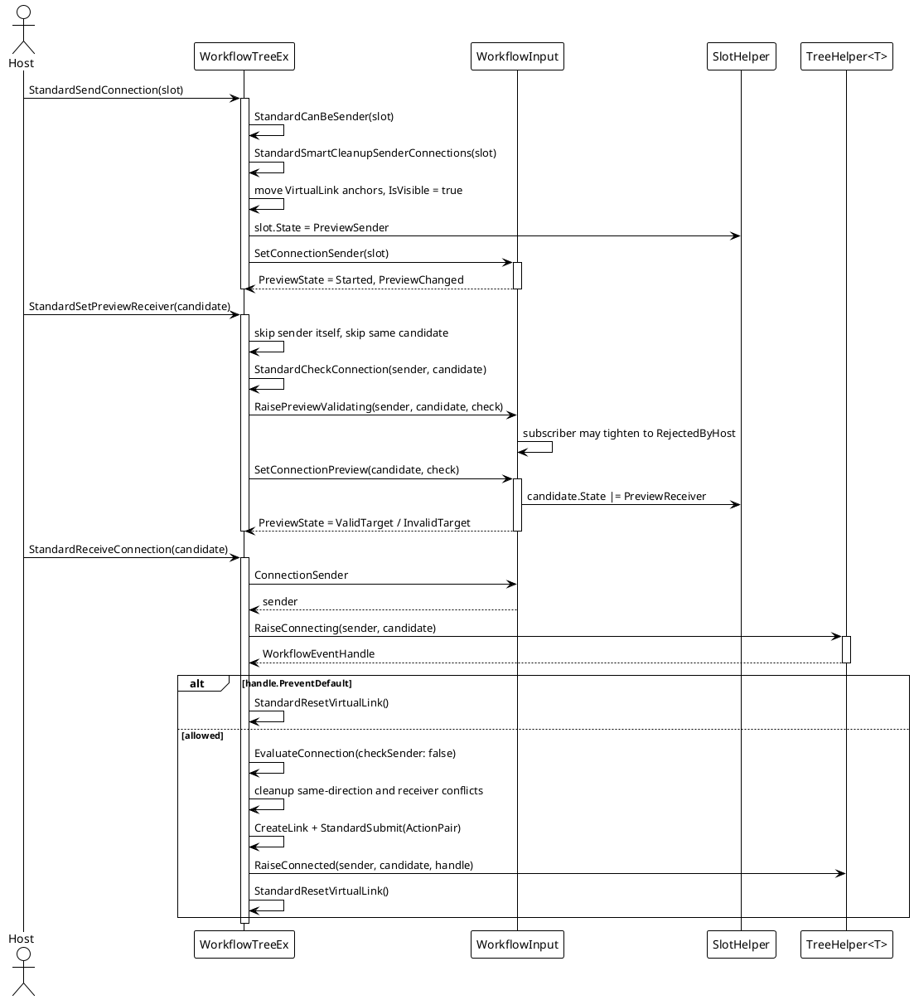

# Connection rules and preview

A connection drag is split into three stages: start a virtual link from a sender, report the candidate under the pointer, and commit on release. The same rule set decides the preview and the commit, so a green rubber band and an accepted connection cannot disagree.

## Rules

`StandardCheckConnection` is pure. It checks direction, same-node, and the helper's own `ValidateConnection`, in that order, and returns the first reason that refused the pair.

```csharp
private static ConnectionCheck EvaluateConnection(
    ITreeComponent component,
    ISlotComponent sender,
    ISlotComponent receiver,
    bool checkSender)
{
    if (checkSender && !sender.StandardCanBeSender())
        return ConnectionCheck.Rejected(ConnectionRejectReason.SenderCannotSend);

    if (!receiver.StandardCanBeReceiver())
        return ConnectionCheck.Rejected(ConnectionRejectReason.ReceiverCannotReceive);

    if (ReferenceEquals(sender.Parent, receiver.Parent))
        return ConnectionCheck.Rejected(ConnectionRejectReason.SameNode);

    return component.GetHelper().ValidateConnection(sender, receiver)
        ? ConnectionCheck.Valid
        : ConnectionCheck.Rejected(ConnectionRejectReason.RejectedByRule);
}
```

> Source: `Src/Core/VeloxDev.Core/WorkflowSystem/StandardEx/WorkflowTreeEx.cs` lines 216-234.

## Normal flow: start, preview, commit



The commit path asks the event first and the rule second; either refusal resets the drag without creating a link.

```csharp
var helper = component.GetHelper();
var events = helper as ITreeEvents;
var handle = events?.RaiseConnecting(sender, slot) ?? new WorkflowEventHandle();
if (handle.PreventDefault)
{
    component.StandardResetVirtualLink();
    return;
}

if (!EvaluateConnection(component, sender, slot, checkSender: false).IsValid)
{
    component.StandardResetVirtualLink();
    return;
}
```

> Source: `Src/Core/VeloxDev.Core/WorkflowSystem/StandardEx/WorkflowTreeEx.cs` lines 285-299.

## Preview state

`WorkflowInput` owns the drag state: it is the only object that knows the sender, the candidate, the check and the stage. `SetConnectionPreview` marks the candidate slot, publishes the stage, and raises `PreviewChanged`.

```csharp
internal void SetConnectionPreview(ISlotComponent? receiver, ConnectionCheck check)
{
    if (connectionSender is null)
    {
        ClearConnectionPreview();
        return;
    }

    var nextCheck = receiver is null ? (ConnectionCheck?)null : check;
    var next = receiver is null
        ? ConnectionPreviewState.Started
        : check.IsValid ? ConnectionPreviewState.ValidTarget : ConnectionPreviewState.InvalidTarget;
    // ...
    if (receiver is not null)
    {
        receiver.State |= SlotState.PreviewReceiver;
        receiver.GetHelper().UpdateState();
    }
    SetPreviewState(next);
    RaisePreviewChanged();
}
```

> Source: `Src/Core/VeloxDev.Core/WorkflowSystem/GUI/Events/WorkflowInput.cs` lines 124-156.

## Error, veto and asynchronous validation

- **Not attached**: `StandardSendConnection` calls `WorkflowGuard.Fail` when the slot has no tree.
- **Sender cannot send**: the virtual link is reset and no preview begins.
- **Candidate is the sender**: it is treated as no candidate, so a drag never paints itself invalid before the pointer moves.
- **Host veto at release**: `ITreeEvents.Connecting` can set `PreventDefault`; the connection is not created.
- **Host veto during preview**: `WorkflowInput.PreviewValidating` can only tighten a framework-valid check to `RejectedByHost`; it can never turn a refusal into a pass.
- **Asynchronous validation**: subscribe to `PreviewValidating`, start the host's work, then call `StandardRefreshConnectionPreview` when the verdict lands. Repeating the same candidate is otherwise a no-op.

> Sources: `Src/Core/VeloxDev.Core/WorkflowSystem/StandardEx/WorkflowTreeEx.cs` lines 111-144, 157-181, 236-268; `Src/Core/VeloxDev.Core/Interfaces/WorkflowSystem/Connections/ConnectionCheck.cs` lines 3-23.

## Related rules

Channel capacity is not a rejection. Completing a connection cleans up conflicts according to `SlotChannel`, so a passing check means “acceptable, possibly after cleanup”.

> Source: `Src/Core/VeloxDev.Core/Interfaces/WorkflowSystem/Connections/ConnectionCheck.cs` lines 25-41; `Src/Core/VeloxDev.Core/WorkflowSystem/StandardEx/WorkflowTreeEx.cs` lines 406-517, 557-584.
