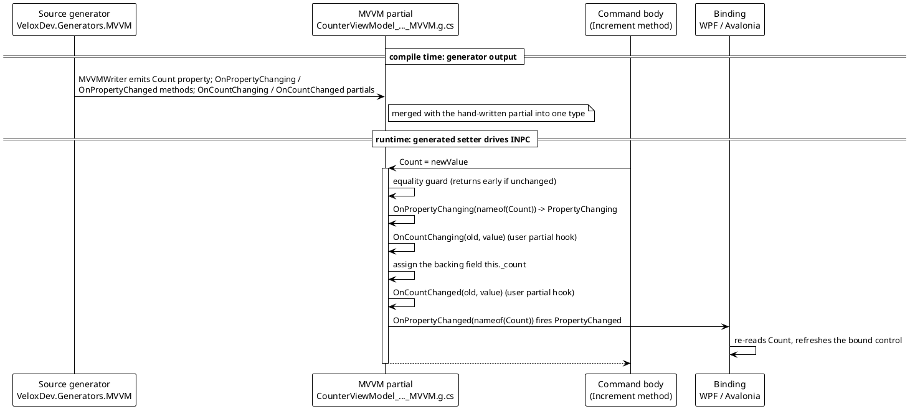
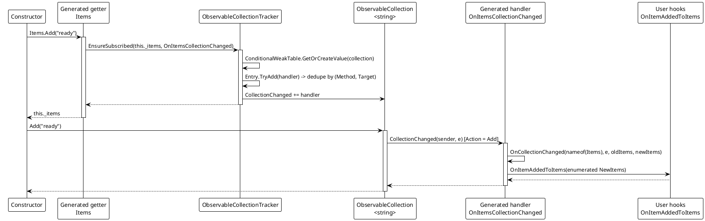
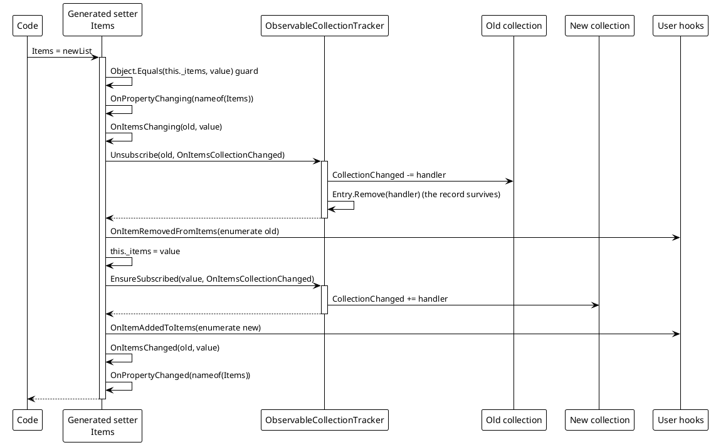

# Data Flow — Property and Collection

The scalar-property path and the collection path share a shape: the generator emits a skeleton at compile time, and the setter drives it at run time. The collection path adds a lazy subscription so that a field initializer (`= []`) cannot leave `CollectionChanged` unobserved.

## (a) Generator output → INPC flow



> Source: the setter shape is emitted by `MVVMPropertyFactory.GetSetterBodyLines` (`Src/Generators/VeloxDev.Core.Generator/Base/Analizer.cs`).

```csharp
// Source: Src/Generators/VeloxDev.Core.Generator/Base/Analizer.cs (Default setter mode)
set
{
    if(global::System.Object.Equals(this._count, value)) return;
    var old = this._count;
    OnPropertyChanging(nameof(Count));
    OnCountChanging(old, value);
    this._count = value;
    OnCountChanged(old, value);
    OnPropertyChanged(nameof(Count));
}
```

## (b) Collection flow: initializer → getter subscription → per-action hooks

The interesting step is the first `Items.Add("ready")` in the constructor. The field initializer assigned `this._items` directly, so the setter never ran; the subscription exists only because the **getter** was read on the way to `Add`.



> Source: `MVVMPropertyFactory.GenerateCollectionMembers` (`Base/Analizer.cs`); tracker behaviour — `Src/Core/VeloxDev.Core/MVVM/ObservableCollectionTracker.cs`.

```csharp
// Source: Base/Analizer.cs — the generated collection getter
get
{
    global::VeloxDev.MVVM.ObservableCollectionTracker.EnsureSubscribed(this._items, OnItemsCollectionChanged);
    return this._items;
}
```

## (c) Replacing the whole collection

Replacement is where `Unsubscribe` matters: without it the discarded collection would keep a handler pointing back into this view-model.



> Source: `MVVMPropertyFactory.GetSetterBodyLines` and `GenerateCollectionMembers` (`Base/Analizer.cs`); `Unsubscribe` — `ObservableCollectionTracker.cs`.

## Per-action dispatch

The generated `OnItemsCollectionChanged` calls `OnCollectionChanged<T>` first, then maps `NotifyCollectionChangedAction` onto the user hooks:

```csharp
// Source: Base/Analizer.cs — GenerateCollectionMembers
var oldItems = e.OldItems is null ? null : EnumerateItemsItems(e.OldItems);
var newItems = e.NewItems is null ? null : EnumerateItemsItems(e.NewItems);
OnCollectionChanged(nameof(Items), e, oldItems, newItems);
switch (e.Action)
{
    case NotifyCollectionChangedAction.Add when e.NewItems is not null:
        OnItemAddedToItems(EnumerateItemsItems(e.NewItems));
        break;
    case NotifyCollectionChangedAction.Remove when e.OldItems is not null:
        OnItemRemovedFromItems(EnumerateItemsItems(e.OldItems));
        break;
    case NotifyCollectionChangedAction.Replace:
        if (e.OldItems is not null)
        {
            OnItemRemovedFromItems(EnumerateItemsItems(e.OldItems));
        }
        if (e.NewItems is not null)
        {
            OnItemAddedToItems(EnumerateItemsItems(e.NewItems));
        }
        break;
    case NotifyCollectionChangedAction.Move when e.NewItems is not null:
        OnItemMovedInItems(EnumerateItemsItems(e.NewItems));
        break;
    case NotifyCollectionChangedAction.Reset:
        OnItemsResetInItems();
        break;
}
```

## Error and edge paths

| Path | Behaviour |
| --- | --- |
| Value unchanged | The equality guard returns before any notification or hook. |
| Collection is not `INotifyCollectionChanged` | `EnsureSubscribed` / `Unsubscribe` return immediately. |
| `null` collection | Same early return; no exception. |
| Handler arrives as a fresh method-group delegate | Deduped by `(Method, Target)`, so the invocation list does not grow. |
| Collection garbage-collected | Its `ConditionalWeakTable` entry goes with it — no leak. |
| Handler throws | Collection handlers are plain .NET event subscribers and are not guarded by the tracker. |
