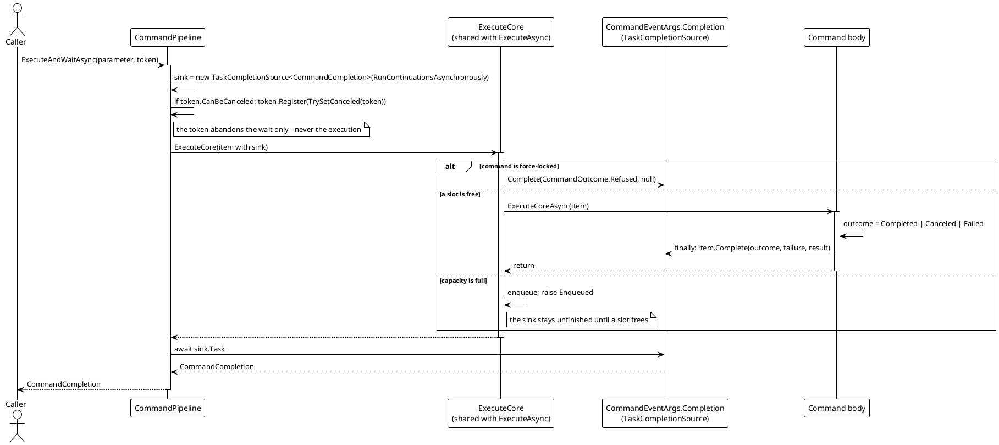
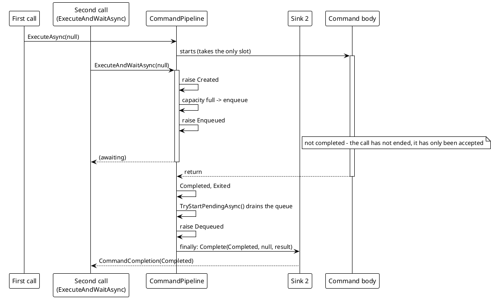
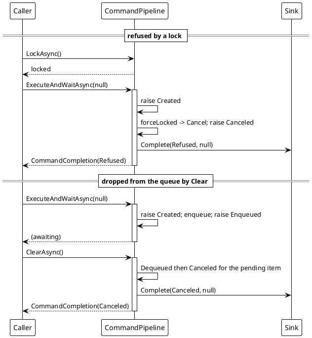

# Data Flow — `ExecuteAndWaitAsync`

`ExecuteAndWaitAsync` is `ExecuteAsync` plus a sink. Both share `ExecuteCore`; the difference is whether a `TaskCompletionSource<CommandCompletion>` is attached, and every path is responsible for finishing it exactly once.

## (a) The wait path



> Source: `Src/Core/VeloxDev.Core/MVVM/CommandPipeline{TParam,TResult}.cs` — `ExecuteAndWaitAsync`, `ExecuteCore`, `CommandEventArgs.Complete`.

## (b) Where the outcome is decided

The outcome is **computed inside the execution**, not read back from events:

```csharp
// Source: Src/Core/VeloxDev.Core/MVVM/CommandPipeline{TParam,TResult}.cs
private async Task ExecuteCoreAsync(CommandEventArgs<TParam, TResult> item)
{
    RaiseCommandEventAs(Started, item, CommandEventType.Started);

    // the outcome is computed here, not read back from the events or from the item:
    // the awaiting sink must not depend on someone having subscribed to Failed
    var outcome = CommandOutcome.Completed;
    Exception? failure = null;
    TResult result = default!;

    try
    {
        if (_resultCommand is not null)
        {
            result = _isCtsNeeded
                ? await _resultCommand(item.ResolveParameter(), (item.Cts ?? new()).Token).ConfigureAwait(false)
                : await _resultCommand(item.ResolveParameter(), _defct).ConfigureAwait(false);
        }
        else if (_isCtsNeeded)
        {
            await _command(item.ResolveParameter(), (item.Cts ?? new()).Token).ConfigureAwait(false);
        }
        else
        {
            await _command(item.ResolveParameter(), _defct).ConfigureAwait(false);
        }
        RaiseCommandEventAs(Completed, item, CommandEventType.Completed);
    }
    catch (OperationCanceledException)
    {
        outcome = CommandOutcome.Canceled;
        RaiseCanceled(item);
    }
    catch (Exception ex)
    {
        outcome = CommandOutcome.Failed;
        failure = ex;
        RaiseCommandEventAs(Failed, item, CommandEventType.Failed, ex);
    }
    finally
    {
        try
        {
            await OnExecutionCompletedAsync(item).ConfigureAwait(false);
        }
        finally
        {
            if (item.Completion is not null)
            {
                item.Complete(outcome, failure, result);
            }

            item.CompleteTyped(outcome, failure, result);
            item.TakeCts()?.Dispose();
        }
    }
}
```

This is the design point that makes the API usable: a caller that never subscribed to `Failed` still gets `CommandOutcome.Failed` with the exception.

## (c) Why a queued call's sink stays pending



> Source: the enqueue branch of `ExecuteCore`; `TryStartPendingAsync`.

## (d) Refusal and queue-drop: the two cases a hand-rolled wait hangs on

Neither a refused call nor one dropped from the queue ever raises `Exited`, which is precisely why "subscribe to `Exited` + `Failed`" was not a usable wait.



> Source: the `forceLocked` branch and the pending-item loop of `ClearAsync`; `CommandCompletion.cs`.

## (e) Abandoning the wait

The caller's token is registered before `ExecuteCore` runs, and it cancels only the `TaskCompletionSource`:

```csharp
// Source: Src/Core/VeloxDev.Core/MVVM/CommandPipeline{TParam,TResult}.cs
var sink = new TaskCompletionSource<CommandCompletion>(TaskCreationOptions.RunContinuationsAsynchronously);

// this token only abandons the wait, it does not cancel the execution - cancelling the execution
// is the job of Interrupt / Clear
using var registration = cancellationToken.CanBeCanceled
    ? cancellationToken.Register(
        static state =>
        {
            var (source, token) = ((TaskCompletionSource<CommandCompletion>, CancellationToken))state!;
            source.TrySetCanceled(token);
        },
        (sink, cancellationToken))
    : default;

var item = CommandEventArgs<TParam, TResult>.FromBoxed(parameter, CommandEventType.Created);
item.Completion = sink;
await ExecuteCore(item).ConfigureAwait(false);

return await sink.Task.ConfigureAwait(false);
```

## (f) The typed result channel

A typed command uses the same shape with `TaskCompletionSource<TypedCompletion<TResult>>` in `ExecuteAndWaitTypedAsync`; the caller receives `TResult` directly instead of a boxed `object?`. `ExecuteAndWaitTyped` is the blocking twin.

`CommandCompletion.Result` is the boxed value for the untyped path; `GetResultOrThrow` / `GetResultOrThrow<TR>` turn a completion into a value or rethrow the original exception.

## Comparison with `ExecuteAsync`

| Aspect | `ExecuteAsync` | `ExecuteAndWaitAsync` |
| --- | --- | --- |
| Sink | `null` | a `TaskCompletionSource<CommandCompletion>` |
| Completes when | the call is accepted | that call has ended, including refused and dropped calls |
| Result channel | events only | a `CommandCompletion` value (and its `Result`) |
| Refusal observable | reported as `Canceled`, indistinguishable from a cancellation | `CommandOutcome.Refused` |
| `Failed` subscriber required | yes, to observe a body failure | no |
| Token semantics | n/a | abandons the wait only |
| Continuations | n/a | `RunContinuationsAsynchronously`, so completing the sink never runs user code inline on the pipeline |

One deliberate omission completes the picture: the copies produced by `CommandEventArgs.With` do not carry the sink, so a projection cannot complete someone else's wait.
