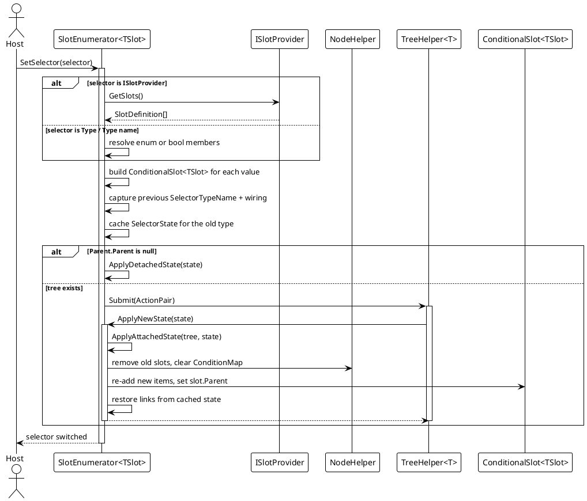

# Dynamic slot enumeration

`SlotEnumerator<TSlot>` turns one selector — an enum, a `bool`, or an `ISlotProvider` — into one slot per value. Switching the selector swaps the whole slot set as one undoable step and re-wires the new branches onto the neighbours the old ones had.

## Normal flow: set the selector



`SetSelector` is the only entry. It builds the item list, captures the old state under the selector's type name, and submits the swap:

```csharp
var tree = Parent.Parent;
if (tree is null)
{
    ApplyDetachedState(newState);
    return;
}

tree.GetHelper().Submit(new ActionPair(
    () => ApplyNewState(tree, newState, isFresh ? previousSelectorTypeName : null, isFresh ? previousWiring : null),
    () => ApplyAttachedState(tree, oldState)));
```

> Source: `Src/Core/VeloxDev.Core/WorkflowSystem/SelectorEx/SlotEnumerator.cs` lines 413-423.

`ApplyAttachedState` removes every link touching the current slots, detaches each slot from the node, then rebuilds `ConditionMap` and `Items` from the cached state. It sets `SelectorType` before `SelectorTypeName` so consumers that refresh derived values observe the new type.

```csharp
SelectorType = state.Type;
SelectorTypeName = state.TypeName;
ConditionMap.Clear();

Items.Clear();
foreach (var item in state.Items)
{
    if (item.Value is not null)
        ConditionMap[item.Value] = item.Slot;
    Items.Add(item);
}
```

> Source: `Src/Core/VeloxDev.Core/WorkflowSystem/SelectorEx/SlotEnumerator.cs` lines 569-579.

## Slot registration

Adding an item to `Items` registers its slot with the parent node. While the node is detached the add is direct; once attached it goes through `CreateSlotCommand`, so the add is one undoable step.

```csharp
if (!_isDeserializing && Parent is { } parent)
{
    if (parent.Parent is null)
        parent.StandardCreateSlot(item.Slot);
    parent.CreateSlotCommand.Execute(item.Slot);
}
```

> Source: `Src/Core/VeloxDev.Core/WorkflowSystem/SelectorEx/SlotEnumerator.cs` lines 114-126.

## Routing lookup

`TrySelect` is a dictionary lookup on the current `conditionMap`; it never allocates and never walks the item list.

```csharp
public bool TrySelect(object value, out TSlot? slot)
{
    return conditionMap.TryGetValue(value, out slot);
}
```

> Source: `Src/Core/VeloxDev.Core/WorkflowSystem/SelectorEx/SlotEnumerator.cs` lines 279-282.

`NormalizeValue` maps a foreign value onto the current selector type: an enum is parsed by name, anything else goes through `Convert.ChangeType`; a failed conversion returns the original value rather than throwing.

> Source: `Src/Core/VeloxDev.Core/WorkflowSystem/SelectorEx/SlotEnumerator.cs` lines 133-160.

## Error and edge paths

- **Not installed**: `SetSelector` calls `WorkflowGuard.Fail` when `Parent` is null.
- **Unresolvable selector**: a `Type` name that cannot be resolved, or a type that is neither enum nor `bool`, hits `Debug.Fail` and returns without changing the set.
- **Same type**: re-selecting the current enum type returns early; the set is not rebuilt.
- **Provider re-use**: an `ISlotProvider` is keyed by instance, not type, so a fresh provider never inherits a previous provider's cached slots.
- **Wiring restore**: both `Targets` and `Sources` are replayed. Restoring only `Targets` would silently drop every link feeding a rebuilt input set.
- **Re-entrancy guards**: `_isApplyingState`, `_isDeserializing` and `_isDeduplicating` keep collection callbacks from rebuilding state while state is being installed.

> Sources: `Src/Core/VeloxDev.Core/WorkflowSystem/SelectorEx/SlotEnumerator.cs` lines 260-276, 285-362, 399-457, 683-686; `Src/Core/VeloxDev.Core/WorkflowSystem/SelectorEx/ConditionalSlot.cs` lines 24-34; `Src/Core/VeloxDev.Core/Interfaces/WorkflowSystem/Providers/ISlotProvider.cs` lines 16-23.
