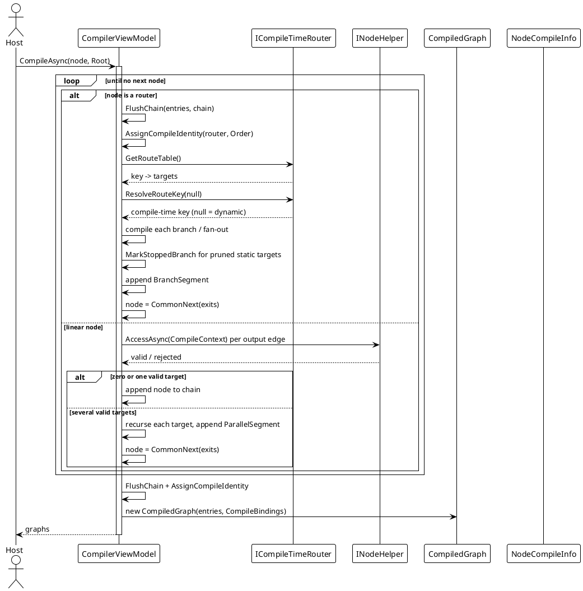
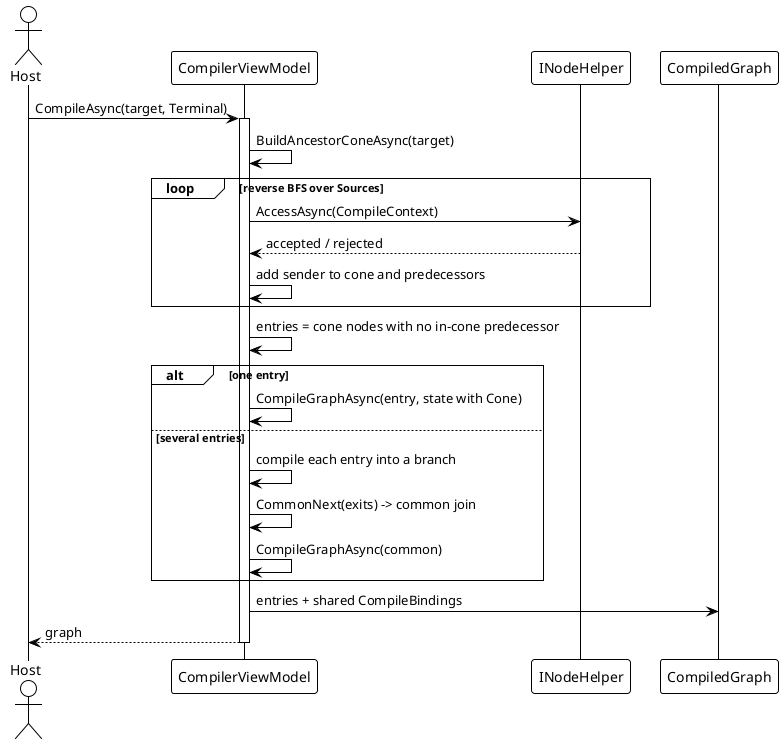

# Workflow compiler

`CompilerViewModel.CompileAsync` turns the graph reachable from one node into a `CompiledGraph`: an ordered list of chain, branch and parallel segments. The compiled artifact describes every possible path; the runtime chooses one.

## Entry point

```csharp
public async Task<IReadOnlyList<CompiledGraph>> CompileAsync<T>(
    T component, CompileRole role, CancellationToken ct = default)
    where T : IWorkflowComponent
{
    if (component is not INodeComponent node)
        throw new ArgumentException(
            $"CompileAsync requires an INodeComponent as the {role} node; received {component?.GetType().Name}.");

    CompiledGraph graph = role switch
    {
        CompileRole.Root => await CompileGraphAsync(node, new CompileState(), ct).ConfigureAwait(false),
        CompileRole.Terminal => await CompileConeAsync(
            node, await BuildAncestorConeAsync(node, ct).ConfigureAwait(false), ct).ConfigureAwait(false),
        _ => throw new ArgumentOutOfRangeException(nameof(role), role, null),
    };
```

> Source: `Src/Core/VeloxDev.Core/WorkflowSystem/CompilerEx/Compile/CompilerViewModel.cs` lines 38-52.

## Root compile



The linear walk treats a multi-input node as a join boundary: it stops and lets the parent graph continue from it, so the boundary node is not marked visited by the child.

```csharp
if (!ReferenceEquals(node, start) && !resumedAfterBranch && HasMultipleInputs(node, state.Cone))
    break;

if (!state.Visited.Add(node))
    break;
```

> Source: `Src/Core/VeloxDev.Core/WorkflowSystem/CompilerEx/Compile/CompilerViewModel.cs` lines 74-79.

Every node that enters the compiled graph gets a `NodeCompileInfo`, and the same instance of the binding table is shared by every nested graph.

```csharp
var info = new NodeCompileInfo(
    order,
    chainIndex,
    offset,
    state.JoinInputs.TryGetValue(node, out var inputs) ? inputs : null);

state.Bindings[node] = info;

if (node is ICompileTimeAware aware)
{
    try
    {
        aware.AttachCompileTimeContext(new CompileContext
        {
            Order = info.Order,
            ChainIndex = info.ChainIndex,
            Offset = info.Offset,
            InputNodes = info.InputNodes,
        });
    }
    catch (Exception)
    {
    }
}
```

> Source: `Src/Core/VeloxDev.Core/WorkflowSystem/CompilerEx/Compile/CompilerViewModel.cs` lines 272-298.

The node's copy is a notification only. The authoritative identity stays in `CompiledGraph.CompileBindings`, which is why a node that implements neither `ICompileTimeAware` nor `ICompileTimeRouter` still participates in joins and redirects.

> Source: `Src/Core/VeloxDev.Core/WorkflowSystem/CompilerEx/Compile/Model/CompiledGraph.cs` lines 19-47.

## Terminal compile

`CompileRole.Terminal` compiles the ancestor cone of a target. `BuildAncestorConeAsync` walks `Sources` in reverse and keeps only edges whose sender's `AccessAsync` accepts them. `CompileConeAsync` then compiles from the cone's entry frontier; several independent producers become one `ParallelSegment` followed by the common join.



> Source: `Src/Core/VeloxDev.Core/WorkflowSystem/CompilerEx/Compile/CompilerViewModel.Reverse.cs` lines 34-135.

## Error paths

- **Wrong component type**: `CompileAsync` throws `ArgumentException` when the argument is not an `INodeComponent`.
- **Unknown role**: the switch throws `ArgumentOutOfRangeException`.
- **Ambiguous cone**: if more than one branch of the same router can reach the terminal, `RestrictRouteToCone` throws `InvalidOperationException`; a single forward run cannot take two branches, so the compiler refuses rather than guesses.
- **No common funnel**: if the cone's independent producers do not converge on one join before the target, `CompileConeAsync` throws `InvalidOperationException` and names the target.
- **Node notification failure**: an exception thrown by `ICompileTimeAware.AttachCompileTimeContext` is swallowed; the compiled artifact is already complete and a display-side failure must not fail compilation.

> Sources: `Src/Core/VeloxDev.Core/WorkflowSystem/CompilerEx/Compile/CompilerViewModel.cs` lines 42-52, 283-298; `Src/Core/VeloxDev.Core/WorkflowSystem/CompilerEx/Compile/CompilerViewModel.Reverse.cs` lines 110-116, 342-349.

## Segment model

| Segment | Holds | Runtime meaning |
|---|---|---|
| `ChainSegment` | ordered node list | drive nodes one by one |
| `BranchSegment` | router, options, `IsDynamic`, `CompileKey` | drive router, then the option matching the key |
| `ParallelSegment` | child graphs | fan-out group, joined before the common next |

> Sources: `Src/Core/VeloxDev.Core/WorkflowSystem/CompilerEx/Compile/Model/ChainSegment.cs` lines 7-14; `.../BranchSegment.cs` lines 8-26; `.../ParallelSegment.cs` lines 6-15.
