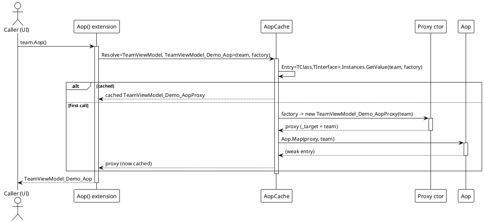
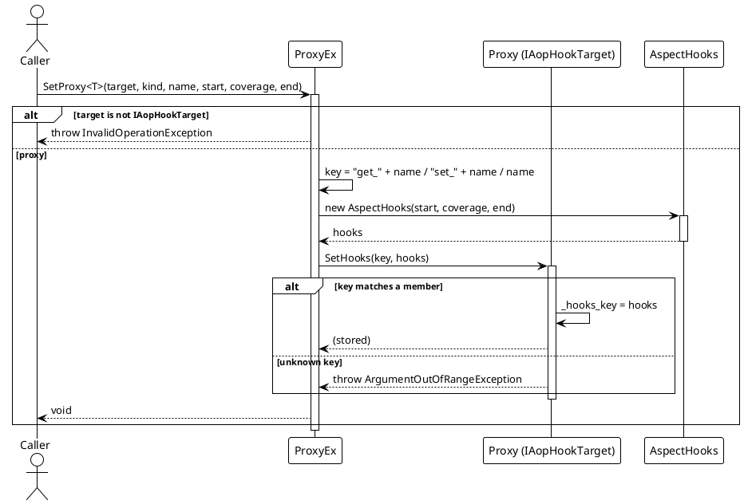
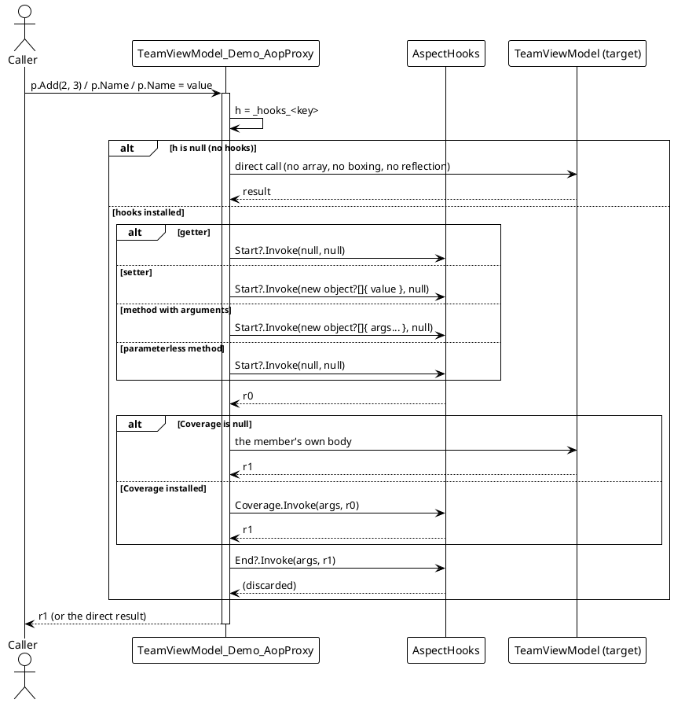

# Data Flow — AOP

Three flows: **proxy acquisition**, **hook installation**, and **intercepted invocation**. The example uses `Demo.TeamViewModel` from `Examples/AOP/WPF/Demo`, whose generated proxy is `TeamViewModel_Demo_AopProxy`.

## 1. Proxy acquisition — `Aop()`

The generated extension is the only entry point. `AopCache` runs the factory once per target; later calls return the cached proxy.



The proxy is constructed with `new`, not through a factory API. The generated extension is:

```csharp
var p = new global::VeloxDev.AopInterfaces.AopFixture_VeloxDev_Core_Test_AspectOriented_AopProxy(x);
global::VeloxDev.AspectOriented.Aop.Map(p, x);
return p;
```

(emitted by `AopWriter.WriteExtension`; shown for `AopFixture`, same shape for every target.)

## 2. Hook installation — `SetProxy`



`SetHooks` is an explicit interface implementation on the generated proxy; its `switch` has one case per interceptable accessor. Re-installing replaces the field — the previous `AspectHooks` is dropped, not composed.

## 3. Intercepted invocation

Every generated member has the same two-branch shape: **no hooks** calls the target directly; **hooks present** runs the chain.



Applied to the demo regs in `MainWindow.xaml.cs`:

| Call | Registered stage | What happens |
|---|---|---|
| `p.Name` | getter `start` | logs the read; the body still runs and returns the value |
| `p.Name = "..."` | setter `end` | the body writes; `end` reads `args[0]` |
| `p.Reset()` | method `coverage` | the body never runs; `coverage`'s `null` result is returned |
| `p.Members.Add(...)` | `AOP_OnMemberAdded` `end` | the collection event re-enters `this.Aop()`; the method body runs, then `end` reports the new item |

### Event-driven re-entry

`TeamViewModel` subscribes to its own collection in the constructor and forwards through the proxy (`Examples/AOP/WPF/Demo/TeamViewModel.cs`):

```csharp
private void OnMemberAdded(object? sender, NotifyCollectionChangedEventArgs e)
{
    this.Aop().AOP_OnMemberAdded(sender, e);
}
```

`this.Aop()` is the same cached proxy, so the notification path is intercepted exactly like a direct call. The method body still runs (no `coverage`), and the demo's `end` hook inspects `parameters[1]` — the `NotifyCollectionChangedEventArgs`.

## 4. Error and boundary paths

| Path | Trigger | Result |
|---|---|---|
| Not a proxy | `SetProxy` on a hand-written `IAspectOriented` | `InvalidOperationException` before any state changes |
| Unknown member | `SetProxy(..., "NoSuchMember", ...)` | `ArgumentOutOfRangeException` from `SetHooks` |
| Hook throws | any non-null stage | Propagates unchanged; later stages are skipped |
| Coverage returns `null` for a value type | e.g. `int` member | `NullReferenceException` at the generated unbox |
| Coverage returns the wrong type | any member | `InvalidCastException` at the generated cast |
| Target member throws | body or direct call | Propagates unchanged — no `TargetInvocationException` wrapper |
| No hooks | any member | Direct call; no exception surface of its own |

The absence of a reflection wrapper is a behavioral improvement over the previous `MethodInfo.Invoke` design: callers catch the same exception type the target threw.

> Source: `Src/Core/VeloxDev.Core/AspectOriented/{Aop,AopCache,ProxyEx,AspectHooks}.cs`, `Src/Generators/VeloxDev.Core.Generator/{AopSurface,AopProxy}.cs`, `Writers/AopWriter.cs`, `Src/Core/VeloxDev.Core.Test/AspectOriented/AopProxyTests.cs`, `Examples/AOP/WPF/Demo/{TeamViewModel.cs,MainWindow.xaml.cs}`.
