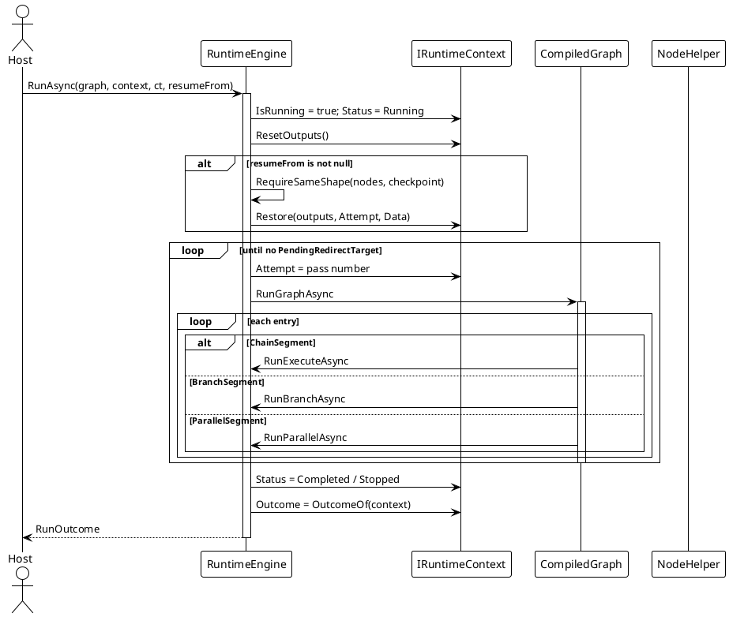

# Execution loop

`RunAsync` prepares the session, then repeats one pass over the whole graph until no pass asks to redirect. Each pass dispatches every entry to a chain, branch or parallel driver.

## Normal flow



The pass loop is deliberately uniform: a redirect is implemented as “re-run the whole graph from the target Order”, not as a nested continuation.

```csharp
while (true)
{
    context.Attempt = resumeFrom is null ? redirects + 1 : resumeFrom.Attempt + redirects;
    if (redirects == 0)
        await ObserveAsync(session, context, ExecutionObservationKind.RunStarted, null, null, TimeSpan.Zero, ct);
    context.PendingRedirectTarget = null;
    if (redirects > 0) context.Data = passSeed;
    context.ActiveRedirectTarget = redirectTarget;
    var terminated = await RunGraphAsync(graph, context, bindings, ct, redirectTarget, redirects == 0 ? done : null);
    if (!terminated && context.PendingRedirectTarget is { } next)
    {
        redirects++;
        if (redirects > MaxRedirects) { /* ends the run with an error */ }
        redirectTarget = next;
        continue;
    }
    break;
}
```

> Source: `Src/Core/VeloxDev.Core/WorkflowSystem/CompilerEx/Runtime/RuntimeEngine.cs` lines 94-124.

## Driving one node

`DriveAsync` is the only place `ReceiveAsync` is called. It applies the pause gate, records the compile order, injects joined inputs, registers the output and hands the value to the next node.

```csharp
var result = await node.GetHelper().ReceiveAsync(context, ct);

if (ReportedLevel(context, session) == ExecutionReportLevel.Error) result = null;

context.RegisterOutput(node, result);
context.Data = result;
await ObserveAsync(session, context, ExecutionObservationKind.NodeSucceeded, node, null, ElapsedSince(startedAt), ct);
await SaveCheckpointAsync(session, context, ct);
return;
```

> Source: `Src/Core/VeloxDev.Core/WorkflowSystem/CompilerEx/Runtime/RuntimeEngine.cs` lines 574-583.

A join point receives a `GroupData` instead of the chained value. The compiler records the input nodes on `NodeCompileInfo.InputNodes`; the engine builds the dictionary from the outputs registered this pass.

```csharp
if (info?.InputNodes is { Count: > 1 } inputs)
    context.Data = new GroupData(context.CollectGroupedInputs(inputs));
```

> Source: `Src/Core/VeloxDev.Core/WorkflowSystem/CompilerEx/Runtime/RuntimeEngine.cs` lines 568-572.

## Branch and parallel dispatch

- **Branch**: the router is driven (unless it is before the redirect target), a static branch uses `CompileKey`, a dynamic one calls `ResolveRouteKey(context)`, and the matching option's graph is walked. A missing or terminal option ends the run as a normal completion.
- **Parallel**: the source payload is copied to every branch; each branch runs against its own `BranchRuntimeContext` so payload, redirect request and report level are branch-local. Branches start concurrently as async operations and are joined with `Task.WhenAll`; an optional `MaxParallelBranches` caps the group with a semaphore.
- **Terminal branch**: returning `true` from a branch driver ends the whole run.

> Sources: `Src/Core/VeloxDev.Core/WorkflowSystem/CompilerEx/Runtime/RuntimeEngine.cs` lines 328-384 and 413-491.

## Redirect and failure

A node that reports `Error` (or throws) either implements `IRedirectable` or is asked through the host's `HostRedirect`. The answer must be an upstream node of the failing node, proven by `SearchReverseNodes` rather than by comparing Order, and its Order becomes `PendingRedirectTarget`. Without a valid answer the run ends with `EndedWithError = true` and status `-1`.

```csharp
var targetOrder = NodeOrder(bindings, target);
if (targetOrder < 0 || targetOrder >= order || !IsUpstreamOf(node, target))
{
    context.Log($"Redirect target '{target.GetType().Name}' (Order {targetOrder}) is not an upstream compiled node; ignored.");
    continue;
}

context.PendingRedirectTarget = targetOrder;
break;
```

> Source: `Src/Core/VeloxDev.Core/WorkflowSystem/CompilerEx/Runtime/RuntimeEngine.cs` lines 306-318.

- **Cancellation** is not a failure: `RunAsync` catches `OperationCanceledException`, sets `Stopped`, and reports only to the error sink.
- **Redirect cap**: more than 50 redirects sets status `Stopped`, `EndedWithError = true`, reports the failure, and throws `InvalidOperationException`.
- **Router/redirect contract throws**: treated as a redirect-phase failure; the run ends instead of guessing a branch.
- **Checkpoint shape mismatch**: `RequireSameShape` throws before `IsRunning` is set, so the session is not touched.

> Sources: `Src/Core/VeloxDev.Core/WorkflowSystem/CompilerEx/Runtime/RuntimeEngine.cs` lines 106-141, 253-301, 725-740.

## Outcome

`RunOutcome` is derived, not stored by each path: `Completed` maps from status `Completed`, `Failed` and `Cancelled` both map from `Stopped` and are split by `EndedWithError`.

> Source: `Src/Core/VeloxDev.Core/WorkflowSystem/CompilerEx/Runtime/Contracts/RunOutcome.cs` lines 24-37; `RuntimeEngine.cs` lines 714-722.
