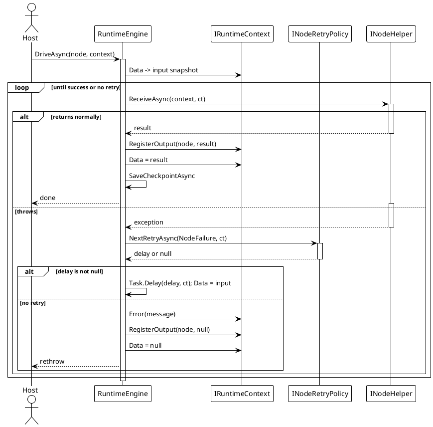

# Resilience and checkpoint

Every capability beyond plain execution is optional and read off the concrete `RuntimeContext`. With none configured, the run behaves exactly as it did before these capabilities existed: same log lines, same number of drives.

## Optional capabilities

```csharp
public IExecutionGate? ExecutionGate { get; set; }
public IExecutionObserver? Observer { get; set; }
public INodeRetryPolicy? RetryPolicy { get; set; }
public IExecutionErrorSink? ErrorSink { get; set; }
public Func<IRuntimeContext, INodeComponent, INodeComponent?>? HostRedirect { get; set; }
public IExecutionCompensation? Compensation { get; set; }
public IExecutionCheckpointStore? CheckpointStore { get; set; }
public ILogWriter? LogWriter { get; set; }
```

> Source: `Src/Core/VeloxDev.Core/WorkflowSystem/CompilerEx/Runtime/Model/RuntimeContext.cs` lines 148-199.

They live on the concrete class rather than on `IRuntimeContext` because adding members to that contract would break every external implementation. The engine reaches them by casting; a host-supplied context keeps only the baseline behavior.

> Source: `Src/Core/VeloxDev.Core/WorkflowSystem/CompilerEx/Runtime/RuntimeEngine.cs` lines 784-790.

## Pause gate

The gate is consulted once per node drive, before the node body runs. A gate that is already open completes synchronously and does not make the session flash `Paused`; a closed gate parks the drive and sets `Status = "Paused"` until it opens.

```csharp
if (session?.ExecutionGate is { } gate)
{
    var wait = gate.WaitAsync(ct);
    if (wait.IsCompleted)
    {
        await wait;
    }
    else
    {
        context.Status = "Paused";
        try { await wait; }
        finally { context.Status = "Running"; }
    }
}
```

> Source: `Src/Core/VeloxDev.Core/WorkflowSystem/CompilerEx/Runtime/RuntimeEngine.cs` lines 516-529.

## Retry

Only a thrown exception is offered to the retry policy. A node that requested a redirect through `Error()` chose control flow, not a failure, so it is not retried. The input is snapshotted before the first attempt and restored before each retry.



```csharp
var delay = await NextRetryAsync(session, context, node, ex, failures, elapsed, ct);
if (delay is { } wait)
{
    context.Log($"[Retry {failures}] {node.GetType().Name}: {ex.Message}");
    await ObserveAsync(session, context, ExecutionObservationKind.NodeRetried, node, failures.ToString(), TimeSpan.Zero, ct);
    await Task.Delay(wait, ct);
    context.Data = input;
    continue;
}
```

> Source: `Src/Core/VeloxDev.Core/WorkflowSystem/CompilerEx/Runtime/RuntimeEngine.cs` lines 595-604.

A policy that throws is treated as “do not retry”; the host's bug must not replace the node's original failure.

> Source: `Src/Core/VeloxDev.Core/WorkflowSystem/CompilerEx/Runtime/RuntimeEngine.cs` lines 617-637.

## Observer and error sink

- The observer receives run, node and branch observations. It cannot change the run: an observer exception is logged and dropped.
- The error sink receives structured `ExecutionError` records for node failures, router failures, redirect failures and cancellation. A sink exception is logged and dropped; a report never fails the run that made it.
- A node can also report through `IRuntimeContext.ErrorAsync` / `WarnAsync`; those write the log and hand the sink a record. `Warn` is a note; `Error` is a stop.

> Sources: `Src/Core/VeloxDev.Core/WorkflowSystem/CompilerEx/Runtime/RuntimeEngine.cs` lines 640-711; `RuntimeContext.cs` lines 320-378.

## Compensation and checkpoint

Compensation runs only when the outcome is `Failed` or `Cancelled`, over the nodes this run actually drove, most recent first. A node that cannot be compensated is logged and skipped; it does not hide the original failure.

```csharp
if (session?.Compensation is not { } compensation) return;
if (outcome is not (RunOutcome.Failed or RunOutcome.Cancelled)) return;

var completed = session.CompletedThisRun;
for (var i = completed.Count - 1; i >= 0; i--)
{
    var (node, output) = completed[i];
    try
    {
        await compensation.CompensateAsync(new NodeCompensation(node, output, NodeOrder(bindings, node)), CancellationToken.None);
    }
    catch (Exception ex)
    {
        context.Log($"[Compensation] {node.GetType().Name} was not compensated: {ex.Message}");
    }
}
```

> Source: `Src/Core/VeloxDev.Core/WorkflowSystem/CompilerEx/Runtime/RuntimeEngine.cs` lines 671-693.

The checkpoint is written after every successful drive. Restoring first validates the node-key shape, then replays `Attempt`, `ActiveRedirectTarget`, `Data` and the registered outputs. Nodes recorded as done are not driven again; the filter is by node reference, not by Order, because fan-out branch orders interleave.

- **Shape mismatch**: throws before the session is touched.
- **Store throws**: logged as `[Checkpoint]`, the run continues.
- **Restored pass**: keeps the checkpoint's `Attempt`; redirects after it increment from there.

> Sources: `Src/Core/VeloxDev.Core/WorkflowSystem/CompilerEx/Runtime/RuntimeEngine.cs` lines 69-83, 207-213, 725-775; `RuntimeContext.cs` lines 219-243, 407-411.

## Log writer

`AppendLog` hands the line to `LogWriter` before the retention check. A writer that throws raises `LogWriteFailed` and is dropped, because `AppendLog` runs inside node frames and an escaping exception would be read as a node failure.

> Source: `Src/Core/VeloxDev.Core/WorkflowSystem/CompilerEx/Runtime/Model/RuntimeContext.cs` lines 295-315.
