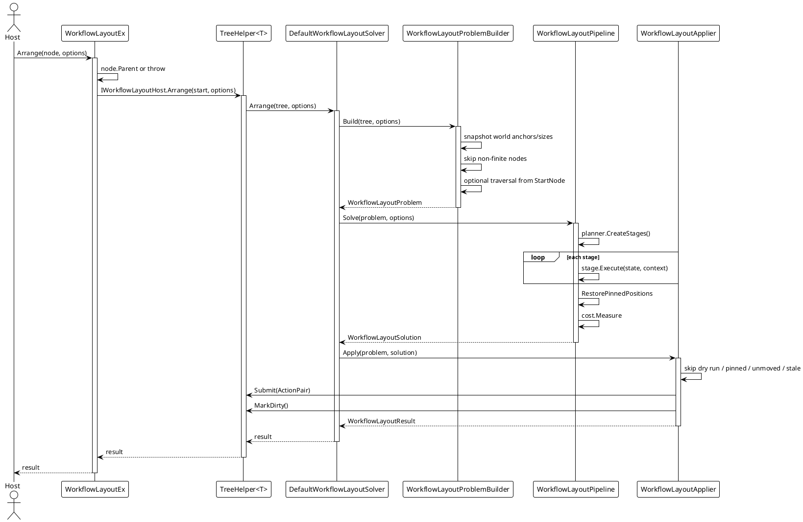

# Workflow auto-layout

`WorkflowLayoutEx.Arrange` is a one-call entry. It snapshots the tree, solves positions from that immutable snapshot, and writes the result back as a single undoable action. The model is never read by the solver and never written by the pipeline.

## Normal flow



The solver is the composition point: snapshot, pipeline, apply, once.

```csharp
public WorkflowLayoutResult Arrange(ITreeComponent tree, WorkflowLayoutOptions options)
{
    if (tree is null) throw new ArgumentNullException(nameof(tree));
    options ??= new WorkflowLayoutOptions();

    var problem = WorkflowLayoutProblemBuilder.Build(tree, options);
    var pipeline = new WorkflowLayoutPipeline(_planner, _cost);
    var solution = pipeline.Solve(problem, options);
    return new WorkflowLayoutApplier(tree).Apply(problem, solution);
}
```

> Source: `Src/Core/VeloxDev.Core/WorkflowSystem/Layout/DefaultWorkflowLayoutSolver.cs` lines 25-34.

## Snapshot

The builder is the only layout component that reads the model. It converts the collapsed anchors back to world coordinates, drops nodes with `NaN` or infinite geometry together with their edges, and records which nodes are pinned.

```csharp
var anchor = node.GetWorldAnchor();
var size = node.GetWorldSize();
var x = anchor.Horizontal;
var y = anchor.Vertical;
var width = size.Width;
var height = size.Height;

if (!IsFinite(x) || !IsFinite(y) || !IsFinite(width) || !IsFinite(height))
{
    skipped.Add(sourceIndex);
    continue;
}
```

> Source: `Src/Core/VeloxDev.Core/WorkflowSystem/Layout/WorkflowLayoutProblemBuilder.cs` lines 47-59.

A start node narrows the movable set to its reachable subgraph. Nodes outside the set remain in the problem as fixed obstacles, so a selected cluster cannot be pushed through them.

> Source: `Src/Core/VeloxDev.Core/WorkflowSystem/Layout/WorkflowLayoutProblemBuilder.cs` lines 87-121.

## Solve

The pipeline owns no model state. It runs the planner's stages against the snapshot, restores pinned positions after the last stage (so a misbehaving stage cannot move them), and measures the cost.

```csharp
var state = new WorkflowLayoutState(problem, options);
var stages = _planner.CreateStages(problem, options);

foreach (var stage in stages)
{
    context.CancellationToken.ThrowIfCancellationRequested();
    stage.Execute(state, context);
}

RestorePinnedPositions(state);

var cost = _cost.Measure(problem, state, context);
```

> Source: `Src/Core/VeloxDev.Core/WorkflowSystem/Layout/WorkflowLayoutPipeline.cs` lines 43-54.

## Apply

Applying is a separate, calling-thread step. Pinned and unmoved nodes are skipped, a node whose live anchor, layer or parent no longer matches the snapshot is skipped instead of overwritten, and every remaining move is wrapped in one `ActionPair`.

```csharp
helper.Submit(new ActionPair(
    () =>
    {
        foreach (var move in moves) move.Node.StandardSetAnchor(move.To);
    },
    () =>
    {
        foreach (var move in moves) move.Node.StandardSetAnchor(move.From);
    }));
helper.MarkDirty();
```

> Source: `Src/Core/VeloxDev.Core/WorkflowSystem/Layout/WorkflowLayoutApplier.cs` lines 70-80.

## Error and edge paths

- **Node not attached**: `Arrange(node, ...)` throws `ArgumentException` when `Parent` is null.
- **Start node not finite or not in the tree**: the builder throws `ArgumentException`.
- **Dry run**: the pipeline still solves; the applier returns `Applied = false` and `DryRun = true`.
- **No nodes**: the applier returns without submitting.
- **Concurrent edit**: a node whose anchor/layer/parent changed between snapshot and apply is counted in `SkippedCount`, not overwritten.
- **Solution mismatch**: the applier throws `ArgumentException` when the solution was produced for a different problem.
- **Cancellation**: the pipeline checks the token before every stage.
- **Node move hooks**: applying goes through `StandardSetAnchor`, so a host's `Moving`/`Moved` events still see the change.

> Sources: `Src/Core/VeloxDev.Core/WorkflowSystem/Layout/WorkflowLayoutEx.cs` lines 38-51; `WorkflowLayoutProblemBuilder.cs` lines 92-97; `WorkflowLayoutApplier.cs` lines 28-97; `WorkflowLayoutPipeline.cs` lines 46-50.
