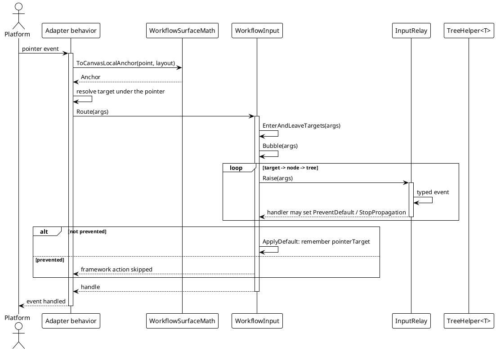

# Input routing

An adapter decides *what* was hit and passes it as `PointerEventArgs.Target`. `WorkflowInput` decides *who hears about it*: the target first, then its ancestors, then the tree, all sharing one argument instance and one handle.

## Normal flow



`Route` is three steps: synthesize enter/exit when the target changed, bubble the event, then run the framework's own reaction unless a subscriber prevented it.

```csharp
public void Route(PointerEventArgs e)
{
    if (e is null) throw new ArgumentNullException(nameof(e));

    EnterAndLeaveTargets(e);

    if (Bubble(e)) return;

    ApplyDefault(e);
}
```

> Source: `Src/Core/VeloxDev.Core/WorkflowSystem/GUI/Events/WorkflowInput.cs` lines 267-276.

The chain is target → owner node (for a slot) → the tree passed by the adapter. The tree is never derived from `Parent` chains, because a drag preview slot or a detached node may not have a reliable parent.

```csharp
private IEnumerable<IWorkflowHelper> Chain(IWorkflowComponent? target)
{
    switch (target)
    {
        case ISlotComponent slot:
            yield return slot.GetHelper();
            if (slot.Parent is { } owner) yield return owner.GetHelper();
            break;

        case INodeComponent node:
            yield return node.GetHelper();
            break;

        case ILinkComponent link:
            yield return link.GetHelper();
            break;
    }

    yield return tree.GetHelper();
}
```

> Source: `Src/Core/VeloxDev.Core/WorkflowSystem/GUI/Events/WorkflowInput.cs` lines 358-378.

## Handle semantics

One `WorkflowEventHandle` travels with one logical action. The two flags are independent and land differently by action kind:

| Action kind | `PreventDefault` | `StopPropagation` |
|---|---|---|
| routed input | the framework's own hand stands down | no ancestor hears it |
| `…ing` model action | the action is refused | (report side) |
| `…ed` report | no effect | later subscribers do not hear it |

> Source: `Src/Core/VeloxDev.Core/WorkflowSystem/GUI/Events/WorkflowEventHandle.cs` lines 22-55.

## The adapter boundary

The WPF surface behavior is one concrete translation. It converts the pointer position into a canvas-local anchor, resolves the target, routes the event, and returns the handle.

```csharp
private static WorkflowEventHandle RoutePointer(
    SurfaceState state, ITreeComponent tree, Point point, FrameworkElement source, DependencyObject? hit,
    Func<Anchor, IWorkflowComponent?, WorkflowEventHandle, Wf.PointerEventArgs> args)
{
    var anchor = WorkflowSurfaceMath.ToCanvasLocalAnchor(point.X, point.Y, Panel.GetZIndex(source), tree.Layout);
    var input = WorkflowInput.For(tree);
    var target = ResolveTarget(hit, tree, anchor.Horizontal, anchor.Vertical, input.HitRadius);

    var handle = new WorkflowEventHandle();
    input.Route(args(anchor, target, handle));
    FocusHoveredLink(input, state);
    return handle;
}
```

> Source: `Src/Adapters/VeloxDev.WPF/WorkflowSystem/AttachedBehaviors/WorkflowSurfaceBehavior.cs` lines 976-988.

During a connection drag the adapter does not route ordinary pointer moves; it reports the candidate slot and lets the connection preview own the state.

```csharp
if (viewModel.VirtualLink.IsVisible)
{
    viewModel.StandardSetPreviewReceiver(
        SlotHitTestEx.HitTest(viewModel, pointer.Horizontal, pointer.Vertical));
    return;
}
```

> Source: `Src/Adapters/VeloxDev.WPF/WorkflowSystem/AttachedBehaviors/WorkflowSurfaceBehavior.cs` lines 727-731.

## Wheel ownership

A normal wheel is owned by the adapter: the platform scroll container must not scroll, the route decides, and the default scroll is applied afterwards through `IWorkflowSurfaceScroller`. `PreventDefault` therefore means “this turn does not scroll”, and the subscriber scrolls through the registered scroller instead.

```csharp
var handle = RoutePointer(state, viewModel, e.GetPosition(state.Canvas), host, e.OriginalSource as DependencyObject,
    (anchor, target, h) => new Wf.PointerWheelEventArgs(
        anchor, Modifiers(), host, target, 0d, e.Delta, h));

e.Handled = true;
if (!handle.PreventDefault)
{
    state.Scroller?.ScrollBy(0d, e.Delta);
}
```

> Source: `Src/Adapters/VeloxDev.WPF/WorkflowSystem/AttachedBehaviors/WorkflowSurfaceBehavior.cs` lines 879-888.

## Error and edge paths

- **Null event**: `Route` throws `ArgumentNullException`.
- **Target changed**: an exit event is synthesized for the previous target and an entry event for the new one, each with its own handle; the return value of those two is intentionally ignored.
- **Pointer target**: `ApplyDefault` writes `pointerTarget` for any targeted pointer event, so a key pressed after a scroll still targets the last known element. `IsSuspended` stops that update while a host popup is open.
- **Keyboard**: keys have no framework default; Core routes them and the host decides (for example, Delete runs `link.DeleteCommand`).
- **Undeclared helper**: a helper that does not implement `IInputEvents` is skipped; the route continues to its ancestors.

> Sources: `Src/Core/VeloxDev.Core/WorkflowSystem/GUI/Events/WorkflowInput.cs` lines 278-388; `Src/Core/VeloxDev.Core/WorkflowSystem/GUI/Events/Input/IInputEvents.cs` lines 19-23.
