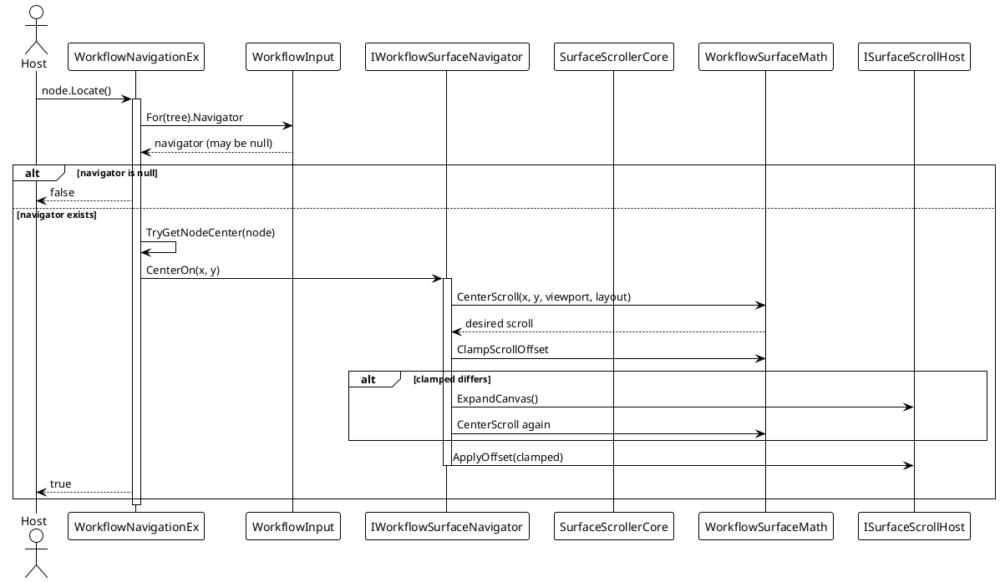

# Surface navigation

Navigation is panning only: it centers a model point in the viewport and preserves zoom. It works before a view exists because every target is derived from model data, not from a drawn curve or a measured slot anchor.

## Locate



`Locate` has three overloads. A node centers on its rectangle, a slot on its parent node's rectangle, and a link on the midpoint of its two endpoint nodes' centers.

```csharp
private static bool TryGetNodeCenter(INodeComponent node, out double x, out double y)
{
    var anchor = node.Anchor;
    var size = node.Size;
    x = anchor.Horizontal + size.Width / 2d;
    y = anchor.Vertical + size.Height / 2d;
    return IsFinite(x) && IsFinite(y);
}
```

> Source: `Src/Core/VeloxDev.Core/WorkflowSystem/StandardEx/WorkflowNavigationEx.cs` lines 93-100.

The target travels through `WorkflowInput.Navigator`, which an adapter registers while its surface is attached. A tree with no navigator returns `false` and changes nothing.

> Source: `Src/Core/VeloxDev.Core/WorkflowSystem/StandardEx/WorkflowNavigationEx.cs` lines 24-104.

## Wheel scrolling

`SurfaceScrollerCore.ScrollBy` converts a wheel delta into a platform step, writes only the axis that moved, and grows the canvas through `ClampScrollOffset` when the request overshoots the current extent.

```csharp
var dx = wheelDeltaX != 0d ? (wheelDeltaX / notch) * stepX : 0d;
var dy = wheelDeltaY != 0d ? -(wheelDeltaY / notch) * stepY : 0d;

var offsetX = host.HorizontalOffset;
var offsetY = host.VerticalOffset;
var desiredX = dx != 0d ? offsetX + dx : offsetX;
var desiredY = dy != 0d ? offsetY + dy : offsetY;
```

> Source: `Src/Core/VeloxDev.Core/WorkflowSystem/GUI/Surface/SurfaceScrollerCore.cs` lines 70-76.

The two axes do not share a sign convention: a positive `wheelDeltaX` moves towards the right content, a positive `wheelDeltaY` towards the content above, so `dy` is negated.

> Source: `Src/Core/VeloxDev.Core/WorkflowSystem/GUI/Surface/SurfaceScrollerCore.cs` lines 60-71.

## Hit testing

Slots are found by their measured anchors; links are found by the curve their view published.

```csharp
public static ISlotComponent? HitTest(
    ITreeComponent tree, double x, double y, double radius = DefaultHitRadius)
{
    // ...
    foreach (var node in tree.Nodes)
    {
        foreach (var slot in node.Slots)
        {
            var anchor = slot.Anchor;
            if (double.IsNaN(anchor.Horizontal) || double.IsNaN(anchor.Vertical)) continue;
            // nearest anchor within radius wins
        }
    }
    return best;
}
```

> Source: `Src/Core/VeloxDev.Core/WorkflowSystem/GUI/Interaction/SlotHitTestEx.cs` lines 29-56.

For links, the pool walks `VisibleItems` from the back, skips the drag preview, and rejects a link covered by a node card unless the point is near its own port.

```csharp
var items = tree.GetHelper()?.VisibleItems;
if (items is null) return null;

var dragPreview = tree.VirtualLink;
for (var i = items.Count - 1; i >= 0; i--)
{
    if (items[i] is not ILinkComponent link) continue;
    if (ReferenceEquals(link, dragPreview)) continue;
    if (!link.HitTest(x, y, radius)) continue;
    if (IsCoveredByANode(items, link, x, y, radius)) continue;
    return link;
}
```

> Source: `Src/Core/VeloxDev.Core/WorkflowSystem/GUI/Interaction/LinkHitTestEx.cs` lines 79-92.

## Error and edge paths

- **No navigator**: `Locate` returns `false` without touching the model.
- **No finite position**: a `NaN`/infinite anchor returns `false`.
- **No layout**: `ScrollBy` and `CenterOn` return without writing offsets; they cannot know the canvas geometry.
- **Zero delta**: an axis with zero delta is left alone; both zero is a no-op.
- **Overscroll**: the canvas is expanded, the maximum is re-read, and the offset is clamped against the new maximum.
- **Unmeasured slot**: a slot whose anchor is still `NaN` is skipped; the nearest remaining slot wins.
- **Link visibility**: a link with no published curve or `IsVisible = false` is never hit.
- **Hit radius**: `LinkHitTestEx.DefaultHitRadius` is 6 canvas units, `SlotHitTestEx.DefaultHitRadius` is 12.

> Sources: `Src/Core/VeloxDev.Core/WorkflowSystem/GUI/Surface/SurfaceScrollerCore.cs` lines 49-116, 124-156; `Src/Core/VeloxDev.Core/WorkflowSystem/GUI/Interaction/LinkHitTestEx.cs` lines 18, 54-58, 104-140; `SlotHitTestEx.cs` line 20.
