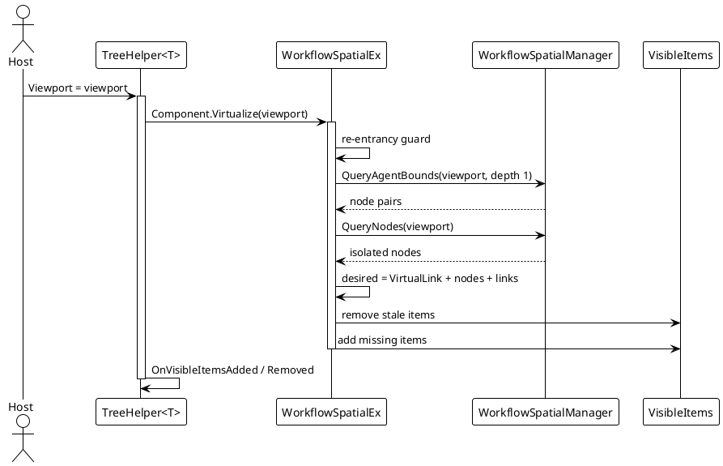
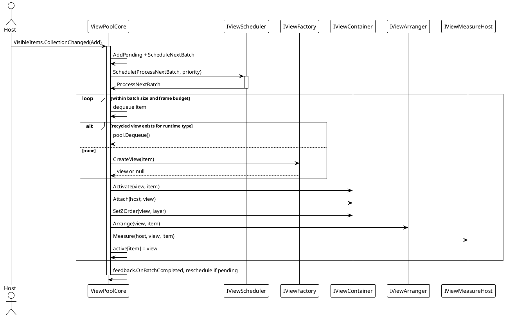

# View hosting and virtualization

Two layers cooperate. `TreeHelper` decides which model items are visible for a viewport; a `ViewPool` maps that visible set to platform views, creating each item at most once and recycling by runtime type.

## Virtualization flow



`EnableMap` creates the spatial manager and subscribes it to the tree's add/remove events. `Virtualize` is a no-op for a zero viewport and guarded against re-entrancy because updating `VisibleItems` can itself change the viewport.

```csharp
if (viewport.Width <= 0 || viewport.Height <= 0)
    return;

if (!Virtualizing.TryAdd(tree, 0))
    return;
try
{
    VirtualizeCore(tree, viewport);
}
finally
{
    Virtualizing.TryRemove(tree, out _);
}
```

> Source: `Src/Core/VeloxDev.Core/WorkflowSystem/GUI/Virtualization/WorkflowSpatialEx.cs` lines 95-113.

The desired set is built in one pass, then stale items are removed and missing ones added. Links are resolved from the node-pair index, which is why a long link crossing the viewport brings both endpoint nodes into the set.

```csharp
List<IWorkflowComponent> desiredItems = [tree.VirtualLink];
var desiredSet = new HashSet<IWorkflowComponent>(
    WorkflowReferenceEqualityComparer<IWorkflowComponent>.Instance)
{
    tree.VirtualLink
};

foreach (var node in visibleNodes)
    AddDesiredItem(desiredItems, desiredSet, node);

foreach (var link in manager.ResolveLinksFromPairs(agentBounds))
    AddDesiredItem(desiredItems, desiredSet, link);
```

> Source: `Src/Core/VeloxDev.Core/WorkflowSystem/GUI/Virtualization/WorkflowSpatialEx.cs` lines 164-176.

> Sources: `Src/Core/VeloxDev.Core/WorkflowSystem/GUI/Virtualization/WorkflowSpatialEx.cs` lines 47-67, 145-188; `WorkflowSpatialManager.cs` lines 41-67, 80-125.

## View materialization



The pool is the platform-neutral half of materialization. It owns the recycle queues, the active map and the pending queue; every platform-specific step is delegated.

```csharp
if (pools.TryGetValue(itemType, out var pool) && pool.Count > 0)
{
    view = pool.Dequeue();
    reusedViewCount++;
}

if (view is null)
{
    view = host.Factory.CreateView(typedItem);
    if (view is null)
    {
        unsupportedTypes.Add(itemType);
        return;
    }
    createdViewCount++;
}

stage = ViewStage.Activate;
host.Container.Activate(view, typedItem);
stage = ViewStage.Attach;
host.Container.Attach(hostElement, view);
```

> Source: `Src/Core/VeloxDev.Core/WorkflowSystem/ViewHosting/ViewPool.cs` lines 338-359.

## Tick-driven pass

The helper's generated `Update` hook runs at 10 FPS. It only does work when the tree is dirty and only one UI pass is queued at a time; when a UI `SynchronizationContext` was captured, the pass is posted there rather than run on the timer thread.

```csharp
partial void Update(FrameEventArgs e)
{
    if (!useVirtualization || Volatile.Read(ref isDirty) == 0) return;

    var context = hostContext;
    if (context is null || ReferenceEquals(context, SynchronizationContext.Current))
    {
        RunVirtualizationPass();
        return;
    }

    if (Interlocked.Exchange(ref uiPassQueued, 1) != 0) return;
    // ...
}
```

> Source: `Src/Core/VeloxDev.Core/WorkflowSystem/Templates/Helpers/TreeHelper.cs` lines 75-87.

> Source: `Src/Core/VeloxDev.Core/WorkflowSystem/Templates/Helpers/TreeHelper.cs` lines 33, 54-58.

## Error and edge paths

- **Virtualization not enabled**: `VirtualizeCore` throws `ArgumentNullException` when the spatial map is missing; `TreeHelper` only calls it when virtualization was turned on.
- **Empty viewport**: a non-positive width or height is a no-op.
- **Nested virtualization**: the re-entrancy guard drops the nested call; the outer call already reaches the final state.
- **Pending link**: a link whose endpoint node is not registered yet is parked and retried on the next `NodeAdded`, instead of disappearing forever.
- **Factory refuses**: a null view records the runtime type as unsupported, so the pool does not retry it on every batch.
- **Materialization throws**: the view is deactivated, detached and returned to the pool, and the failure is reported to `IViewDiagnostics`.
- **Recycle cap**: `MaxRecycledViewsPerType` bounds the pool; beyond it the view is destroyed through `IViewContainer`.

> Sources: `Src/Core/VeloxDev.Core/WorkflowSystem/GUI/Virtualization/WorkflowSpatialEx.cs` lines 115-126; `WorkflowSpatialManager.cs` lines 151-185, 254-264; `ViewPool.cs` lines 319-415; `ViewHostCore.cs` lines 90-100.
