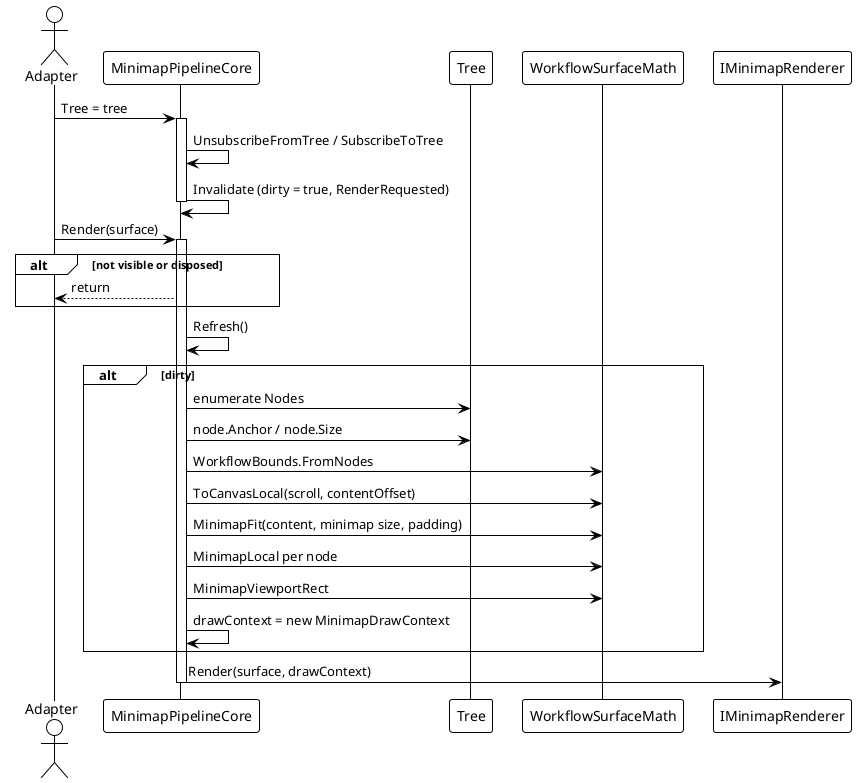
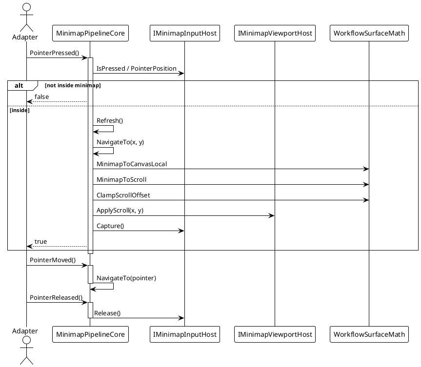

# Minimap

`MinimapPipelineCore` is the platform-neutral minimap state machine. Node, link and viewport changes only set a dirty flag and raise `RenderRequested`; the mapping and placement work runs once on the next render or refresh.

## Normal flow: map and draw



```csharp
public void Render(TSurface surface)
{
    if (disposed || !IsVisible)
    {
        return;
    }

    Refresh();
    if (drawContext is null)
    {
        return;
    }

    Renderer.Render(surface, drawContext);
}
```

> Source: `Src/Core/VeloxDev.Core/WorkflowSystem/Minimap/MinimapPipelineCore.cs` lines 188-202.

`BuildDrawContext` converts node rectangles and the viewport rectangle into canvas-local bounds, fits the content into the minimap, and maps each node with the minimum thumb size applied.

```csharp
var (ox, oy, sc) = WorkflowSurfaceMath.MinimapFit(
    ContentBounds.Width, ContentBounds.Height, mmW - pad * 2, mmH - pad * 2, pad);

// ...
var (l, t) = WorkflowSurfaceMath.MinimapLocal(
    nx, ny, ContentBounds.Left, ContentBounds.Top, ox, oy, sc);
mapped.Add(WorkflowBounds.FromNode(
    l, t,
    WorkflowSurfaceMath.MinThumbSize(nw, sc, minThumb),
    WorkflowSurfaceMath.MinThumbSize(nh, sc, minThumb)));
```

> Source: `Src/Core/VeloxDev.Core/WorkflowSystem/Minimap/MinimapPipelineCore.cs` lines 328-342.

## Drag to scroll

A press inside the minimap refreshes the mapping, centers the viewport on the pressed point, captures the pointer and starts a drag. Every move re-centers; release ends the drag.



```csharp
public bool PointerPressed()
{
    if (disposed || dragging || !Input.IsPressed)
    {
        return false;
    }

    var (x, y) = Input.PointerPosition;
    if (!HitTest(x, y))
    {
        return false;
    }

    Refresh();
    NavigateTo(x, y);
    dragging = true;
    Input.Capture();
    return true;
}
```

> Source: `Src/Core/VeloxDev.Core/WorkflowSystem/Minimap/MinimapPipelineCore.cs` lines 215-233.

## Invalidation

The pipeline subscribes to node and link collection changes and to `Anchor`/`Size` property changes. Each one calls `Invalidate`, which sets `dirty` and raises `RenderRequested`; a burst of changes therefore costs one mapping pass.

```csharp
public void Invalidate()
{
    if (disposed)
    {
        return;
    }

    dirty = true;
    RenderRequested?.Invoke(this, EventArgs.Empty);
}
```

> Source: `Src/Core/VeloxDev.Core/WorkflowSystem/Minimap/MinimapPipelineCore.cs` lines 163-172.

> Sources: `Src/Core/VeloxDev.Core/WorkflowSystem/Minimap/MinimapPipelineCore.cs` lines 413-631.

## Error and edge paths

- **No tree**: `BuildDrawContext` returns null and clears the cached bounds.
- **No nodes**: an empty content bounds produces no draw context; nothing is rendered.
- **Invalid scale**: `NavigateTo` returns when `Scale <= 0`.
- **Not visible**: `Render` returns before refreshing, but hit testing and drag math still work.
- **Pointer outside**: `PointerPressed` returns false and does not capture.
- **Capture lost**: `PointerCaptureLost` ends the drag without asking for capture again.
- **Thread affinity**: tree notifications may arrive on any thread; the adapter must marshal `Invalidate` and render calls to the host thread.

> Sources: `Src/Core/VeloxDev.Core/WorkflowSystem/Minimap/MinimapPipelineCore.cs` lines 50-59, 141-145, 188-202, 259-269, 294-322, 378-392.
