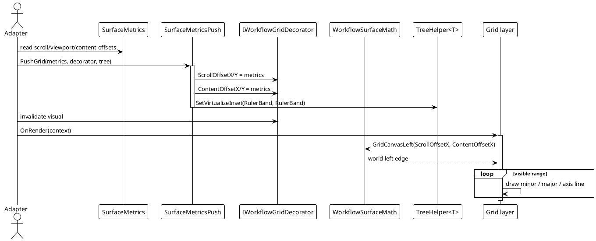

# Grid decorators and rulers

The grid decorator is a data sink: the surface behavior pushes scroll and content offsets into it before each render, and the decorator draws world-aligned grid lines and floating rulers from those numbers. Core owns the contract and the shared math; each adapter owns the drawing.

## Normal flow: push offsets, render



`PushGrid` is the whole write path. It also forwards the ruler band thickness to virtualization, so nodes under the translucent ruler are not culled one band too early.

```csharp
public static void PushGrid(
    SurfaceMetrics metrics, IWorkflowGridDecorator decorator, ITreeComponent? tree)
{
    if (decorator is null) throw new ArgumentNullException(nameof(decorator));

    decorator.ScrollOffsetX = metrics.ScrollOffsetX;
    decorator.ScrollOffsetY = metrics.ScrollOffsetY;
    decorator.ContentOffsetX = metrics.ContentOffsetX;
    decorator.ContentOffsetY = metrics.ContentOffsetY;

    tree?.SetVirtualizeInset(left: decorator.RulerBand, top: decorator.RulerBand);
}
```

> Source: `Src/Core/VeloxDev.Core/WorkflowSystem/GUI/Surface/SurfaceMetricsPush.cs` lines 25-37.

## Contract

The contract exists so all seven GUI adapters share one definition instead of carrying an identical local copy.

```csharp
public interface IWorkflowGridDecorator
{
    double ScrollOffsetX { get; set; }
    double ScrollOffsetY { get; set; }
    double ContentOffsetX { get; set; }
    double ContentOffsetY { get; set; }
    double RulerBand { get; }
}
```

> Source: `Src/Core/VeloxDev.Core/Interfaces/WorkflowSystem/Surface/IWorkflowGridDecorator.cs` lines 12-33.

The minimap contract derives from it, because a minimap needs the same scroll/content offsets plus the viewport size and the tree.

> Source: `Src/Core/VeloxDev.Core/Interfaces/WorkflowSystem/Surface/IWorkflowMinimapOverlay.cs` lines 15-46.

## Drawing

A concrete decorator computes the world edge by subtracting the content offset from the scroll offset, then draws at multiples of the grid spacing.

```csharp
protected override void OnRender(DrawingContext context)
{
    var bounds = new Rect(RenderSize);
    DrawGrid(context, bounds);
}

private void DrawGrid(DrawingContext context, Rect bounds)
{
    var spacing = Math.Max(0.1, owner.GridSpacing);
    var majorStep = spacing * Math.Max(1, owner.MajorLineEvery);
    var worldLeft = WorkflowSurfaceMath.GridCanvasLeft(owner.ScrollOffsetX, owner.ContentOffsetX);
    // vertical lines at worldLeft + k * spacing
    // major lines when IsMajorLine(value, majorStep)
}
```

> Source: `Src/Templates/VeloxDev.WPF.Templates/working/content/workflow-grid-decorator/TemplateClass.cs` lines 148-182.

Membership, axis emphasis and the near-zero test are local helpers: a line is major when the remainder against `majorStep` is within `0.001`, and the axis pen is used when the value is near zero.

> Source: `Src/Templates/VeloxDev.WPF.Templates/working/content/workflow-grid-decorator/TemplateClass.cs` lines 290-304.

## Viewport persistence

The same metrics pass writes the tree's viewport and persists its canvas-local position, so a reload can restore the scroll.

```csharp
var localX = WorkflowSurfaceMath.ToCanvasLocal(metrics.ScrollOffsetX, metrics.ContentOffsetX);
var localY = WorkflowSurfaceMath.ToCanvasLocal(metrics.ScrollOffsetY, metrics.ContentOffsetY);

tree.GetHelper().Viewport = new Viewport(
    localX, localY, metrics.ViewportWidth, metrics.ViewportHeight);

tree.Layout.ViewportOffset = new Offset(localX, localY);
```

> Source: `Src/Core/VeloxDev.Core/WorkflowSystem/GUI/Surface/SurfaceMetricsPush.cs` lines 71-77.

## Error and edge paths

- **Missing decorator**: `PushGrid` throws `ArgumentNullException`; a surface with no decorator must skip the call, not pass null.
- **Missing tree**: the decorator still receives offsets; only the virtualization inset is skipped.
- **No scroll range**: the decorator draws from the snapshots it was given; it does not query the platform.
- **Ruler band**: `RulerBand` is 0 when the decorator draws no floating band, so no virtualization inset is applied.
- **Offset authority**: scroll offsets are in the platform's scroll space; content offsets are `CanvasLayout.ActualOffset`. Mixing them is what `WorkflowSurfaceMath.ToCanvasLocal` exists to prevent.

> Sources: `Src/Core/VeloxDev.Core/WorkflowSystem/GUI/Surface/SurfaceMetricsPush.cs` lines 18-37; `Src/Core/VeloxDev.Core/Interfaces/WorkflowSystem/Surface/IWorkflowGridDecorator.cs` lines 14-32.
