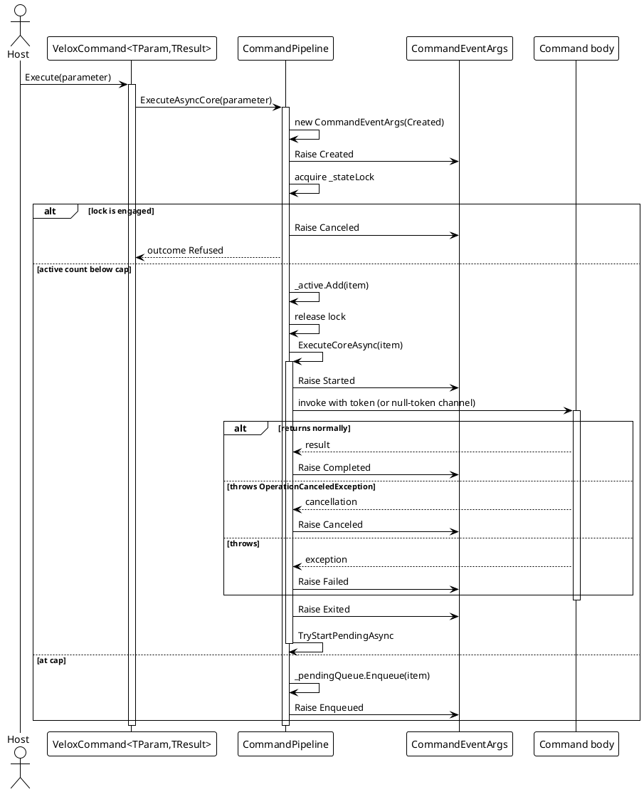

# MVVM ViewModel generation

The generator emits `On{Name}Changing/Changed` partials for `[VeloxProperty]` members and a `{Name}Command` for each `[VeloxCommand]` method. At runtime that command is a `VeloxCommand`, and all execution funnels through `CommandPipeline`'s queue, one concurrency cap and eight lifecycle events.

## Generated shape

A `[VeloxProperty]` setter raises the two notification hooks around the field write; the exact methods are generated per class, not reflected. A `[VeloxCommand]` method becomes a typed command property whose body is the method.

> Sources: `Src/Generators/VeloxDev.Core.Generator/Writers/MVVMWriter.cs` lines 147-148, 188-189; `Src/Core/VeloxDev.Core/MVVM/VeloxPropertyAttribute.cs`; `Src/Core/VeloxDev.Core/MVVM/VeloxCommandAttribute.cs`.

The runtime entry is the same for the `object?` command and the typed command:

```csharp
public void Execute(TParam parameter) => _ = ExecuteAsyncCore(parameter);
public Task ExecuteAsync(TParam parameter) => ExecuteAsyncCore(parameter);
```

> Source: `Src/Core/VeloxDev.Core/MVVM/VeloxCommand{TParam,TResult}.cs` lines 96-100.

## Normal flow



The decision and the queue push happen under one state lock; the body and all events start after the lock is released, so a handler can re-enter the command without deadlocking.

```csharp
await _stateLock.WaitAsync().ConfigureAwait(false);
try
{
    forceLocked = _isForceLocked;
    if (!forceLocked)
    {
        if (_active.Count < _maxConcurrency)
        {
            _active.Add(item);
            startNow = true;
        }
        else
        {
            _pendingQueue.Enqueue(item);
            enqueued = true;
        }
    }
}
finally
{
    _stateLock.Release();
}
```

> Source: `Src/Core/VeloxDev.Core/MVVM/CommandPipeline{TParam,TResult}.cs` lines 589-610.

The body is invoked in exactly one place, and a returned value is read there once, so it belongs to that execution and is never stored on the command.

```csharp
if (_resultCommand is not null)
{
    result = _isCtsNeeded
        ? await _resultCommand(item.ResolveParameter(), (item.Cts ?? new()).Token).ConfigureAwait(false)
        : await _resultCommand(item.ResolveParameter(), _defct).ConfigureAwait(false);
}
else if (_isCtsNeeded)
{
    await _command(item.ResolveParameter(), (item.Cts ?? new()).Token).ConfigureAwait(false);
}
```

> Source: `Src/Core/VeloxDev.Core/MVVM/CommandPipeline{TParam,TResult}.cs` lines 651-664.

## Completion and waiting

`ExecuteAndWaitTypedAsync` attaches a `TaskCompletionSource` to the item. The final `finally` completes it with the outcome, exception and result, so a caller sees the body's value even when no event subscriber exists.

```csharp
try
{
    await OnExecutionCompletedAsync(item).ConfigureAwait(false);
}
finally
{
    if (item.Completion is not null)
    {
        item.Complete(outcome, failure, result);
    }

    item.CompleteTyped(outcome, failure, result);
    item.TakeCts()?.Dispose();
}
```

> Source: `Src/Core/VeloxDev.Core/MVVM/CommandPipeline{TParam,TResult}.cs` lines 683-698.

A waiting caller is completed with the body's value, the original exception, `OperationCanceledException`, or `InvalidOperationException` when the command was locked.

> Source: `Src/Core/VeloxDev.Core/MVVM/CommandPipeline{TParam,TResult}.cs` lines 521-538.

## Error and edge paths

- **`CanExecute`**: evaluates the predicate and the lock only, never the queue. At the concurrency cap it still returns true, because the call would be parked rather than dropped.
- **Locked**: `ExecuteCore` cancels the item's own token source, raises `Canceled`, completes the sink as `Refused`, and never starts the body.
- **Queued**: at the cap the item is enqueued and raises `Enqueued`; `OnExecutionCompleted` starts the next pending item.
- **Cancellation**: the body's `OperationCanceledException` is reported as `Canceled`; the wait token only abandons the wait and does not cancel the execution.
- **Re-entrancy**: the body is started outside the state lock, so a handler may call back into the same command.
- **Collection hooks**: `[VeloxProperty]` collections also get generated `OnItemAddedTo` / `OnItemRemovedFrom` / reset hooks, which fire after the collection mutation.

> Sources: `Src/Core/VeloxDev.Core/MVVM/CommandPipeline{TParam,TResult}.cs` lines 403-416, 612-635, 637-718; `Src/Core/VeloxDev.Core/MVVM/ObservableCollectionTracker.cs`; `Src/Generators/VeloxDev.Core.Generator/Writers/MVVMWriter.cs` lines 980-1022.
