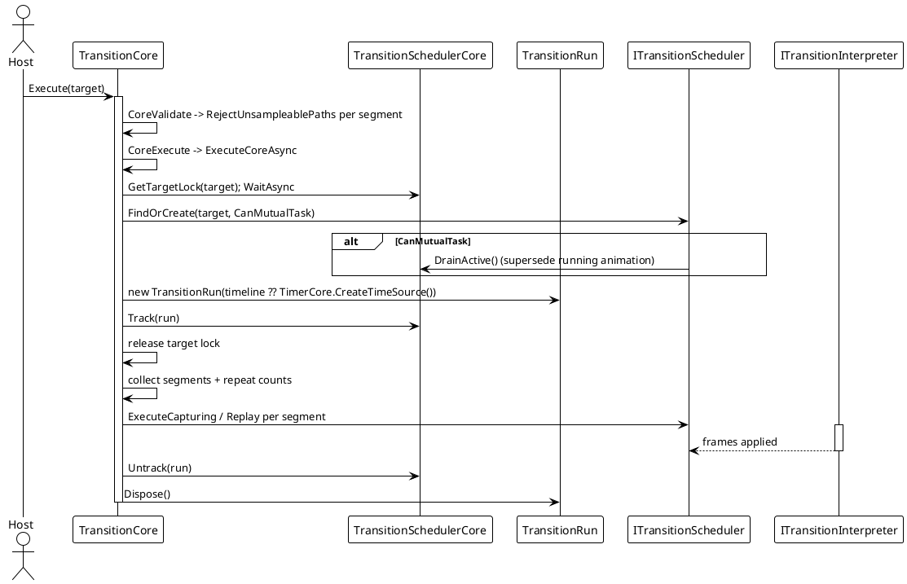

# Execute chain

A transition is a chain of `TransitionCore` segments. Each segment owns a frame state, an effect and an interpolator; `Then`, `AwaitThen` and `Repeat` link segments without executing anything. `Execute` is where control starts.

## Validation and run registration



The run is created and registered under the target's control-plane lock, so an `Exit` racing with the start either cancels this animation or happens entirely before it — never between the two.

```csharp
var gate = TransitionSchedulerCore.GetTargetLock(target);
await gate.WaitAsync();
try
{
    scheduler = TransitionSchedulerCore<THost, TTransitionInterpreterCore, TPriorityCore>.FindOrCreate(target, CanMutualTask);
    if (CanMutualTask)
    {
        superseded.AddRange(((TransitionSchedulerCore)scheduler).DrainActive());
    }

    run = new TransitionRun(timeline ?? TimerCore.CreateTimeSource<ITimeSourceControl>());
    cts = run.Cts;

    coreScheduler = (TransitionSchedulerCore)scheduler;
    coreScheduler.Track(run);
    // ...
}
finally
{
    gate.Release();
}
```

> Source: `Src/Core/VeloxDev.Core/TransitionSystem/Effects/Transition.cs` lines 375-409.

## Segment execution

The chain is flattened into one array of segments and one array of repeat counts. A segment runs once with `ExecuteCapturing`; every later iteration reuses the captured frame set through `Replay`, so a repeated segment starts from the frame set prepared on its first iteration rather than re-reading the target.

```csharp
if (prepared[index] is { } frameSet)
{
    await chainScheduler.Replay(frameSet, (ITransitionEffect<TPriorityCore>)segments[index].Effect, cts);
}
else
{
    prepared[index] = await chainScheduler.ExecuteCapturing(
        segments[index].Interpolator,
        segments[index].State,
        (ITransitionEffect<TPriorityCore>)segments[index].Effect,
        cts);
}
```

> Source: `Src/Core/VeloxDev.Core/TransitionSystem/Effects/Transition.cs` lines 441-452.

`RunRangeAsync` expands the loops: each segment's `Repeat` wraps the chain from the first segment through that one, and `int.MaxValue` means forever.

```csharp
async Task RunRangeAsync(int from, int to)
{
    if (to < from)
    {
        return;
    }

    var repeat = repeats[to - 1];
    for (var iteration = 0; repeat == int.MaxValue || iteration <= repeat; iteration++)
    {
        if (cts.IsCancellationRequested) return;
        await RunBodyAsync(from, to);
    }
}
```

> Source: `Src/Core/VeloxDev.Core/TransitionSystem/Effects/Transition.cs` lines 465-479.

## Control plane

`Exit`, `Pause`, `Resume`, `SetRate` and `Seek` do not create a new animation; they act on the runs the scheduler already tracks for the target.

```csharp
public static void Pause<T>(T target, bool IncludeMutual = true, bool IncludeNoMutual = false)
    where T : class
    => ApplyToRuns(target, IncludeMutual, IncludeNoMutual, static run => run.Timeline.Pause());
```

> Source: `Src/Core/VeloxDev.Core/TransitionSystem/Effects/Transition.cs` lines 63-65.

- `Exit` drains runs under the target lock and cancels them after the release, avoiding a deadlock when a cancel callback re-enters `Exit`.
- `Pause` parks the timeline; paused time is excluded from the animation.
- `SetRate(0)` freezes the timeline without setting `IsPaused`.
- `Seek` re-anchors the run's pass position.

> Sources: `Src/Core/VeloxDev.Core/TransitionSystem/Effects/Transition.cs` lines 30-123, 170-194.

## Error paths

- **Target type mismatch**: `ExecuteCoreAsync` throws `InvalidDataException` when the target is not `T`.
- **Unsampleable path**: a reference-typed leaf with no custom interpolator and no registered sampler throws `TransitionPathUnsampleableException` before any run starts.
- **Host scheduler throws**: the exception reaches the `async void` `CoreExecute`, which reports it through the effect's `Error` stage and does not take the process down.
- **Contract throws**: an `IRedirectable`-style host hook is not involved here; the effect callbacks are the reporting channel.
- **Cancellation**: `Exit` cancels the run's token source; the chain stops at its next await.

> Sources: `Src/Core/VeloxDev.Core/TransitionSystem/Effects/Transition.cs` lines 205-215, 336-358, 360-364.
