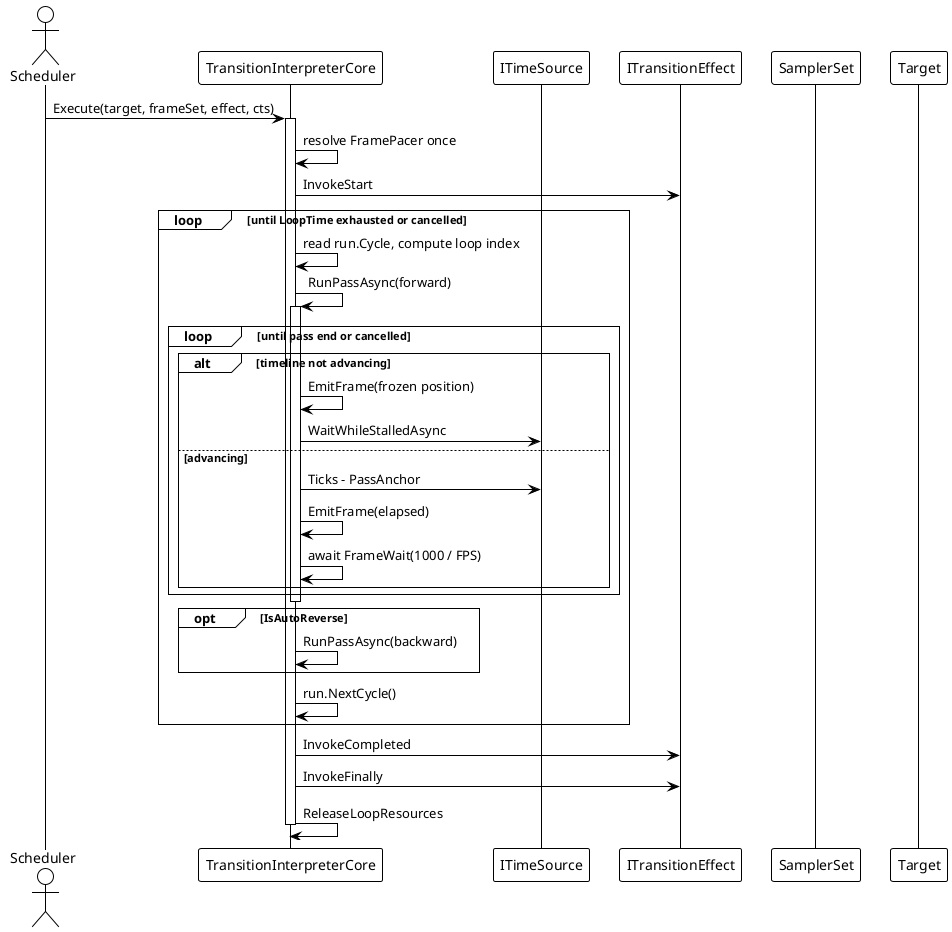

# Sampling and scheduling

The scheduler resolves the platform-specific interpreter and frame set; the interpreter runs a timeline-driven sampling loop. The timeline is the timing authority: frame waits only decide how often the loop looks, never where it is.

## Scheduler preparation

`ExecuteCapturing` raises the effect's `Awake` (which may veto through `Args.Handled`), asks the interpolator to prepare a `SamplerSet`, and hands the set to the interpreter.

```csharp
effect.InvokeAwake(target, newInterpreter.Args);
// ...
frameSet = producer.Prepare(target, state, effect, host);
```

> Source: `Src/Core/VeloxDev.Core/TransitionSystem/Runtime/TransitionScheduler.cs` lines 138, 159.

Awake is awaited before `Prepare`, because Awake is the hook that may put the target into the state the animation is meant to start from; `Prepare` must not read the target before that.

> Source: `Src/Core/VeloxDev.Core/TransitionSystem/Runtime/TransitionScheduler.cs` lines 126-159.

## Sampling loop



`EmitFrame` converts elapsed ticks into a raw normalized time, applies the effect's easing, then raises `Update`, applies the frame set, and raises `LateUpdate`. A throwing callback invalidates the frame and ends the pass through the normal cancellation path.

```csharp
var rawT = durationMs <= 0d ? 1d : elapsedMs / durationMs;

double easedT;
if (rawT >= 1d)
{
    easedT = forward ? 1d : 0d;
}
else
{
    var easeIn = forward ? rawT : 1d - rawT;
    easedT = effect.Ease.Ease(easeIn);
}

if (Report(effect, target, Args, diagnostics, ErrorStage.Update, UpdateCallback)
    || ReportMarshaling(apply, easedT, diagnostics)
    || Report(effect, target, Args, diagnostics, ErrorStage.LateUpdate, LateUpdateCallback))
{
    throw new OperationCanceledException();
}

return rawT >= 1d;
```

> Source: `Src/Core/VeloxDev.Core/TransitionSystem/Runtime/TransitionInterpreter.cs` lines 377-403.

The FPS value is a maximum sample rate, not a frame grid: the loop yields at `1000 / FPS` milliseconds, and the timeline decides the actual position. The final frame of a pass is pinned to the exact endpoint rather than relying on `Ease(1)` being exactly 1.

> Source: `Src/Core/VeloxDev.Core/TransitionSystem/Runtime/TransitionInterpreter.cs` lines 155-170, 377-392.

## Pause and seek

When the timeline is not advancing, the loop first draws the frozen position and then parks on `WaitWhileStalledAsync`. That is what makes a seek visible while paused without resuming, and a paused animation costs no timer wake-ups.

```csharp
if (!timeline.IsAdvancing)
{
    EmitFrame(target, effect, durationMs, forward, ToMilliseconds(timeline, timeline.Ticks - run.PassAnchor), apply, diagnostics);
    await timeline.WaitWhileStalledAsync(cts.Token);
    continue;
}
```

> Source: `Src/Core/VeloxDev.Core/TransitionSystem/Runtime/TransitionInterpreter.cs` lines 317-328.

## Resource ownership

The interpreter owns the frame pacer and the reusable wait, not the token source. The scheduler resolves the source from the caller, and `Transition` hands one source to every segment, so cancelling it on the way out would end the animation after its first segment. Both resources are released when the loop ends.

```csharp
internal void ReleaseLoopResources()
{
    _pacer?.Dispose();
    _pacer = null;
    _pacerResolved = false;
    _wait?.Dispose();
    _wait = null;
}
```

> Source: `Src/Core/VeloxDev.Core/TransitionSystem/Runtime/TransitionInterpreter.cs` lines 444-451.

## Error and edge paths

- **Callback or sampler throws**: reported through `TransitionDiagnostics` at the failing stage, then the run unwinds through the `Canceled` and `Finally` callbacks; resources are still released.
- **Awake veto**: `Args.Handled` stops the animation before `Prepare`.
- **Cancellation**: checked at the top of each pass and before each frame; the loop exits through `OperationCanceledException`.
- **Completed/Finally callbacks throw**: each callback is reported, and a throwing `Finally` cannot skip `ReleaseLoopResources`.
- **Zero duration**: `rawT` is forced to 1, so the pass ends on its first frame.
- **No pacer**: the default is a reused thread-pool timer; a host pacer is resolved once, before the first await, on the thread that started the loop.

> Sources: `Src/Core/VeloxDev.Core/TransitionSystem/Runtime/TransitionInterpreter.cs` lines 165-168, 229-256, 264-280, 313-341; `TransitionScheduler.cs` lines 138-164.
