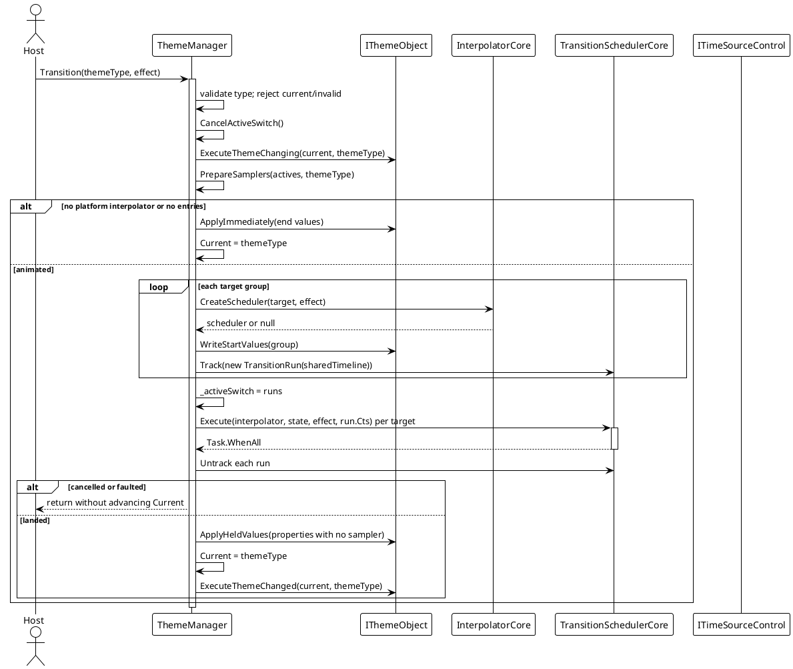

# Runtime themes

`ThemeManager` keeps a weak list of registered `IThemeObject`s. A switch prepares one entry per theme-able property per target, then either animates the entries on a shared timeline or writes their end values immediately. `Current` advances only when the switch actually lands.

## Registration

`InitializeTheme` is generated per theme object and calls `ThemeCache.RegisterType`; `Register` adds the instance to the manager's weak list, so a collected target disappears without an explicit unregister.

```csharp
public static void Register(IThemeObject target)
{
    if (!_act_cache.TryGetValue(target, out _))
    {
        Dictionary<string, Dictionary<PropertyInfo, Dictionary<Type, object?>>>? cache = [];
        _act_cache.Add(target, cache);
        activeThemes.Add(new WeakReference<IThemeObject>(target));
    }
}
```

> Source: `Src/Core/VeloxDev.Core/DynamicTheme/ThemeManager.cs` lines 75-83.

## Animated switch



`RunSwitch` resolves every target's scheduler before starting any of them. A target that cannot animate falls back to an immediate switch for the whole change, rather than leaving half the targets moving and half snapped.

```csharp
if (interpolator is null || groups.Count == 0)
{
    return ApplyImmediately(groups, themeType);
}

var planned = new List<(TransitionSchedulerCore Scheduler, TargetEntries Group)>(groups.Count);
foreach (var group in groups)
{
    TransitionSchedulerCore? scheduler;
    try
    {
        scheduler = interpolator.CreateScheduler(group.Target, effect);
    }
    catch (Exception ex)
    {
        Debug.WriteLine($"[ThemeManager] Error resolving the platform scheduler: {ex.Message}");
        scheduler = null;
    }

    if (scheduler is null)
    {
        return ApplyImmediately(groups, themeType);
    }
    planned.Add((scheduler, group));
}
```

> Source: `Src/Core/VeloxDev.Core/DynamicTheme/ThemeManager.cs` lines 202-234.

All targets of one switch share one `ITimeSourceControl`. That is what makes `Pause` / `Resume` / `SetRate` on any one target move the whole switch; `Seek` re-anchors only the given target's runs, and `Exit` cancels only that target's runs.

> Source: `Src/Core/VeloxDev.Core/DynamicTheme/ThemeManager.cs` lines 236-264.

## Jump

`Jump` is the no-animation path. It still runs the changing hooks, writes every end value directly, and advances `Current`; it needs neither `SetPlatformInterpolator` nor a platform effect.

```csharp
ApplyImmediately(PrepareSamplers(actives, themeType), themeType);

foreach (var themeObject in actives)
{
    themeObject?.ExecuteThemeChanged(current, themeType);
}
```

> Source: `Src/Core/VeloxDev.Core/DynamicTheme/ThemeManager.cs` lines 172-187.

## Start value

`StartModel` decides where the animated start value comes from:

- `Reflect`: read the property's current value.
- `Cache`: read the cached value for `Current`, first from the active (per-instance) cache, then from the static cache.

> Sources: `Src/Core/VeloxDev.Core/DynamicTheme/ThemeManager.cs` lines 490-522; `Src/Core/VeloxDev.Core/DynamicTheme/ThemeCache.cs` lines 71-141.

## Per-property API

`IThemeObject` also exposes direct writes and restores, which the generated members use:

```csharp
public void SetThemeValue<T>(string propertyName, object? newValue) where T : ITheme;
public void RestoreThemeValue<T>(string propertyName) where T : ITheme;
```

> Source: `Src/Core/VeloxDev.Core/Interfaces/DynamicTheme/IThemeObject.cs` lines 21-28.

## Error and edge paths

- **Current or invalid type**: `Transition` and `Jump` log and return without touching the targets.
- **Scheduler creation fails**: the whole switch falls back to `ApplyImmediately`.
- **A switch is superseded**: `CancelActiveSwitch` cancels the previous runs, wakes paused timelines, and the old caller returns without advancing `Current`.
- **Execution fault**: logged; the switch is treated as stopped and `Current` does not advance.
- **No sampler for a property**: `Prepare` silently skips it; the end value is written by `ApplyHeldValues` after the switch lands.
- **Null end value**: a theme that leaves a property alone is skipped, not sampled towards null.
- **Missing start/target value**: the property is skipped during preparation.

> Sources: `Src/Core/VeloxDev.Core/DynamicTheme/ThemeManager.cs` lines 112-149, 294-300, 365-411, 439-589; `Src/Core/VeloxDev.Core/DynamicTheme/ThemeCache.cs` lines 101-116.
