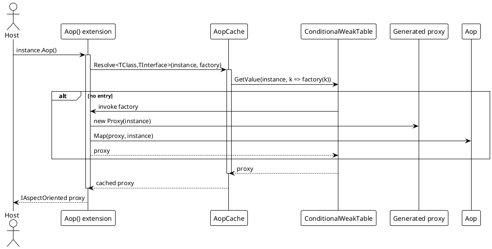
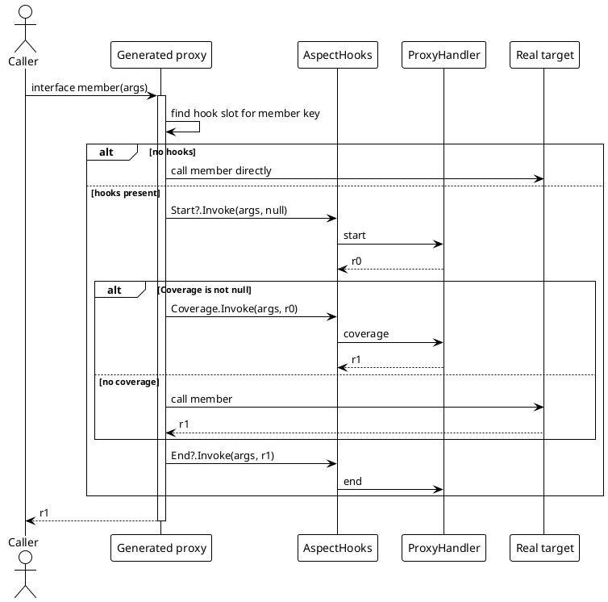

# Aspect-oriented programming

The generator emits, for an `[AspectOriented]` type, a matching interface, a proxy that implements it, and an `Aop()` extension that returns the cached proxy. A call through that interface runs the proxy's member, which applies the installed before / replace / after stages around the real target.

## Proxy acquisition



`AopCache` uses one `ConditionalWeakTable` per closed `(TClass, TInterface)` pair, so the cache is per instance and does not keep a collected target alive. The generated factory also records the proxy-to-target mapping used by `Aop.GetTarget`.

```csharp
public static TInterface Resolve<
    TClass,
    [DynamicallyAccessedMembers(DynamicallyAccessedMemberTypes.PublicParameterlessConstructor)] TInterface>(
    TClass instance,
    Func<TClass, TInterface> factory)
    where TInterface : class, IAspectOriented
    where TClass : class
{
    return Entry<TClass, TInterface>.Instances
        .GetValue(instance, k => factory(k));
}
```

> Source: `Src/Core/VeloxDev.Core/AspectOriented/AopCache.cs` lines 41-51.

> Sources: `Src/Generators/VeloxDev.Core.Generator/Writers/AopWriter.cs` lines 82-93; `Src/Core/VeloxDev.Core/AspectOriented/Aop.cs` lines 15-27.

## Member invocation



The generated proxy writes the stage order as straight-line code: `Start` receives `null` as its previous value, `Coverage` replaces the member, and `End` sees the result and its return value is discarded.

```csharp
var r0 = h.Start?.Invoke(args, null);
object? r1;
if (h.Coverage is null)
{
    // call the real member
}
else
{
    r1 = h.Coverage.Invoke(args, r0);
}
h.End?.Invoke(args, r1);
```

> Source: `Src/Generators/VeloxDev.Core.Generator/AopSurface.cs` lines 278-290.

> Source: `Src/Generators/VeloxDev.Core.Generator/AopSurface.cs` lines 251-261, 313-326.

## Installation

`ProxyEx.SetProxy` installs all three stages for one member. The key is `get_Name`, `set_Name`, or the method's own name; installing twice replaces the whole set, and passing null clears it.

```csharp
string memberKey = memberType switch
{
    ProxyMembers.Getter => "get_" + memberName,
    ProxyMembers.Setter => "set_" + memberName,
    _ => memberName,
};

hookTarget.SetHooks(memberKey, new AspectHooks(start, coverage, end));
```

> Source: `Src/Core/VeloxDev.Core/AspectOriented/ProxyEx.cs` lines 67-74.

## Error and edge paths

- **Installed on the real object**: `SetProxy` throws `InvalidOperationException`. The proxy never passes through hooks installed on the target, so this is refused instead of silently doing nothing.
- **Unknown member key**: the generated `SetHooks` throws `ArgumentOutOfRangeException`; a name that matches no member is a mistake, not a no-op.
- **No hooks for a member**: the proxy calls the target directly, without allocating the stage values.
- **Hooks set whole**: there is no way to keep an existing stage and swap another; passing a null hook set clears the member's aspects.
- **Reflection-free**: the proxy is ordinary generated code; no `MethodInfo.Invoke` is used on the per-call path.
- **Boxing**: `ProxyHandler` takes and returns `object?`, which is the contract that keeps the generated code free of reflection or runtime code generation.

> Sources: `Src/Core/VeloxDev.Core/AspectOriented/ProxyEx.cs` lines 50-75; `Src/Core/VeloxDev.Core/AspectOriented/AspectHooks.cs` lines 17-76; `Src/Core/VeloxDev.Core/AspectOriented/AspectOrientedAttribute.cs` lines 6-11.
