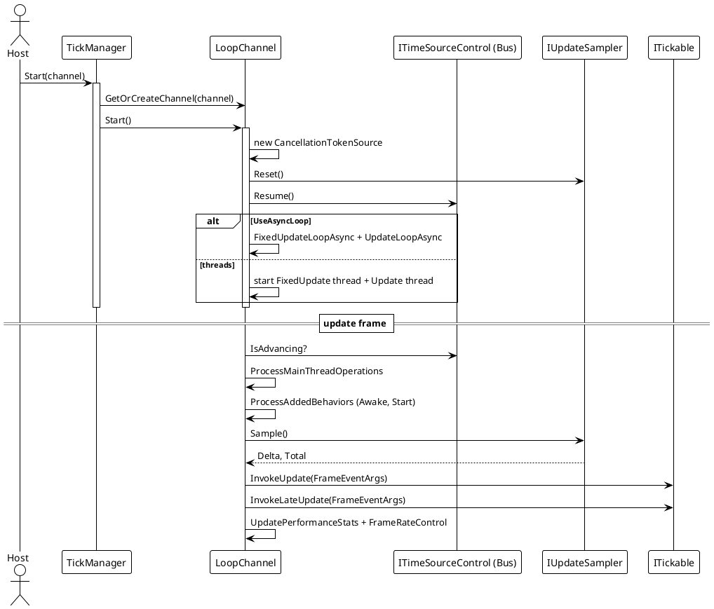

# Tick loop

`[Tickable]` makes the generator emit an `ITickable` implementation that registers the object on a named channel. `TickManager` runs two loops per channel — an update loop and a fixed-update loop — and dispatches the lifecycle hooks to every active behaviour.

## Registration

```csharp
public void InitializeTickable()
{
    TickManager.RegisterBehaviour(this, "default");
}

public void InvokeAwake() => Awake();
public void InvokeStart() => Start();
public void InvokeUpdate(FrameEventArgs e) => Update(e);
public void InvokeLateUpdate(FrameEventArgs e) => LateUpdate(e);
public void InvokeFixedUpdate(FrameEventArgs e) => FixedUpdate(e);
```

> Source: `Src/Generators/VeloxDev.Core.Generator/Writers/TickWriter.cs` lines 86-121 (the channel is the `[Tickable]` channel; the placeholder above shows the emitted shape).

`RegisterBehaviour` is a queue write, not a direct call. The update loop drains the queue at the start of a frame, then runs `Awake` once and `Start` once before the object becomes active.

```csharp
public void RegisterBehaviour(ITickable behavior)
{
    if (behavior != null) _addQueue.Enqueue(behavior);
}
```

> Source: `Src/Core/VeloxDev.Core/TimeLine/TickManager.cs` lines 432-435.

```csharp
SafeExecute(behavior.InvokeAwake, "Awake");
SafeExecute(behavior.InvokeStart, "Start");
```

> Source: `Src/Core/VeloxDev.Core/TimeLine/TickManager.cs` lines 798-799.

## Normal flow



```csharp
var sample = _updateSampler.Sample();
if (sample.Delta == TimeSpan.Zero)
{
    Sleep(TimeSpan.FromMilliseconds(MIN_SLEEP_MS), token);
    continue;
}

var frameArgs = CreateFrameEventArgs(sample.Delta, sample.Total);

ExecuteBehaviorsUpdateSync(frameArgs, token);
ExecuteBehaviorsLateUpdateSync(frameArgs, token);

_frameEventArgsPool.Return(frameArgs);
```

> Source: `Src/Core/VeloxDev.Core/TimeLine/TickManager.cs` lines 532-544.

## Fixed update

The fixed loop uses a separate sampler. `Advance` returns how many fixed steps are currently owed, including steps missed during a stall, so the loop catches up instead of dropping the backlog. Each step receives its own `TotalTime` computed from its step index.

```csharp
var count = _fixedSampler.Advance(out var sample);
if (count > 0)
{
    var stepTicks = _fixedSampler.Step.Ticks;
    var firstStep = sample.Step - count + 1;

    for (var i = 0; i < count; i++)
    {
        var fixedFrameArgs = CreateFrameEventArgs(
            sample.Delta,
            TimeSpan.FromTicks((firstStep + i) * stepTicks));
        ExecuteBehaviorsFixedUpdateSync(fixedFrameArgs, token);
        _frameEventArgsPool.Return(fixedFrameArgs);
    }
}
```

> Source: `Src/Core/VeloxDev.Core/TimeLine/TickManager.cs` lines 478-496.

`SetFixedUpdateInterval` is queued rather than written directly, so the step change lands on the fixed loop's own thread, which owns the sampler.

> Source: `Src/Core/VeloxDev.Core/TimeLine/TickManager.cs` lines 459-465.

## Pause, resume and rate

The bus is the single source of truth for the paused state. Both loops park on `WaitWhileStalledAsync` when the bus is not advancing, so a paused channel costs no timer wake-ups; `Pause`/`Resume` act on the bus.

> Sources: `Src/Core/VeloxDev.Core/TimeLine/TickManager.cs` lines 386-404, 470-474.

## Error and edge paths

- **Behaviour throws**: `ExecuteBehaviors*` catches, reports through `ReportBehaviorError`, and continues with the next behaviour. One failing object does not stop the channel.
- **`Handled`**: a non-null `FrameEventArgs.Handled` stops the remaining behaviours for that frame; the loop still advances.
- **Start while running**: `Start` returns immediately if the channel is already running.
- **Stop during pause**: `StopAsync` resumes the bus before cancelling, so the next lifecycle does not start parked.
- **Restart**: `RestartAsync` stops, waits for loop shutdown, waits for the queues to drain, then starts again; on timeout it force-cleans up.
- **Async override**: `UseAsyncLoop` replaces threads with async loops for WASM; it cannot be changed while the channel is running.
- **Main-thread operations**: `ExecuteOnMainThread` actions are drained in bounded batches (64 per frame) before the sample.

> Sources: `Src/Core/VeloxDev.Core/TimeLine/TickManager.cs` lines 276-278, 331-376, 406-430, 690-768; `Src/Core/VeloxDev.Core/TimeLine/TickableAttribute.cs` lines 6-18; `Src/Core/VeloxDev.Core/Interfaces/Tickable/ITickable.cs` lines 6-28.
