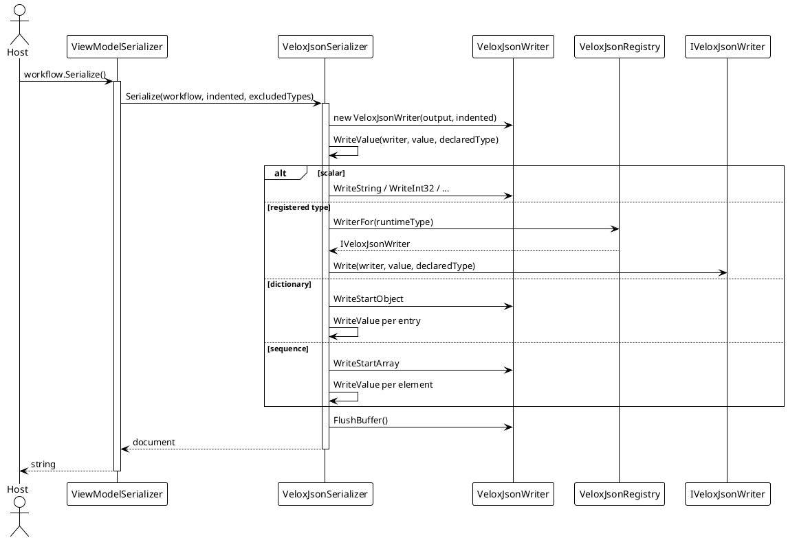

# Write path

`ViewModelSerializer.Serialize` forwards to `VeloxJsonSerializer.Serialize`, which creates one writer and asks `WriteValue` to spell the graph. Scalars are written directly; everything else is dispatched by the registry.

## Normal flow



The dispatch order matters: a registered type wins over the container branch, so a type that implements `IEnumerable` can still be written as an object if the generator registered it that way.

```csharp
if (TryWriteScalar(writer, value)) return;

var type = value.GetType();
if (VeloxJsonRegistry.WriterFor(type) is { } registered)
{
    registered.Write(writer, value, declaredType);
    return;
}

if (value is System.Collections.IDictionary map)
{
    // ...
    return;
}

if (value is System.Collections.IEnumerable sequence && value is not string)
{
    // ...
    return;
}

throw MissingWriter(type);
```

> Source: `Src/Core/VeloxDev.Core/Serialization/VeloxJsonSerializer.cs` lines 146-185.

The writer is the only object that touches the text. `WriteValue` never builds an intermediate tree.

```csharp
using var text = new StringWriter();
WriteTo(text, value, indented, excludedTypes);
return text.ToString();
```

> Source: `Src/Core/VeloxDev.Core/Serialization/VeloxJsonSerializer.cs` lines 56-63.

## Scalars

Every BCL scalar has one spelling: integers and enums as numbers, `Guid`/`DateTime`/`TimeSpan` as invariant strings, `byte[]` as base64. Enum values are written as their underlying integer, which is the shape existing archives hold.

```csharp
case Enum enumeration:
    writer.WriteInt64(Convert.ToInt64(enumeration, System.Globalization.CultureInfo.InvariantCulture));
    return true;
```

> Source: `Src/Core/VeloxDev.Core/Serialization/VeloxJsonSerializer.cs` lines 240-243.

## Exclusion

`SerializationOptions.WithExcludedPropertyTypes` stores the declared types to drop; `WriteTo` copies them into a thread-static set for the duration of the document. `IsExcluded` is consulted by generated writers, so the rule is ambient rather than threaded through every call.

```csharp
var previous = _excludedTypes;
_excludedTypes = excludedTypes is { Count: > 0 } ? [.. excludedTypes] : null;

try
{
    var writer = new VeloxJsonWriter(output, indented);
    WriteValue(writer, value, null);
    writer.FlushBuffer();
}
finally
{
    _excludedTypes = previous;
}
```

> Source: `Src/Core/VeloxDev.Core/Serialization/VeloxJsonSerializer.cs` lines 82-96.

## Registry

Registration comes from generated `[ModuleInitializer]` methods, so the table is complete before any caller can reach it. A type with no entry cannot be written; that is the closed world.

```csharp
public static IVeloxJsonWriter? WriterFor(Type type)
{
    var snapshot = _snapshot;
    return snapshot.Writers.TryGetValue(type, out var writer) ? writer : null;
}
```

> Source: `Src/Core/VeloxDev.Core/Serialization/VeloxJsonRegistry.cs` lines 268-282.

Lookups take no lock: the registry publishes an immutable snapshot by `volatile` field replacement, and readers see either the old whole table or the new whole table.

> Source: `Src/Core/VeloxDev.Core/Serialization/VeloxJsonRegistry.cs` lines 100-105.

## Error paths

- **Null root**: `Serialize` throws `ArgumentNullException`.
- **Null argument**: `WriteTo` throws `ArgumentNullException` for the output or the value.
- **No writer**: a runtime type outside the generated closure throws `InvalidOperationException` naming the type and the two ways to fix it.
- **Writer throws**: `WriteTo` does not catch it; serialization fails at the caller.
- **Excluded type**: a member declared with an excluded type is omitted, but a concrete declaration is not dropped.
- **Stream output**: a UTF-8 `StreamWriter` without BOM is created and left open; the whole document is not buffered first.

> Sources: `Src/Core/VeloxDev.Core/Serialization/VeloxJsonSerializer.cs` lines 56-123, 671-675; `Src/Core/VeloxDev.Core/Serialization/ViewModelSerializer.cs` lines 28-50, 59-66.
