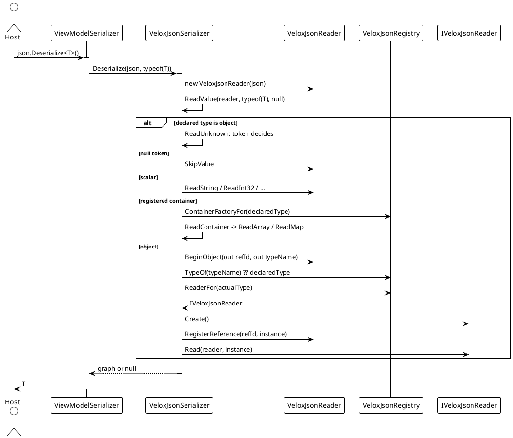

# Read path

`Deserialize` opens a reader and asks `ReadValue` to build the graph. The declared type decides how to read; when the document carries a `$type`, the registry decides which generated reader creates and fills the object.

## Normal flow



`ReadObjectValue` registers the new instance before reading its members, so a `$ref` later in the document can resolve to it. The reader is handed the existing instance when the member already holds one, which lets a collapsed geometry object write itself back into its node.

```csharp
var instance = existing is not null && actualType.IsInstanceOfType(existing)
    ? existing
    : registered.Create();

reader.RegisterReference(referenceId, instance);

registered.Read(reader, instance);
return instance;
```

> Source: `Src/Core/VeloxDev.Core/Serialization/VeloxJsonSerializer.cs` lines 472-480.

The registry resolves the type name and then the reader; a `null` reader is only tolerated when the declared type is `object`, where the document's shape is read as a plain map or list.

```csharp
var registered = VeloxJsonRegistry.ReaderFor(actualType);
if (registered is null && declaredType != typeof(object)) throw MissingReader(actualType, typeName);

if (registered is null)
{
    return ReadByShape(reader, referenceId);
}
```

> Source: `Src/Core/VeloxDev.Core/Serialization/VeloxJsonSerializer.cs` lines 462-470.

## Collections

A collection member is filled in place by its generated reader. `ReadArray` clears the target first, because the document describes what the member *has now*, not what to append; the instance identity and its subscriptions stay alive.

```csharp
if (!target.IsFixedSize) target.Clear();

reader.BeginArray();
while (reader.NextElement())
{
    target.Add(ReadValue(reader, elementType, null));
}
reader.FinishArray();
```

> Source: `Src/Core/VeloxDev.Core/Serialization/VeloxJsonSerializer.cs` lines 518-525.

A map follows the same rule. An interface-keyed map uses the key object's reference id as the member name, which is the shape existing archives carry.

> Source: `Src/Core/VeloxDev.Core/Serialization/VeloxJsonSerializer.cs` lines 540-566, 625-665.

## Streaming

The `TextReader` and `Stream` overloads read only as far as the parser needs. The format only refers back to objects it already wrote, so one forward pass suffices and peak memory is the reader's buffer plus the graph.

> Source: `Src/Core/VeloxDev.Core/Serialization/VeloxJsonSerializer.cs` lines 280-334.

## Error paths

- **Null JSON, reader or type**: the overload throws `ArgumentNullException`.
- **Unknown writer type**: `ReadValue` throws when the document names a type with no reader and the declared type is not `object`.
- **Top-level array**: `ReadValue` throws `InvalidOperationException` for an array whose declared type is not an array; array text is read as a tree through `VeloxJsonValue.Parse` instead.
- **Malformed JSON**: the reader throws; `ViewModelSerializer.TryDeserialize` catches and returns `false` with a default value.
- **Null result**: `ViewModelSerializer.Deserialize` throws `InvalidOperationException` when the document is the JSON literal.
- **Callback throws**: generated readers call `[OnDeserializing]` / `[OnDeserialized]` directly; a callback exception surfaces to the caller.
- **Registration order**: a consumer assembly's writer/reader does not replace the declaring assembly's entry; module-initializer order therefore cannot change which one wins.

> Sources: `Src/Core/VeloxDev.Core/Serialization/VeloxJsonSerializer.cs` lines 257-334, 387-415, 452-470; `Src/Core/VeloxDev.Core/Serialization/ViewModelSerializer.cs` lines 68-91, 122-168; `VeloxJsonRegistry.cs` lines 188-226.
