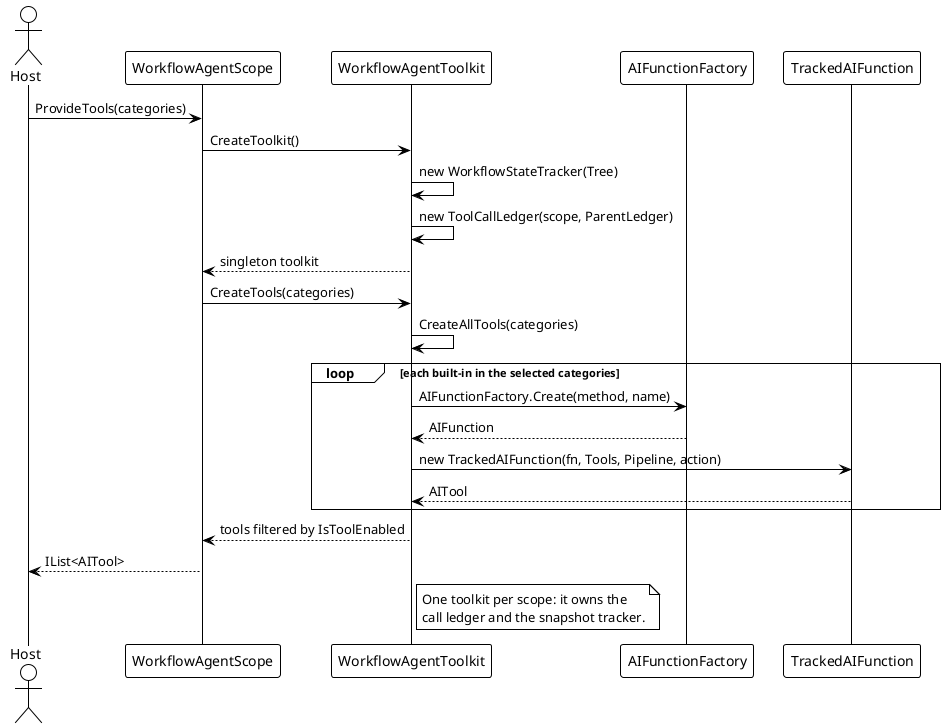
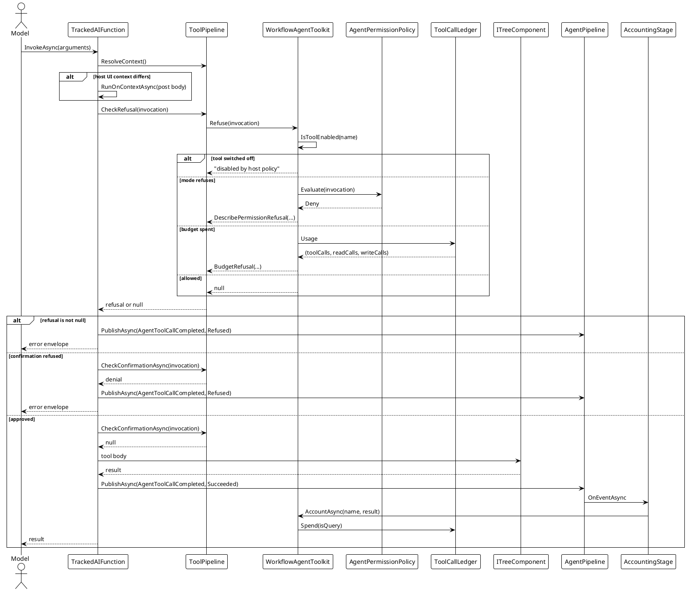
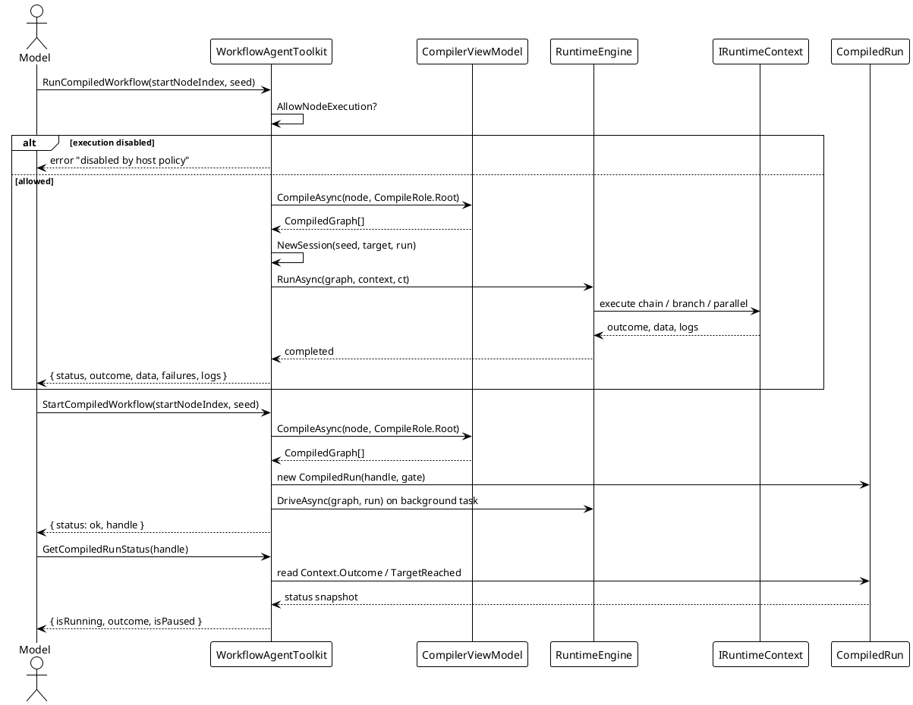

# Workflow Agent Tools

This page follows the call chain that turns one `ITreeComponent` into a tool surface the model can call, and then follows a single call from the model through the permission and budget gates into the tree.

The two collaborators are `WorkflowAgentScope`, which owns configuration, and `WorkflowAgentToolkit`, which owns the tool list, the state tracker and the call ledger.

## Tool provisioning

`ProvideTools` is a thin convenience over one toolkit instance. The toolkit is created once per scope, because it owns mutable state the budgets are enforced against.

Source: `Src/Core/VeloxDev.Core.Extension/Agent/Workflow/WorkflowAgentScope.cs:1555-1594`

```csharp
public WorkflowAgentToolkit CreateToolkit() => _toolkit ??= new WorkflowAgentToolkit(this, ParentLedger);

public IList<AITool> ProvideTools() => CreateToolkit().CreateTools();

public IList<AITool> ProvideTools(WorkflowToolCategory categories) => CreateToolkit().CreateTools(categories);
```

Each built-in method is wrapped in `TrackedAIFunction` at registration time, so the gate and the reporting are fixed on the same line that declares the tool's action category.

Source: `Src/Core/VeloxDev.Core.Extension/Agent/Workflow/Functions/WorkflowAgentToolkit.cs:88-99`

```csharp
internal IList<AITool> CreateAllTools(WorkflowToolCategory categories = WorkflowToolCategory.All)
{
    AITool T(Delegate method, string name, AgentActionCategory action)
        => new TrackedAIFunction(AIFunctionFactory.Create(method, name), Tools, _scope.Pipeline, action);

    var tools = new List<AITool>();

    void Add(WorkflowToolCategory category, params AITool[] items)
    {
        if ((categories & category) == category)
            tools.AddRange(items);
    }
```



`CreateTools` is the single place the host's per-tool switches are applied. `CreateAllTools` stays unfiltered so a host UI can list a switched-off tool and switch it back on.

Source: `Src/Core/VeloxDev.Core.Extension/Agent/Workflow/Functions/WorkflowAgentToolkit.cs:78-81`

```csharp
public IList<AITool> CreateTools(WorkflowToolCategory categories = WorkflowToolCategory.All)
    => [.. CreateAllTools(categories).Where(t =>
        string.Equals(t.Name, ResetBudgetToolName, StringComparison.OrdinalIgnoreCase)
        || _scope.IsToolEnabled(t.Name))];
```

## A call through the gates

The wrapper marshals the whole call onto the host's synchronization context, then asks the shared `ToolPipeline` for two pre-flight decisions: the budget/mode refusal and the human confirmation. Only an approved call reaches the tool body.

Source: `Src/Core/VeloxDev.Core.Extension/Agent/TrackedAIFunction.cs:71-114`

```csharp
var invocation = new ToolInvocation(Name, _category, _source, arguments);

if (_tools.CheckRefusal(invocation) is { } refusal)
{
    await ReportAsync(refusal, AgentToolOutcome.Refused, TimeSpan.Zero, cancellationToken);
    return Error(refusal);
}

if (await _tools.CheckConfirmationAsync(invocation, cancellationToken) is { } denial)
{
    await ReportAsync(denial, AgentToolOutcome.Refused, TimeSpan.Zero, cancellationToken);
    return Error(denial);
}
```

`CheckInvocation` evaluates the mode first and the budgets second, deliberately: a call the mode refuses must not be reported as a budget problem.

Source: `Src/Core/VeloxDev.Core.Extension/Agent/Workflow/Functions/WorkflowAgentToolkit.cs:371-411`

```csharp
if (_scope.PermissionPolicy.Evaluate(invocation) == PermissionDecision.Deny)
    return _scope.DescribePermissionRefusal(invocation);

if (_scope.PermissionPolicy.Mode != AgentPermissionMode.Bypass)
{
    var (spent, readCalls, writeCalls) = _ledger.Usage;
    if (_scope.MaxToolCalls.HasValue && spent >= _scope.MaxToolCalls.Value)
        return BudgetRefusal($"Tool call limit ({_scope.MaxToolCalls.Value}) reached.");
    // ... per-kind caps ...
}

if (_scope.MaxTokens.HasValue && _scope.TotalTokens >= _scope.MaxTokens.Value)
    return BudgetRefusal($"Token budget ({_scope.MaxTokens.Value}) reached.");
```



Accounting is a pipeline stage, not part of the wrapper, so it sees the same `AgentToolCallCompleted` every observer sees. It spends only on `Succeeded`; a refused or failed call never ran its body, so counting it would charge the model for something it did not get.

Source: `Src/Core/VeloxDev.Core.Extension/Agent/Workflow/Functions/WorkflowAgentToolkit.cs:333-345`

```csharp
if (agentEvent is AgentToolCallCompleted { Outcome: AgentToolOutcome.Succeeded } completed)
    await owner.AccountAsync(completed.ToolName, completed.Result).ConfigureAwait(false);

await next(agentEvent).ConfigureAwait(false);
```

## Graph edit and compiled execution

The mutation tools do not bundle multi-step gestures. `ConnectSlots` dispatches the tree's two connection commands and waits for both completions, then verifies the link actually landed in `LinksMap`; a silent framework rejection becomes a structured `rejected` envelope.

Source: `Src/Core/VeloxDev.Core.Extension/Agent/Workflow/Functions/WorkflowAgentToolkit.cs:934-946`, `4099-4102`

```csharp
await SendReceiveAsync(senderSlot!, receiverSlot!, cancellationToken);

bool connected = VerifyConnection(senderSlot!, receiverSlot!);
if (!connected)
{
    var rejected = (VeloxJsonObject)VeloxJsonValue.Parse(ConnectionRejected(senderSlot!, receiverSlot!,
        $"[{senderNodeIndex}][{senderSlotIndex}]", $"[{receiverNodeIndex}][{receiverSlotIndex}]"));
    // ...
    return rejected.ToJson();
}
```

```csharp
private async Task SendReceiveAsync(ISlotComponent sender, ISlotComponent receiver, CancellationToken ct)
    => await Task.WhenAll(
        Tree.SendConnectionCommand.ExecuteAndWaitAsync(sender, ct),
        Tree.ReceiveConnectionCommand.ExecuteAndWaitAsync(receiver, ct)).ConfigureAwait(false);
```

Execution has two entry shapes. The synchronous `RunCompiledWorkflow` compiles the root and drives the engine inline; `StartCompiledWorkflow` compiles the same way but returns a handle immediately and drives the run in the background, so pause, resume and stop can reach it later.

Source: `Src/Core/VeloxDev.Core.Extension/Agent/Workflow/Functions/WorkflowAgentToolkit.cs:2577-2596`, `2401-2447`

```csharp
var compiler = new CompilerViewModel();
var graphs = await compiler.CompileAsync(node, role);
if (graphs.Count == 0) return Error(...);
_lastCompiledGraph = graphs[0];

var run = new CompiledRun(NextHandle(), new ManualExecutionGate());
var context = NewSession(seed, role == CompileRole.Terminal ? node : null, run);
await new RuntimeEngine().RunAsync(graphs[0], context, timeoutCts?.Token ?? ct);
```

```csharp
var graphs = await new CompilerViewModel().CompileAsync(node, CompileRole.Root);
if (graphs.Count == 0) return Error("Compile produced no graphs from this start node.");
_lastCompiledGraph = graphs[0];

var run = new CompiledRun(NextHandle(), new ManualExecutionGate());
run.Context = NewSession(seed, target: null, run);
lock (_runsGate) _runs[run.Handle] = run;
run.Task = DriveAsync(graphs[0], run, place);
```



`GetNodeResult` uses `CompileRole.Terminal` and reports an error when a router on the ancestor cone selects a sibling branch: the target was not driven, so no result is fabricated.

Source: `Src/Core/VeloxDev.Core.Extension/Agent/Workflow/Functions/WorkflowAgentToolkit.cs:2612-2618`

```csharp
if (role == CompileRole.Terminal && !context.TargetReached)
{
    return Error(
        $"Target node '{node.GetType().Name}' (id {GetComponentId(node)}) was NOT reached in this run: " +
        "the router selected a branch that does not lead to it, so its condition was not satisfied. " +
        "No result was produced.");
}
```

## Related

- [Agent Safety and Budgets](../18_agent-safety-budgets/index.md) — the policy and ledger the gates read.
- [Agent Context and Skills](../19_agent-context-skills/index.md) — the prompt text that describes these tools.
- [MCP Integration](../20_mcp-integration/index.md) — external tools joining the same per-turn set.
- [Sub-Agents](../21_sub-agents/index.md) — dispatch tools that inherit this toolkit.
- [Agent Dashboard and Transcript](../22_agent-dashboard-transcript/index.md) — observing what the tools did.
