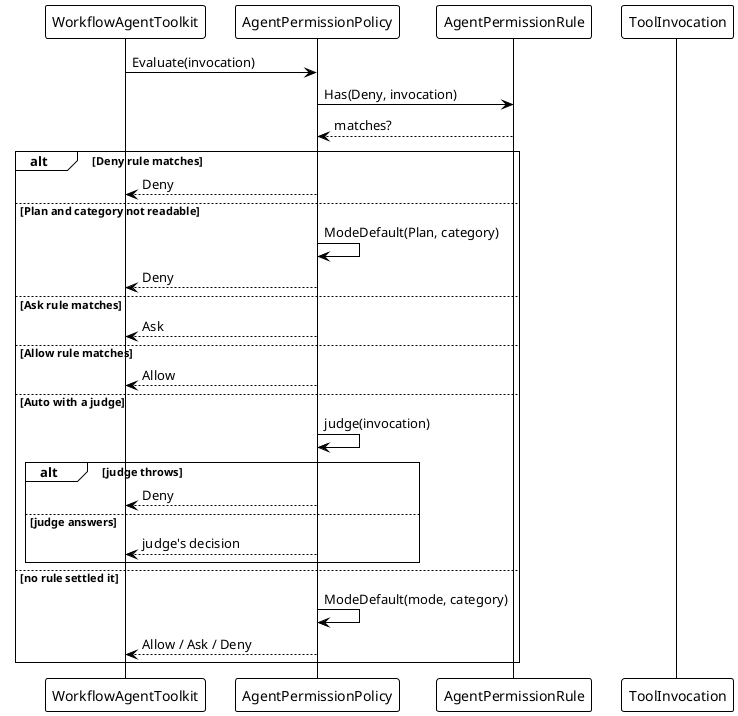
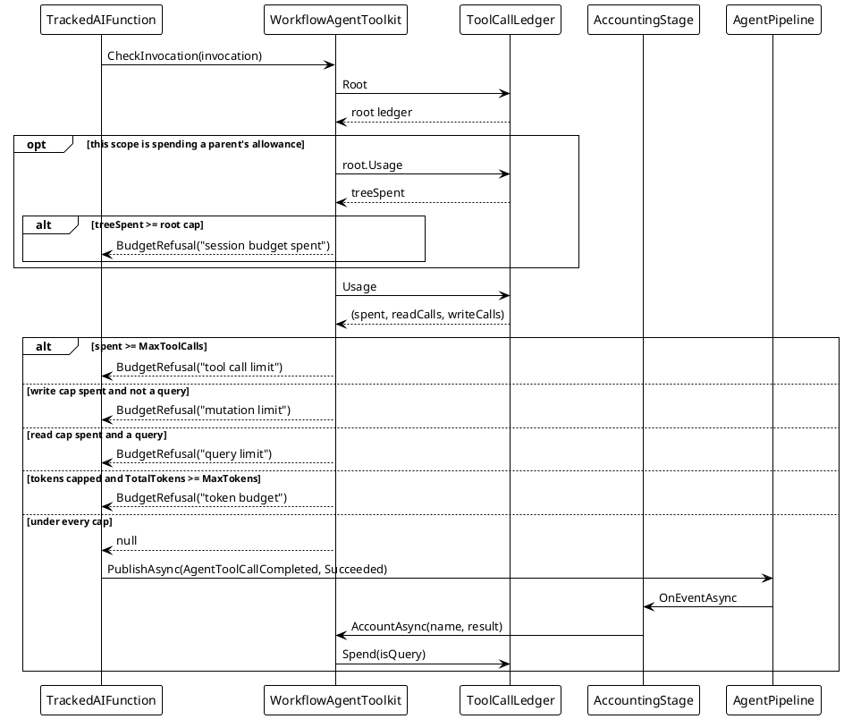

# Agent Safety and Budgets

This page follows two independent gates that every agent tool call passes through: the permission policy, which decides whether the action is allowed at all, and the call ledger, which decides whether the session still has allowance to spend.

Both live behind the same `ToolPipeline` hook set, so a workflow built-in, a skill tool, an MCP tool and a sub-agent tool are judged by the same code.

## Policy evaluation

`AgentPermissionPolicy` is immutable. Every `With*` call on the scope replaces the policy reference atomically, so one evaluation sees one consistent rule set without a lock.

Source: `Src/Core/VeloxDev.Core.Extension/Agent/Safety/AgentPermissionPolicy.cs:100-124`

```csharp
public PermissionDecision Evaluate(ToolInvocation invocation)
{
    if (invocation is null) throw new ArgumentNullException(nameof(invocation));

    if (Has(PermissionDecision.Deny, invocation)) return PermissionDecision.Deny;
    if (Mode == AgentPermissionMode.Plan && ModeDefault(Mode, invocation.Category) == PermissionDecision.Deny)
        return PermissionDecision.Deny;
    if (Has(PermissionDecision.Ask, invocation)) return PermissionDecision.Ask;
    if (Has(PermissionDecision.Allow, invocation)) return PermissionDecision.Allow;

    if (Mode == AgentPermissionMode.Auto && Judge is { } judge)
    {
        try { return judge(invocation); }
        catch (Exception) { return PermissionDecision.Deny; }
    }

    return ModeDefault(Mode, invocation.Category);
}
```

The order is the contract, strongest first: a `Deny` rule, then Plan's unconditional refusals, then `Ask`, then `Allow`, then the mode's default cell. A judge is consulted only in `Auto`, and a judge that throws answers `Deny` rather than failing open.

Source: `Src/Core/VeloxDev.Core.Extension/Agent/Safety/AgentPermissionPolicy.cs:130-145`

```csharp
public static PermissionDecision ModeDefault(AgentPermissionMode mode, AgentActionCategory category)
{
    var read = category is AgentActionCategory.Read or AgentActionCategory.Interact;

    return mode switch
    {
        AgentPermissionMode.Plan => read ? PermissionDecision.Allow : PermissionDecision.Deny,
        AgentPermissionMode.Manual => read ? PermissionDecision.Allow : PermissionDecision.Ask,
        AgentPermissionMode.AutoEdit => category is AgentActionCategory.Read or AgentActionCategory.Interact
            or AgentActionCategory.Edit ? PermissionDecision.Allow : PermissionDecision.Ask,
        AgentPermissionMode.Auto => category == AgentActionCategory.Curate
            ? PermissionDecision.Ask
            : PermissionDecision.Allow,
        _ => PermissionDecision.Allow,
    };
}
```

Rules match on one axis, chosen by prefix: `category:Edit`, `source:mcp:*`, or a tool-name glob. The wildcard matcher is written out rather than compiled into a regex because it runs on every call, on model-supplied names.

Source: `Src/Core/VeloxDev.Core.Extension/Agent/Safety/AgentPermissionRule.cs:47-59`

```csharp
public bool Matches(ToolInvocation invocation)
{
    if (Pattern.StartsWith(CategoryPrefix, StringComparison.OrdinalIgnoreCase))
        return CategoryMatches(invocation.Category, Pattern.Substring(CategoryPrefix.Length));

    if (Pattern.StartsWith(SourcePrefix, StringComparison.OrdinalIgnoreCase))
        return Wildcard(invocation.Source ?? string.Empty, Pattern.Substring(SourcePrefix.Length));

    return Wildcard(invocation.Name, Pattern);
}
```



When the result is `Deny`, the toolkit turns it into a message that names the blocking rule or mode and tells the model what the user can switch to. The model is told not to retry or find an equivalent tool.

Source: `Src/Core/VeloxDev.Core.Extension/Agent/Workflow/WorkflowAgentScope.cs:906-929`

```csharp
internal string DescribePermissionRefusal(ToolInvocation invocation)
{
    var mode = _permission.Mode;
    var rule = _permission.Rules.FirstOrDefault(
        r => r.Decision == PermissionDecision.Deny && r.Matches(invocation));
    // ... returns a language-specific message naming the rule or the mode ...
}
```

## Budget enforcement

Counters live in `ToolCallLedger`. A sub-agent's ledger chains to its parent's, so `Spend` walks the chain and the root's total is the whole tree's spend. That is what bounds an arbitrarily deep spawn tree.

Source: `Src/Core/VeloxDev.Core.Extension/Agent/Workflow/Functions/ToolCallLedger.cs:57-88`

```csharp
public void Spend(bool isQuery)
{
    Interlocked.Increment(ref _total);
    if (isQuery) Interlocked.Increment(ref _read);
    else Interlocked.Increment(ref _write);

    Outer?.Spend(isQuery);
}

public void ResetChain()
{
    Interlocked.Exchange(ref _total, 0);
    Interlocked.Exchange(ref _read, 0);
    Interlocked.Exchange(ref _write, 0);
    Outer?.ResetChain();
}
```

The pre-flight check reads the ledger live rather than snapshotting the caps, so a host may call `WithMaxToolCalls` after the toolkit exists and the next call is judged against the new number.

Source: `Src/Core/VeloxDev.Core.Extension/Agent/Workflow/Functions/WorkflowAgentToolkit.cs:381-411`

```csharp
if (_scope.PermissionPolicy.Mode != AgentPermissionMode.Bypass)
{
    var root = _ledger.Root;
    if (!ReferenceEquals(root, _ledger) && root.Owner.MaxToolCalls is { } ceiling)
    {
        var (treeSpent, _, _) = root.Usage;
        if (treeSpent >= ceiling)
            return BudgetRefusal($"The session's tool-call budget ({ceiling}) is spent.");
    }

    var (spent, readCalls, writeCalls) = _ledger.Usage;
    if (_scope.MaxToolCalls.HasValue && spent >= _scope.MaxToolCalls.Value)
        return BudgetRefusal($"Tool call limit ({_scope.MaxToolCalls.Value}) reached.");
    // ...
}

if (_scope.MaxTokens.HasValue && _scope.TotalTokens >= _scope.MaxTokens.Value)
    return BudgetRefusal($"Token budget ({_scope.MaxTokens.Value}) reached.");
```



`Bypass` is the one mode with no call-count enforcement and no spend. The token cap still applies, because it is a spend limit rather than a call count.

Source: `Src/Core/VeloxDev.Core.Extension/Agent/Workflow/Functions/WorkflowAgentToolkit.cs:469-483`

```csharp
if (IsBudgetTool(toolName))
{
    await _scope.RaiseToolCalledAsync(toolName, result, _ledger.Usage.ToolCalls).ConfigureAwait(false);
    return;
}

if (_scope.PermissionPolicy.Mode != AgentPermissionMode.Bypass)
    _ledger.Spend(IsQueryTool(toolName));
```

The `ResetToolCallLimit` tool is itself exempt from the budget. Counting the reset after the reset had zeroed the counters would immediately refuse the session again.

## Switching modes mid-session

The gate reads `_permission` per call, so `SetPermissionMode` takes effect on the very next tool call; the prompt catches up on the next turn. There is no agent tool that widens the mode. The only two transitions the agent may request are into `Plan` and back out to the mode it left, and both go through the confirmation handler.

Source: `Src/Core/VeloxDev.Core.Extension/Agent/Workflow/WorkflowAgentScope.cs:838-857`

```csharp
public WorkflowAgentScope WithPermissionMode(AgentPermissionMode mode)
{
    if (_permission.Mode == mode) return this;

    _permission = _permission.WithMode(mode);
    Interlocked.Increment(ref _permissionRevision);
    BumpVersion();
    return this;
}

public bool SetPermissionMode(AgentPermissionMode mode)
{
    if (_permission.Mode == mode) return false;
    WithPermissionMode(mode);
    return true;
}
```

## Related

- [Workflow Agent Tools](../17_workflow-agent-tools/index.md) — the toolkit whose calls these gates judge.
- [Agent Context and Skills](../19_agent-context-skills/index.md) — the prompt that describes the active mode.
- [MCP Integration](../20_mcp-integration/index.md) — the same policy also sees MCP management calls.
- [Sub-Agents](../21_sub-agents/index.md) — child grants are a share of the parent's ledger.
