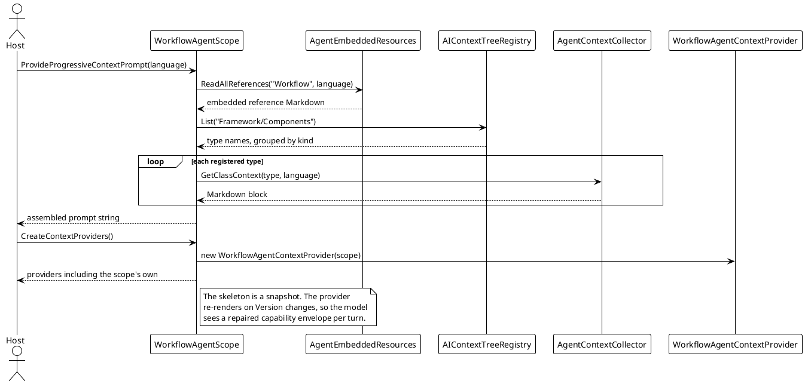
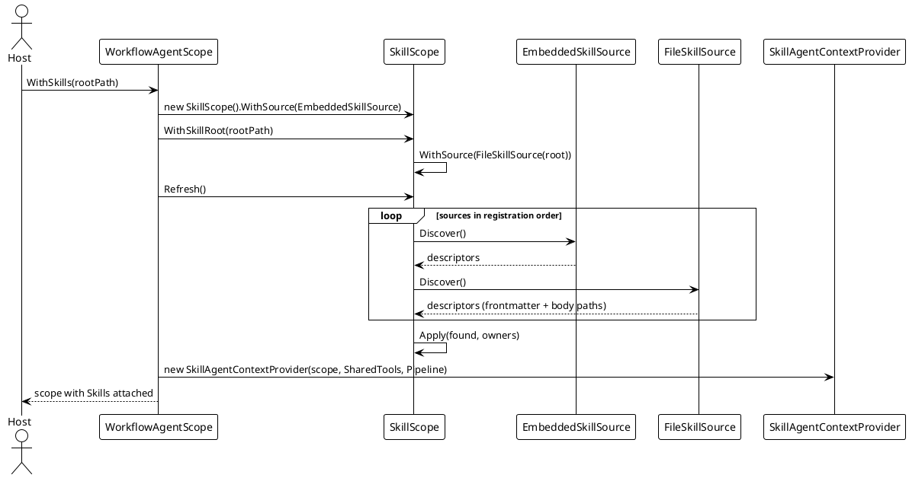
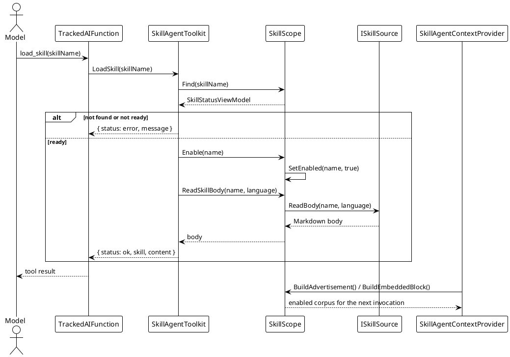

# Agent Context and Skills

This page follows two related chains. The first builds the prompt text a host freezes into the agent's instructions. The second attaches a skill corpus, discovers it and exposes it to the model as four tools.

The context and the skills are separate subsystems; both are composed into the same `WorkflowAgentScope` and both contribute through `AIContextProvider`s.

## Progressive context

`ProvideProgressiveContextPrompt` is the low-token form: a fixed behavioral preamble, the framework's own references, then one-line summaries of registered component types. Full type tables are deliberately not preloaded; the model is told to call `GetComponentContext` when a type's shape matters.

Source: `Src/Core/VeloxDev.Core.Extension/Agent/Workflow/WorkflowAgentScope.cs:1309-1433`

```csharp
public string ProvideProgressiveContextPrompt(AgentLanguages language)
{
    var result = new StringBuilder();

    result.AppendLine("# Workflow Agent Context (Progressive)");
    result.AppendLine();
    // ... behavioral constraints, failure protocol ...
    result.AppendLine(AgentEmbeddedResources.ReadAllReferences(SystemName, language).TrimEnd());
    // ... registered type summaries ...
    AppendPreloadedComponentSummaries(result);
    AppendCustomToolsSection(result);
    result.AppendLine(BuildInteractionSafetyPrompt(language));
    AppendEmbeddedSkills(result, language);
    CaptureSkeletonReceipt(language);
    return result.ToString();
}
```

The per-type renderers are static and language-aware. `ProvideFrameworkContext` walks the agent-context tree's `Framework/` directories, so a framework type that gains `[AgentContext]` appears without a hand-kept list.

Source: `Src/Core/VeloxDev.Core.Extension/Agent/Workflow/WorkflowAgentScope.cs:1472-1499`

```csharp
public string ProvideFrameworkContext(AgentLanguages language = AgentLanguages.English)
{
    var result = new StringBuilder();
    var root = AIContextTreeRegistry.FrameworkRoot;

    foreach (var name in TreeTypeNames($"{root}/Enums"))
        if (AgentTypeResolver.ResolveType(name) is { } t)
            result.AppendLine(AgentContextCollector.GetEnumContext(t, language));
    // ... interfaces and components ...
    return result.ToString();
}
```



The scope exposes `Version`, a monotonic counter advanced by every configuration setter. The context provider caches on it, so a change made after the agent was built still reaches the model on the next invocation without rebuilding the agent.

Source: `Src/Core/VeloxDev.Core.Extension/Agent/Workflow/WorkflowAgentScope.cs:1605`, `1985-2002`

```csharp
public long Version => Interlocked.Read(ref _version);

public IReadOnlyList<AIContextProvider> CreateContextProviders()
{
    var providers = new List<AIContextProvider>();
    if (_compactionProvider is not null) providers.Add(_compactionProvider);
    providers.Add(CreateContextProvider());
    if (_skillProvider is not null) providers.Add(_skillProvider);
    if (_mcpProvider is not null) providers.Add(_mcpProvider);
    if (_subAgentProvider is not null) providers.Add(_subAgentProvider);
    // ... todo, agent-mode, host factories ...
    return providers;
}
```

## Skill discovery

`WithSkills(string)` creates a `SkillScope`, adds the library's embedded corpus as one source, adds the file root as another, and refreshes. `Refresh` asks every source for descriptors; the first source to declare a name owns it, but per-language variants from the same source are all kept.

Source: `Src/Core/VeloxDev.Core.Extension/Agent/Workflow/WorkflowAgentScope.cs:1655-1665`

```csharp
public WorkflowAgentScope WithSkills(string rootPath)
{
    var skills = Skills ??= new SkillScope().WithSource(new EmbeddedSkillSource(SystemName));
    skills.WithSynchronizationContext(UIContext);
    skills.WithPromptLanguage(_defaultLanguage);
    skills.WithSkillRoot(rootPath);
    skills.Refresh();
    return AttachSkillProvider();
}
```

Source: `Src/Core/VeloxDev.Core.Extension/Agent/Skills/SkillScope.cs:160-200`

```csharp
public void Refresh()
{
    ISkillSource[] sources;
    lock (_gate) sources = [.. _sources];

    var found = new List<SkillDescriptor>();
    var owners = new Dictionary<string, ISkillSource>(StringComparer.OrdinalIgnoreCase);

    foreach (var source in sources)
    {
        IReadOnlyList<SkillDescriptor> discovered;
        try { discovered = source.Discover(); }
        catch (Exception ex)
        {
            found.Add(new SkillDescriptor { /* error descriptor */ });
            continue;
        }
        // ... first source to declare a name owns it ...
    }

    Apply(found, owners);
}
```



A source that throws does not take the others down. It contributes an error descriptor, so `ListSkills` shows the failure instead of silently losing a corpus.

## The four skill tools

`SkillAgentContextProvider` contributes `ListSkills`, `load_skill`, `UnloadSkill` and `read_skill_resource`. They are wrapped with the scope's shared `ToolPipeline`, so they are marshalled, gated and counted exactly like the workflow built-ins.

Source: `Src/Core/VeloxDev.Core.Extension/Agent/Skills/SkillAgentToolkit.cs:48-73`

```csharp
public static readonly string[] ToolNames =
    ["ListSkills", "load_skill", "UnloadSkill", "read_skill_resource"];

public IList<AITool> CreateTools(ToolPipeline tools, AgentPipeline? pipeline = null)
{
    if (tools is null) throw new ArgumentNullException(nameof(tools));
    return [.. CreateTools().Select(tool =>
        tool is AIFunction function ? (AITool)new TrackedAIFunction(function, tools, pipeline) : tool)];
}
```

`load_skill` enables the skill and returns its body; the enable flag is what makes the guidance apply on the next turn. `UnloadSkill` only flips the flag and does not rediscover anything.

Source: `Src/Core/VeloxDev.Core.Extension/Agent/Skills/SkillAgentToolkit.cs:106-129`

```csharp
private string LoadSkill(string skillName)
{
    var skill = _scope.Find(skillName);
    if (skill is null) return Error($"Skill '{skillName}' not found. Use ListSkills to see the available skills.");
    if (!skill.IsReady) return Error($"Skill '{skillName}' is not readable: {skill.Error ?? skill.StateText}");

    _scope.Enable(skill.Name);

    var body = _scope.ReadSkillBody(skill.Name, Language);
    if (string.IsNullOrWhiteSpace(body)) return Error($"Skill '{skillName}' is marked ready but produced no text.");

    return new VeloxJsonObject
    {
        ["status"] = "ok",
        ["skill"] = skill.Name,
        ["content"] = body,
    }.ToJson();
}
```



The provider reads the enabled flags each time it re-renders. Embedded skills are injected in full when enabled; file skills are advertised by name and description, and their body is read only through `load_skill`.

## Related

- [Workflow Agent Tools](../17_workflow-agent-tools/index.md) — the toolkit these tools join.
- [Agent Safety and Budgets](../18_agent-safety-budgets/index.md) — the pipeline that gates skill tools too.
- [MCP Integration](../20_mcp-integration/index.md) — a parallel self-service subsystem.
- [Sub-Agents](../21_sub-agents/index.md) — children receive a narrowed skill view.
