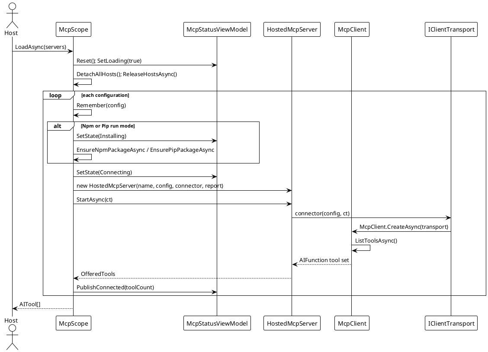
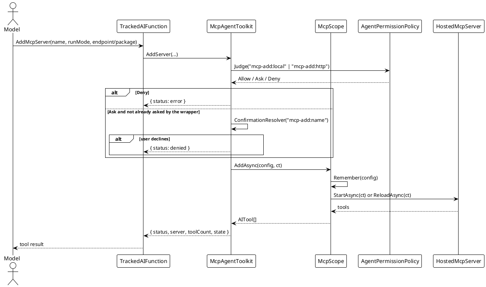

# MCP Integration

This page follows the MCP lifecycle: loading a configuration, launching or connecting a server, publishing its tools, and the agent-facing management tools that can add or reconfigure a server mid-session.

`McpScope` owns the shared data layer (registrations, status rows, loaded tool sets). `HostedMcpServer` owns one server's live client and its lazy rebuild.

## Loading servers

`LoadAsync` has replace semantics: it detaches and disposes every previous host before loading the new list, so a reload cannot strand a stdio child process.

Source: `Src/Core/VeloxDev.Core.Extension/Agent/MCP/McpScope.cs:778-806`

```csharp
public async Task<AITool[]> LoadAsync(
    IEnumerable<McpServerConfiguration> servers, CancellationToken ct = default)
{
    var mcpRoot = ResolveMcpRoot();

    await RunOnUIAsync(() => { Status.Reset(); Status.SetLoading(true); }).ConfigureAwait(false);
    await ReleaseHostsAsync(DetachAllHosts()).ConfigureAwait(false);
    lock (_loadedToolsLock)
        _loadedToolSets.Clear();
    try
    {
        var allTools = new List<AITool>();
        foreach (var config in servers)
        {
            if (config is null) continue;
            Remember(config);
            allTools.AddRange(await LoadOneAsync(config, mcpRoot, ct).ConfigureAwait(false));
        }
        return [.. allTools];
    }
    finally
    {
        await RunOnUIAsync(() => Status.SetLoading(false)).ConfigureAwait(false);
    }
}
```

`LoadOneAsync` distinguishes a first load from a reconfiguration. A local run mode installs its runtime before anything connects; a first load then constructs a `HostedMcpServer` and starts it.

Source: `Src/Core/VeloxDev.Core.Extension/Agent/MCP/McpScope.cs:897-955`

```csharp
if (existing is not null)
{
    existing.SetConfiguration(config);
    await SetServerStateAsync(status, McpServerStatus.Connecting).ConfigureAwait(false);
    return await existing.ReloadAsync(ct).ConfigureAwait(false) ? [.. existing.OfferedTools] : [];
}

if (config.RunMode is McpServerRunMode.Npm or McpServerRunMode.Pip)
{
    await SetServerStateAsync(status, McpServerStatus.Installing).ConfigureAwait(false);
    if (config.RunMode == McpServerRunMode.Npm)
        await EnsureNpmPackageAsync(config.Package, config.Version, mcpRoot, ct).ConfigureAwait(false);
    else
        await EnsurePipPackageAsync(config.Package, config.Version, mcpRoot, ct).ConfigureAwait(false);
}

await SetServerStateAsync(status, McpServerStatus.Connecting).ConfigureAwait(false);
var host = new HostedMcpServer(config.Name, config, BindConnector(mcpRoot), ReportFor(config.Name));
var tools = await host.StartAsync(ct).ConfigureAwait(false);
```



The connector builds a stdio transport for every local run mode and an HTTP transport for `Http`. All local modes resolve to one `(command, arguments)` pair and then pass through the same `StdioClientTransport`; the modes only prepend their install/launch wrapper.

Source: `Src/Core/VeloxDev.Core.Extension/Agent/MCP/McpScope.cs:1235-1263`, `1298-1312`

```csharp
var transport = config.RunMode == McpServerRunMode.Http
    ? (IClientTransport)CreateHttpTransport(config)
    : CreateStdioTransport(config, mcpRoot);

var client = await McpClient.CreateAsync(transport, options, null, connectCt).ConfigureAwait(false);
try
{
    var tools = await client.ListToolsAsync().ConfigureAwait(false);
    return new McpConnection(client, [.. tools.Cast<AIFunction>()]);
}
catch { await SafeDisposeAsync(client).ConfigureAwait(false); throw; }
```

```csharp
var (cmd, args) = config.RunMode switch
{
    McpServerRunMode.Normal => BuildNormalArgs(config),
    McpServerRunMode.Npx    => BuildNpxArgs(config),
    McpServerRunMode.Uvx    => BuildUvxArgs(config),
    McpServerRunMode.Dotnet => BuildDotnetArgs(config, mcpRoot),
    McpServerRunMode.Pip    => BuildPipArgs(config, mcpRoot),
    McpServerRunMode.Exe    => BuildExeArgs(config, mcpRoot),
    _                       => BuildNpmArgs(config, mcpRoot),
};
```

A connection failure is recorded on that server's status row and raised through `ServerError`. It contributes no tools but still advances `Version`, so a context provider keyed on the version re-renders.

Source: `Src/Core/VeloxDev.Core.Extension/Agent/MCP/McpScope.cs:942-953`

```csharp
catch (Exception ex) when (ex is not OperationCanceledException)
{
    await RunOnUIAsync(() =>
    {
        status.Error = ex.Message;
        status.State = McpServerStatus.Error;
    }).ConfigureAwait(false);
    ServerError?.Invoke(config, ex);
    Interlocked.Increment(ref _version);
    return [];
}
```

## Adding a server mid-session

`AddMcpServer` is not a raw passthrough. It first asks the permission policy about the *kind* of server (local versus remote), because a local package installs and runs software while an HTTP endpoint only sends data out. A kind-specific `Ask` rule is the one case the wrapper cannot see, so the tool asks the confirmation resolver itself in that case.

Source: `Src/Core/VeloxDev.Core.Extension/Agent/MCP/McpAgentToolkit.cs:237-299`

```csharp
var kind = mode == McpServerRunMode.Http ? HttpKind : LocalKind;
var kindArguments = new Dictionary<string, object?> { ["name"] = name, ["runMode"] = mode.ToString() };
var verdict = _scope.Judge(kind, kindArguments);
if (verdict == PermissionDecision.Deny)
{
    return Error(mode == McpServerRunMode.Http
        ? "Adding remote MCP servers is refused by host policy (a deny rule naming 'mcp-add:http')."
        : $"Adding a locally launched '{mode}' server is refused by host policy ...");
}

var alreadyAsked = _scope.IsComposed && _scope.Judge(nameof(AddServer), kindArguments) == PermissionDecision.Ask;
if (!_scope.IsComposed || (verdict == PermissionDecision.Ask && !alreadyAsked))
{
    if (!await _scope.ConfirmationResolver($"mcp-add:{name}", description))
        return /* denied envelope */;
}

var tools = await _scope.AddAsync(config, ct);
```



`SetMcpServerArguments` is narrower on purpose: it changes only the launch arguments and carries everything else over, so a slip of the pen cannot turn an npx server into something else.

## Tools and hosted-tool rebuilds

`HostedMcpServer` is where a reconfiguration becomes safe. A rebuild connects the new configuration first and only then adopts it; the old client is retired and released once in-flight calls drain.

The rebuild path is `EnsureCurrentAsync` / `Adopt`; the call-time entry is `InvokeAsync`.

Source: `Src/Core/VeloxDev.Core.Extension/Agent/MCP/HostedMcpServer.cs:218-251`

```csharp
internal async ValueTask<object?> InvokeAsync(string toolName, AIFunctionArguments arguments, CancellationToken ct)
{
    if (RebuildOwed())
    {
        var rebuilt = false;
        await _gate.WaitAsync(ct).ConfigureAwait(false);
        try { rebuilt = await EnsureCurrentAsync(ct, force: false).ConfigureAwait(false); }
        finally { _gate.Release(); }
        if (rebuilt) _report(Phase.Refreshed, Configuration, null);
    }

    var live = Volatile.Read(ref _liveForInvoke);
    if (live is null || !live.TryGetValue(toolName, out var tool))
        return Error($"Server '{_name}' no longer offers a tool named '{toolName}' ...");

    Interlocked.Increment(ref _inFlight);
    try { return await tool.InvokeAsync(arguments, ct).ConfigureAwait(false); }
    finally { if (Interlocked.Decrement(ref _inFlight) == 0) await ReleaseRetiredAsync().ConfigureAwait(false); }
}
```

The management toolkit registers reads on every scope, including a granted view handed to a sub-agent; loading and unloading exist only on a scope that owns its servers. Resources and prompts are always available, because a server that exposes only resources would otherwise be invisible.

Source: `Src/Core/VeloxDev.Core.Extension/Agent/MCP/McpAgentToolkit.cs:131-161`

```csharp
var tools = new List<AITool> { AIFunctionFactory.Create(ListServers, ListName) };

if (!_scope.IsGrantedView)
{
    tools.Add(AIFunctionFactory.Create(LoadServers, LoadName));
    tools.Add(AIFunctionFactory.Create(UnloadServer, UnloadName));
}
tools.Add(AIFunctionFactory.Create(DescribeServer, DescribeName));
tools.Add(AIFunctionFactory.Create(ListResources, ListResourcesName));
tools.Add(AIFunctionFactory.Create(ReadResource, ReadResourceName));
tools.Add(AIFunctionFactory.Create(ListPrompts, ListPromptsName));
tools.Add(AIFunctionFactory.Create(GetPrompt, GetPromptName));
```

The context provider rebuilds the toolkit per render rather than once, because the host may register configurations after the provider was constructed.

Source: `Src/Core/VeloxDev.Core.Extension/Agent/MCP/McpAgentContextProvider.cs:63-99`

```csharp
private McpAgentToolkit CreateToolkit() => new(_scope, _scope.RegisteredServers);

internal AIContext BuildContext()
{
    var version = _scope.Version;
    lock (_gate)
    {
        if (_renderedFor != version)
        {
            var toolkit = CreateToolkit();
            _instructions = BuildInstructions(toolkit);
            _tools = BuildTools(toolkit);
            _renderedFor = version;
        }
        return new AIContext { Instructions = _instructions, Tools = _tools };
    }
}
```

## Related

- [Agent Safety and Budgets](../18_agent-safety-budgets/index.md) — the policy that judges `mcp-add:*` kinds.
- [Agent Context and Skills](../19_agent-context-skills/index.md) — the parallel provider-cached subsystem.
- [Sub-Agents](../21_sub-agents/index.md) — granted MCP servers arrive as read-only views.
- [Headless CLI](../23_headless-cli/index.md) — a process that *is* an MCP server rather than a client.
