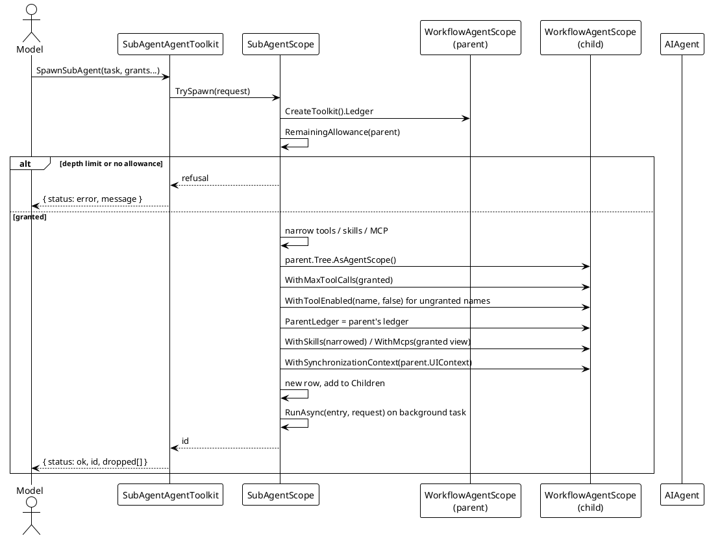
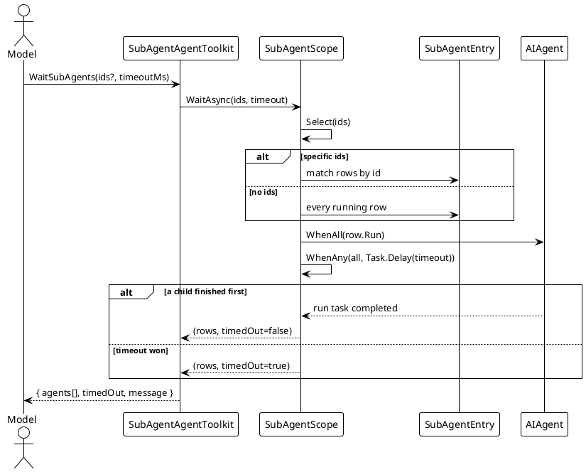

# Sub-Agents

This page follows a spawn: how the parent narrows capabilities and budget into a child scope, how the child's background run is started, and how `WaitSubAgents` collects the result without polling.

`SubAgentScope` owns the roster and the grant logic. `SubAgentAgentToolkit` is the model-facing façade over it.

## Spawning a child

`TrySpawn` is the whole grant algorithm. It computes the remaining allowance, narrows tools, skills and MCP servers, records what was dropped, builds the child scope and starts a background run.

Source: `Src/Core/VeloxDev.Core.Extension/Agent/SubAgents/SubAgentScope.cs:438-468`

```csharp
internal string? TrySpawn(SubAgentRequest request, out string? refusal)
{
    refusal = null;
    var parent = _parent ?? throw new InvalidOperationException(...);

    if (_disposed) { refusal = "This session has been disposed; no further sub-agents can be spawned."; return null; }
    if (!CanSpawn)
    {
        refusal = $"Sub-agents cannot be spawned this deep: the limit is {MaxDepth} and this agent is at depth {Depth}. ...";
        return null;
    }

    var dropped = new List<string>();
    var parentLedger = parent.CreateToolkit().Ledger;
    var remaining = RemainingAllowance(parent, parentLedger);
    var granted = Math.Min(request.MaxToolCalls ?? remaining, remaining - 1);
    if (granted < 1) { refusal = "No tool-call allowance remains ..."; return null; }
    // ...
}
```

Tools default to *inherit*: the child gets the parent's whole current surface minus anything the parent itself switched off. Naming tools is the only way to take something away. The reset-budget escape hatch is added even to an empty grant so the child can ask for a larger budget.

Source: `Src/Core/VeloxDev.Core.Extension/Agent/SubAgents/SubAgentScope.cs:478-527`

```csharp
var parentToolkit = parent.CreateToolkit();
var everyName = parentToolkit.CreateAllTools().Select(t => t.Name).ToList();
if (parent.Skills is not null) everyName.AddRange(SkillAgentToolkit.ToolNames);
everyName.AddRange(SubAgentAgentToolkit.ToolNames);
// ... MCP names from parent.Mcp.LoadedTools ...

var available = everyName.Where(parent.IsToolEnabled).ToList();
List<string> grantedTools;
if (request.AllowedTools is { } wanted)
{
    grantedTools = [.. wanted
        .Where(name => available.Contains(name, StringComparer.OrdinalIgnoreCase))
        .Select(name => Canonical(name, available))];
    foreach (var name in wanted.Where(name => !available.Contains(name, StringComparer.OrdinalIgnoreCase)))
        dropped.Add($"{name}: not available to this agent, or switched off by the host");
}
else
{
    grantedTools = [.. available];
}

if (!grantedTools.Any(n => string.Equals(n, WorkflowAgentToolkit.ResetBudgetToolName, StringComparison.OrdinalIgnoreCase)))
    grantedTools.Add(WorkflowAgentToolkit.ResetBudgetToolName);
```

The child's ledger is chained to the parent's *before* the child toolkit exists, so its very first call is already charged to the tree rather than to a private counter.

Source: `Src/Core/VeloxDev.Core.Extension/Agent/SubAgents/SubAgentScope.cs:599-640`

```csharp
child.ParentLedger = parentLedger;
child.WithSynchronizationContext(parent.UIContext);

var transcript = new AgentTranscript();
child.WithTranscript(transcript);

var id = Guid.NewGuid().ToString("N");
var grand = new SubAgentScope(_agentFactory, _instructions) { Depth = childDepth, SelfId = id, Briefing = ... };
grand.InheritFrom(this);
child.WithSubAgents(grand);
```



The child's agent is built by the host-supplied factory. `ForClient` builds one over a shared `IChatClient`; `ForClientFactory` picks a client per requested model. Either way the child receives `scope.CreateContextProviders()` and the same pipeline.

Source: `Src/Core/VeloxDev.Core.Extension/Agent/SubAgents/SubAgentScope.cs:185-217`

```csharp
public static SubAgentScope ForClient(IChatClient client, string? instructions = null)
{
    if (client is null) throw new ArgumentNullException(nameof(client));
    return new SubAgentScope(scope => client
        .AsAIAgent(scope.CreateContextProviders(), instructions ?? DefaultInstructions)
        .WithPipeline(scope.Pipeline));
}
```

## The background run

The run is deliberately plain: build the agent, await one `RunAsync`, finish the row on the roster thread. State is written last, after its payload, so a panel that reads on the notification never sees a completed row with no result.

Source: `Src/Core/VeloxDev.Core.Extension/Agent/SubAgents/SubAgentScope.cs:853-878`

```csharp
private async Task RunAsync(SubAgentEntry entry, SubAgentRequest request)
{
    await OnRosterThread(() =>
    {
        entry.Row.StartedAt = DateTimeOffset.Now;
        entry.Row.State = SubAgentState.Running;
    }).ConfigureAwait(false);

    try
    {
        var agent = _agentFactory(entry.Scope, request.Model);
        var response = await agent.RunAsync(request.Task, cancellationToken: entry.Cancellation.Token).ConfigureAwait(false);
        await OnRosterThread(() => Finish(entry, response.Text, response.Usage, null, cancelled: false)).ConfigureAwait(false);
    }
    catch (OperationCanceledException)
    {
        await OnRosterThread(() => Finish(entry, null, null, null, cancelled: true)).ConfigureAwait(false);
    }
    catch (Exception ex)
    {
        await OnRosterThread(() => Finish(entry, null, null, ex, cancelled: false)).ConfigureAwait(false);
    }
}
```

## Waiting and collecting

`WaitSubAgents` is one long wait over the children's tasks, not a poll loop. `Task.WhenAny` races the combined task against a delay; a timeout returns the rows as they stand and marks which are still running.

Source: `Src/Core/VeloxDev.Core.Extension/Agent/SubAgents/SubAgentScope.cs:963-978`

```csharp
internal async Task<(IReadOnlyList<SubAgentSummary> Rows, bool TimedOut)> WaitAsync(string[]? ids, int timeoutMs)
{
    var targets = Select(ids);
    if (targets.Count > 0)
    {
        var all = Task.WhenAll(targets.Select(t => t.Run ?? Task.CompletedTask));
        var finished = await Task.WhenAny(all, Task.Delay(Math.Max(0, timeoutMs))).ConfigureAwait(false);
        // ... reference comparison decides which task won ...
    }
    // ...
}
```



`GetSubAgentResult` re-reads one row and returns the full report up to a caller-supplied cap; `WaitSubAgents` truncates previews at 4000 characters. `CancelSubAgent` cancels the child's `CancellationTokenSource`; the run's cancellation path records `Cancelled`, which is a distinct state from `Failed`.

Source: `Src/Core/VeloxDev.Core.Extension/Agent/SubAgents/SubAgentAgentToolkit.cs:146-189`

```csharp
private async Task<string> WaitSubAgents(string[]? ids = null, int? timeoutMs = null)
{
    var timeout = Math.Max(0, timeoutMs ?? 60_000);
    var (rows, timedOut) = await _scope.WaitAsync(ids, timeout).ConfigureAwait(false);

    var agents = new VeloxJsonArray();
    foreach (var row in rows)
    {
        var agent = new VeloxJsonObject
        {
            ["id"] = row.Id,
            ["name"] = row.Name,
            ["depth"] = row.Depth,
            ["state"] = row.State.ToString(),
            ["callCount"] = row.CallCount,
        };
        // ... result, error, dropped ...
        agents.Add(agent);
    }
    return new VeloxJsonObject { ["status"] = "ok", ["timedOut"] = timedOut, ["agents"] = agents }.ToJson();
}
```

## The roster and the tree

`Children` is bound to the roster thread; `Snapshot` is an immutable copy safe to read from any thread. The tree view model is a projection of the flat roster: `ParentId` is the whole of the relation.

Source: `Src/Core/VeloxDev.Core.Extension/Agent/SubAgents/SubAgentStatus.cs:35-56`

```csharp
public sealed class SubAgentSummary
{
    public string Id { get; set; } = string.Empty;
    public string Name { get; set; } = string.Empty;
    public string? ParentId { get; set; }
    public int Depth { get; set; }
    public string Task { get; set; } = string.Empty;
    public SubAgentState State { get; set; }
    // ...
}
```

## Related

- [Workflow Agent Tools](../17_workflow-agent-tools/index.md) — the surface a child inherits.
- [Agent Safety and Budgets](../18_agent-safety-budgets/index.md) — the ledger chain that bounds the tree.
- [Agent Context and Skills](../19_agent-context-skills/index.md) — the narrowed skill view a child receives.
- [MCP Integration](../20_mcp-integration/index.md) — granted servers become read-only views.
- [Agent Dashboard and Transcript](../22_agent-dashboard-transcript/index.md) — the panel that mirrors this roster.
