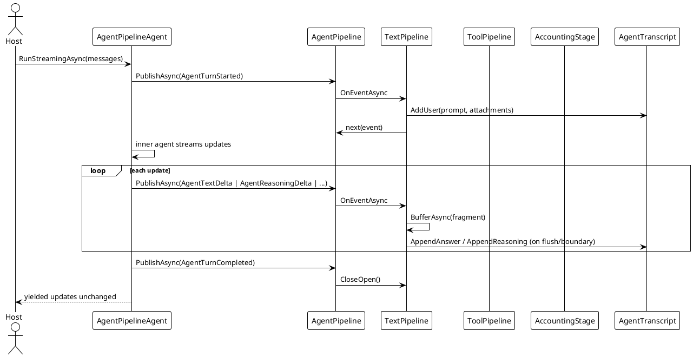
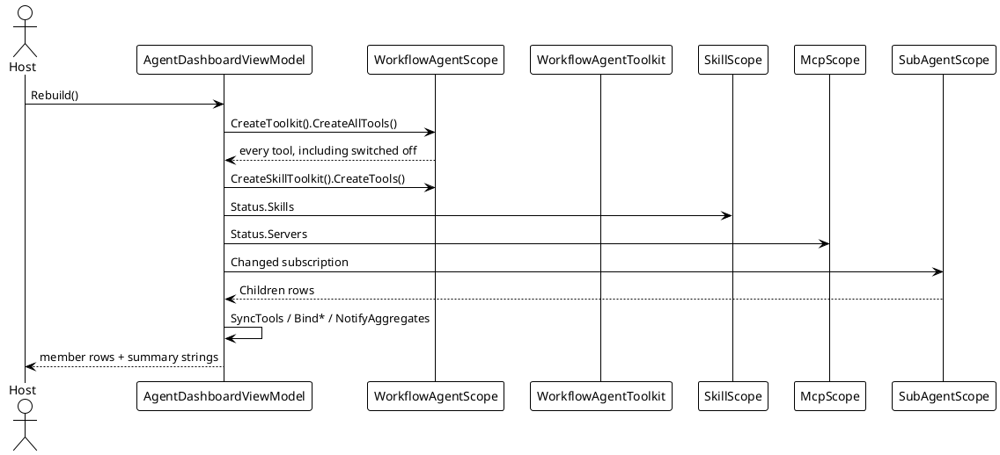
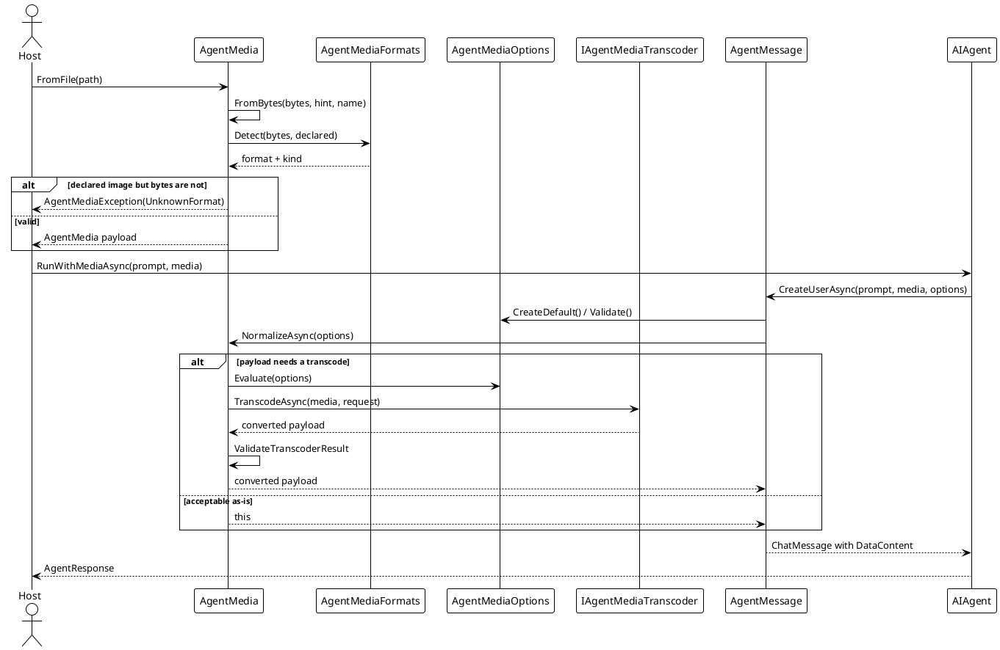

# Agent Dashboard and Transcript

This page follows the observation side of an agent run: how a run's events travel a pipeline into a transcript, how the dashboard rebuilds its member rows, and how a media payload is validated before it becomes part of the user message.

The pipeline is the library's own layer, composed onto the Microsoft Agent Framework middleware slot by `UseAgentPipeline` / `WithPipeline`.

## The event pipeline

`AgentPipelineAgent` sits in the middleware slot, publishes turn boundaries and content, and yields the inner stream untouched. It never consumes or buffers the updates it observes.

Source: `Src/Core/VeloxDev.Core.Extension/Agent/Pipelines/AgentPipelineAgent.cs:77-131`

```csharp
protected override async IAsyncEnumerable<AgentResponseUpdate> RunCoreStreamingAsync(
    IEnumerable<ChatMessage> messages,
    AgentSession? session = null,
    AgentRunOptions? options = null,
    [EnumeratorCancellation] CancellationToken cancellationToken = default)
{
    var request = messages as IReadOnlyList<ChatMessage> ?? [.. messages];
    var (prompt, attachments) = LastUserMessage(request);
    var started = Stopwatch.StartNew();
    await PublishAsync(new AgentTurnStarted(AgentRunKind.Streaming, prompt, attachments), cancellationToken).ConfigureAwait(false);

    await using var updates = base.RunCoreStreamingAsync(request, session, options, cancellationToken).GetAsyncEnumerator(cancellationToken);
    while (await updates.MoveNextAsync().ConfigureAwait(false))
    {
        await PublishContentsAsync(updates.Current.Contents, cancellationToken).ConfigureAwait(false);
        yield return updates.Current;
    }
}
```

The stages run in the order they were added. The scope composes text first, then tools, then accounting, then token usage; the text stage must see a tool-call event before the tool stage closes the open entry.

Source: `Src/Core/VeloxDev.Core.Extension/Agent/Workflow/WorkflowAgentScope.cs:1755-1758`

```csharp
pipeline.Use(new TextPipeline(() => _transcript, () => UIContext));
pipeline.Use(SharedTools);
pipeline.Use(CreateToolkit().CreateAccountingStage());
pipeline.Use(new TokenUsageStage(this));
```

A broken stage does not break the run. Each stage is isolated; a throw skips the rest of the chain and surfaces on `StageFailed`.

Source: `Src/Core/VeloxDev.Core.Extension/Agent/Pipelines/AgentPipeline.cs:84-107`

```csharp
public ValueTask PublishAsync(AgentEvent agentEvent, CancellationToken cancellationToken = default)
    => InvokeAsync(0, agentEvent ?? throw new ArgumentNullException(nameof(agentEvent)), cancellationToken);

private async ValueTask InvokeAsync(int index, AgentEvent agentEvent, CancellationToken cancellationToken)
{
    if (index >= _stages.Count) return;
    var stage = _stages[index];
    try
    {
        await stage.OnEventAsync(agentEvent, next => InvokeAsync(index + 1, next, cancellationToken), cancellationToken).ConfigureAwait(false);
    }
    catch (Exception ex)
    {
        StageFailed?.Invoke(this, new AgentStageFailedEventArgs(stage, agentEvent, ex));
    }
}
```



## Transcript assembly

Text deltas are buffered and flushed at a threshold or at a turn boundary. The role is part of the key: switching from reasoning to answer flushes the pending fragment, so a tool call never lands under half an answer.

Source: `Src/Core/VeloxDev.Core.Extension/Agent/Pipelines/TextPipeline.cs:135-171`

```csharp
private async ValueTask BufferAsync(
    SynchronizationContext? context, AgentTranscript transcript, string fragment, bool reasoning)
{
    if (string.IsNullOrEmpty(fragment)) return;

    if (_hasPending && _pendingIsReasoning != reasoning)
    {
        await DeliverAsync(context, transcript).ConfigureAwait(false);
        _deliveredSinceBoundary = false;
    }

    _pendingIsReasoning = reasoning;
    _hasPending = true;
    _pending.Append(fragment);

    if (!_deliveredSinceBoundary || _pending.Length >= FlushThreshold)
        await DeliverAsync(context, transcript).ConfigureAwait(false);
}
```

A tool call closes any open entry before adding its own. That is what makes the transcript read in order rather than nesting a tool call inside an unfinished answer.

Source: `Src/Core/VeloxDev.Core.Extension/Agent/Pipelines/AgentTranscript.cs:395-422`

```csharp
public AgentTranscriptEntry AddToolCall(string toolName, string result, AgentToolOutcome outcome)
{
    var entry = AgentTranscriptEntry.ToolCall(toolName, result, outcome);
    Close(entry);
    return entry;
}

private AgentTranscriptEntry Append(AgentTranscriptRole role, string fragment)
{
    if (Open is null || Open.Role != role || !Open.IsStreaming)
    {
        Open = role == AgentTranscriptRole.Assistant
            ? AgentTranscriptEntry.Assistant()
            : AgentTranscriptEntry.Reasoning();
        Entries.Add(Open);
    }

    Open.Append(fragment);
    return Open;
}
```

`ToMarkdown` gathers consecutive tool calls into one block, or, with chat fences on, folds each into its own panel. The transcript can round-trip through `ToJson` / `Restore`.

## Dashboard rebuild

`AgentDashboardViewModel` does not own state; it mirrors the scope's subsystems. `Rebuild` re-reads tools, skills, MCP servers and sub-agents, then recomputes the aggregate strings.

Source: `Src/Core/VeloxDev.Core.Extension/Agent/Dashboard/AgentDashboardViewModel.cs:172-203`

```csharp
public void Rebuild()
{
    RebuildSystemTools();
    RebuildSkillTools();
    BindSkills();
    BindMcp();
    RebuildSkills();
    RebuildMcpServers();
    RebuildSubAgents();
    NotifyAggregates();
}

private void RebuildSubAgents()
{
    var source = _scope.SubAgents;
    if (!ReferenceEquals(source, _boundSubAgents))
    {
        if (_boundSubAgents is not null) _boundSubAgents.Changed -= OnSubAgentsChanged;
        _boundSubAgents = source;
        if (source is not null) source.Changed += OnSubAgentsChanged;
    }

    SubAgents.Clear();
    if (source is null) return;
    foreach (var row in source.Children) SubAgents.Add(row);
}
```

It enumerates `CreateAllTools`, not `CreateTools`, so a switched-off tool still has a row and can be switched back on. The gate notes explain tools that are registered but refuse at call time (for example execution without `WithAllowNodeExecution`).



## Media validation

`AgentMedia` validates bytes before any request is made. The declared media type is a hint; the bytes win. An image that is declared as an image but whose header is not a recognised image is rejected at construction.

Source: `Src/Core/VeloxDev.Core.Extension/Agent/Media/AgentMedia.cs:96-127`

```csharp
public static AgentMedia FromBytes(ReadOnlyMemory<byte> bytes, string? mediaType = null, string? name = null)
{
    if (bytes.IsEmpty) throw new AgentMediaException(AgentMediaError.Empty, ...);

    var copy = bytes.ToArray();
    var declared = AgentMediaFormats.CanonicalMediaType(mediaType);
    var declaredKind = AgentMediaFormats.KindOfMediaType(declared);
    var descriptor = AgentMediaFormats.Detect(copy, declared);

    if (declaredKind == AgentMediaKind.Image && descriptor.Kind != AgentMediaKind.Image)
        throw new AgentMediaException(AgentMediaError.UnknownFormat, ...);

    var width = 0;
    var height = 0;
    if (descriptor.Kind == AgentMediaKind.Image)
        ImageHeaderReader.TryRead(copy, descriptor.Format, out width, out height);

    return new AgentMedia(copy, descriptor.Format, descriptor.Kind, descriptor.MediaType, name,
        declared, width > 0 ? width : null, height > 0 ? height : null);
}
```

`Normalize` and `NormalizeAsync` apply limits and, when a payload must change, call the configured `IAgentMediaTranscoder`. `Normalize` refuses when a transcode is required but only an async transcoder is configured; `NormalizeAsync` performs it.

Source: `Src/Core/VeloxDev.Core.Extension/Agent/Media/AgentMedia.cs:297-337`

```csharp
public async Task<AgentMedia> NormalizeAsync(
    AgentMediaOptions? options = null, CancellationToken cancellationToken = default)
{
    options ??= AgentMediaOptions.CreateDefault();
    options.Validate();
    ValidateDeclaredMediaType(options);

    var decision = Evaluate(options);
    if (!decision.NeedsTranscode) return this;

    var transcoder = options.Transcoder;
    if (transcoder is null) throw Reject(decision.Reason, options);

    var target = ChooseTarget(decision.Reason, options);
    var request = new AgentMediaTranscodeRequest(...);
    var converted = await transcoder.TranscodeAsync(this, request, cancellationToken).ConfigureAwait(false);
    // ...
    return converted;
}
```



Source: `Src/Core/VeloxDev.Core.Extension/Agent/Media/AgentMessage.cs:93-110`

```csharp
public static async Task<ChatMessage> CreateUserAsync(
    string? text, IEnumerable<AgentMedia>? media, AgentMediaOptions? options = null,
    CancellationToken cancellationToken = default)
{
    var validated = new List<IAgentMediaContent>();
    if (media is not null)
        foreach (var item in media)
        {
            if (item is null) continue;
            validated.Add(await item.NormalizeAsync(options, cancellationToken).ConfigureAwait(false));
        }
    return User(text, validated);
}
```

## Related

- [Workflow Agent Tools](../17_workflow-agent-tools/index.md) — the tool calls these events report.
- [Agent Safety and Budgets](../18_agent-safety-budgets/index.md) — the accounting stage the pipeline runs.
- [Sub-Agents](../21_sub-agents/index.md) — the roster the dashboard mirrors.
- [Headless CLI](../23_headless-cli/index.md) — the same execution path without a dashboard.
