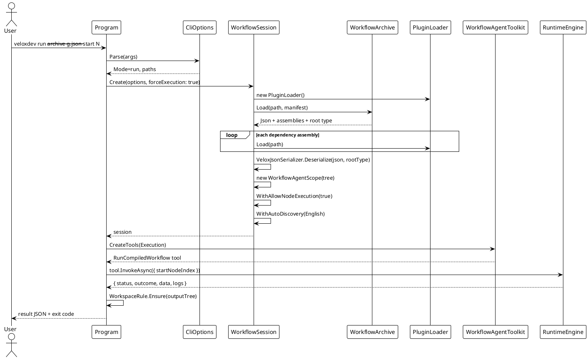
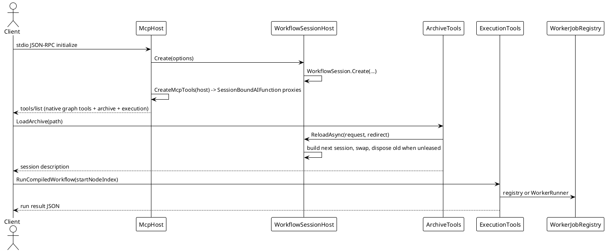

# Headless CLI

This page follows the two verbs of `VeloxDev.Cli`: `run`, a one-shot headless execution, and `mcp`, a long-lived stdio MCP server over one archive. It also follows the archive, plugin and worker paths both verbs share.

The CLI has no demo; its evidence is the test suite and the source.

## Entry and parsing

The entry point is an async top-level program. It parses once, dispatches on `Mode`, and maps usage errors to exit code 2 and runtime errors to exit code 1.

Source: `Src/Cli/VeloxDev.Cli/Program.cs:12-41`

```csharp
try
{
    var options = CliOptions.Parse(args);

    if (options.ShowHelp)
    {
        Console.Out.WriteLine(CliOptions.Usage);
        return 0;
    }

    if (options.Mode == "run")
        return await RunOnceAsync(options);

    await McpHost.RunAsync(options);
    return 0;
}
catch (CliUsageException ex) { /* usage + exit 2 */ }
catch (Exception ex) { /* one-line error + exit 1 */ }
```

`CliOptions.Parse` accepts exactly two verbs. It rejects an unknown verb before reading any option, and validates the required `--archive` (and `--start` for `run`) after the loop.

Source: `Src/Cli/VeloxDev.Cli/CliOptions.cs:95-104`, `206-213`

```csharp
public static CliOptions Parse(string[] args)
{
    if (args.Length == 0) return new CliOptions { ShowHelp = true };
    if (args[0] is "--help" or "-h" or "help") return new CliOptions { ShowHelp = true };

    var mode = args[0];
    if (mode is not ("mcp" or "run"))
        throw new CliUsageException($"Unknown command '{mode}'. Expected 'mcp' or 'run'.");
    // ... option loop ...
    if (string.IsNullOrWhiteSpace(options.Archive))
        throw new CliUsageException("--archive is required.");
    if (mode == "run" && options.StartNode is null)
        throw new CliUsageException("--start is required for 'run'.");
    return options;
}
```

## The `run` verb

`RunOnceAsync` creates a session in forced-execution mode, asks the toolkit for the execution tool, invokes it, and optionally writes the post-run tree.

Source: `Src/Cli/VeloxDev.Cli/Program.cs:47-91`

```csharp
static async Task<int> RunOnceAsync(CliOptions options)
{
    await using var session = WorkflowSession.Create(options, forceExecution: true);

    var toolName = options.NodeResult ? "GetNodeResult" : "RunCompiledWorkflow";
    var tool = session.Toolkit.CreateTools(WorkflowToolCategory.Execution)
        .OfType<AIFunction>()
        .FirstOrDefault(t => string.Equals(t.Name, toolName, StringComparison.Ordinal))
        ?? throw new InvalidOperationException($"{toolName} is not available on this toolkit.");

    var arguments = new AIFunctionArguments
    {
        [options.NodeResult ? "nodeIndex" : "startNodeIndex"] = options.StartNode!.Value,
    };
    // ... seed, timeout ...

    var result = await tool.InvokeAsync(arguments).ConfigureAwait(false);
    // ... optional --output-tree write, guarded by WorkspaceRule.Ensure ...
    Console.Out.WriteLine(text);
    return IsOk(text) && outputWritten ? 0 : 1;
}
```

Session creation is the shared path both verbs use: normalize the workspace, load the archive and manifest, load every dependency assembly, deserialize the tree, then configure the scope.

Source: `Src/Cli/VeloxDev.Cli/WorkflowSession.cs:147-179`, `203-262`

```csharp
var workspace = WorkspaceRule.Normalize(options.Workspace);
WorkspaceRule.Ensure(workspace, options.Archive, "Archive");
WorkspaceRule.Ensure(workspace, options.Manifest, "Manifest");
// ... checkpoint, log, assemblies ...

var plugins = new PluginLoader();
plugins.StrictVersions = options.StrictPluginVersions;
plugins.CopyAssemblies = !options.NoAssemblyCopy;
// ...
```

```csharp
var archive = WorkflowArchive.Load(request.Path, request.Manifest);
foreach (var assembly in archive.Assemblies)
{
    WorkspaceRule.Ensure(workspace, assembly, "Dependency assembly");
    plugins.Load(assembly);
}
// ...
tree = VeloxJsonSerializer.Deserialize(archive.Json, rootType) as ITreeComponent
    ?? throw new InvalidDataException(...);

var scope = new WorkflowAgentScope(tree);
if (execution) scope.WithAllowNodeExecution(true);
scope.WithAutoDiscovery(AgentLanguages.English);
```



The `run` verb forces execution even if the archive manifest does not allow it, because the user launched this process specifically to run. The `mcp` verb does not: there, execution is enabled only by `--allow-execution` or the manifest.

Source: `Src/Cli/VeloxDev.Cli/WorkflowSession.cs:233-236`

```csharp
var execution = executionEnabled ?? (options.AllowExecution || archive.ManifestAllowsExecution);
var inProcess = inProcessExecution ?? options.InProcessExecution;
var scope = new WorkflowAgentScope(tree);
if (execution) scope.WithAllowNodeExecution(true);
```

## The `mcp` verb

`McpHost.RunAsync` builds a `WorkflowSessionHost`, then publishes tools, resources and prompts over stdio. Logging is routed to stderr because stdout is the JSON-RPC stream.

Source: `Src/Cli/VeloxDev.Cli/McpHost.cs:14-49`

```csharp
await using var host = WorkflowSessionHost.Create(options);
await using var jobs = new WorkerJobRegistry();
var session = host.Current;

var builder = Host.CreateApplicationBuilder();
builder.Logging.ClearProviders();
builder.Logging.SetMinimumLevel(LogLevel.Warning);
builder.Logging.AddConsole(console => console.LogToStandardErrorThreshold = LogLevel.Trace);

var tools = session.CreateMcpTools(host);
var mcp = builder.Services
    .AddMcpServer(server => { server.ServerInfo = ...; server.ServerInstructions = session.BuildInstructions(); })
    .WithStdioServerTransport()
    .WithTools(tools)
    .WithTools(new ArchiveTools(host))
    .WithResources(new SessionResources(host))
    .WithPrompts(new SessionPrompts(host));

if (session.ExecutionEnabled) mcp.WithTools(new RedirectTools(host));
if (session.ExecutionEnabled && !session.InProcessExecution)
    mcp.WithTools(new ExecutionTools(host, jobs));

await builder.Build().RunAsync(cancellationToken).ConfigureAwait(false);
```

Each native graph tool is a stable proxy bound to the host, not to the startup session. That is what lets `LoadArchive` replace the session without re-registering tools: the proxy resolves the current session at call time.

Source: `Src/Cli/VeloxDev.Cli/WorkflowSession.cs:273-287`

```csharp
public IReadOnlyList<McpServerTool> CreateMcpTools(WorkflowSessionHost host)
{
    var tools = new List<McpServerTool>();
    foreach (var (function, mutating, executable) in BuildExposedFunctions())
    {
        tools.Add(McpServerTool.Create(new SessionBoundAIFunction(host, function), new McpServerToolCreateOptions
        {
            ReadOnly = !mutating && !executable,
            Destructive = mutating || executable,
            OpenWorld = executable,
        }));
    }
    return tools;
}
```



## Archive reload

`LoadArchive` is refused in two configurations, both for correctness rather than convenience: in-process execution, where run handles belong to the session being replaced; and `--single-archive`, where the process promises stable runtime IDs.

Source: `Src/Cli/VeloxDev.Cli/WorkflowSessionHost.cs:254-296`

```csharp
if (inProcess)
    throw new InvalidOperationException(
        "LoadArchive is unavailable with --in-process-execution: the run handles belong to the session being replaced. ...");

if (_options.SingleArchive)
    throw new InvalidOperationException(
        "LoadArchive is unavailable under --single-archive: this process serves one document for its lifetime ...");

// Build first. A failed load leaves the current session untouched.
var next = WorkflowSession.Create(_options, request, _plugins, _logWriter, _logFile, redirectOnError, ...);

WorkflowSession? old;
lock (_gate)
{
    old = _current;
    _current = next;
    if (_leases > 0) _retired = old;
    else old = null;
}

if (old is not null) await old.DisposeAsync().ConfigureAwait(false);
```

A lease pins a session for the duration of one tool call. If a reload lands while calls are in flight, the old session is retired and disposed when the last lease is released.

## Isolated workers

In isolated mode, execution is a child `dotnet` process. The parent serializes the current tree to a temp snapshot (including the root `$type`, so the child needs no `--root-type`), launches the CLI in `run` mode, and reads back the result and the post-run state file.

Source: `Src/Cli/VeloxDev.Cli/WorkerRunner.cs:27-55`, `57-83`

```csharp
var snapshot = Path.Combine(directory, runId + ".json");
var state = Path.Combine(directory, runId + ".state.json");

try
{
    File.WriteAllText(snapshot, session.Scope.Tree.Serialize());

    var startInfo = BuildStartInfo(snapshot, state, nodeResult, index, seed, timeoutMs);
    return await ExecuteAsync(startInfo, nodeResult, timeoutMs, session.WorkerKillGraceMs, ct).ConfigureAwait(false);
}
finally
{
    try { File.Delete(snapshot); } catch { }
}
```

`WorkerJobRegistry.Start` is the asynchronous form: it acquires a lease, registers a job, and runs it on a background task under a concurrency slot. Cancellation cancels the job's token; the worker process is killed after the configured grace period.

Source: `Src/Cli/VeloxDev.Cli/WorkerJobRegistry.cs:91-110`, `159-167`

```csharp
public string Start(WorkflowSessionHost host, bool nodeResult, int index, string? seed, int? timeoutMs)
{
    var id = Guid.NewGuid().ToString("N")[..10];
    var lease = host.Acquire();
    var job = new WorkerJob(id, nodeResult, index, lease);
    lock (_gate) { _jobs[id] = job; }
    job.Task = RunAsync(host, job, seed, timeoutMs);
    return id;
}
```

```csharp
private static async Task RunAsync(WorkflowSessionHost host, WorkerJob job, string? seed, int? timeoutMs)
{
    var slots = host.RunSlots;
    try { if (slots is not null) await slots.WaitAsync(job.Cancellation.Token).ConfigureAwait(false); }
    catch (OperationCanceledException) { job.MarkCancelled(); job.Lease.Dispose(); return; }
    // ... run the worker ...
}
```

## Workspace sandbox, redirects and the run CSV

`WorkspaceRule.Ensure` is the opt-in sandbox: when `--workspace` is set, every path the process reads or writes must resolve below it. It is checked at session creation and again at each `SaveArchive` / output write.

Source: `Src/Cli/VeloxDev.Cli/WorkspaceRule.cs:28-41`

```csharp
public static void Ensure(string? workspace, string? path, string what)
{
    if (workspace is null || string.IsNullOrWhiteSpace(path)) return;

    var full = Path.GetFullPath(path);
    var comparison = OperatingSystem.IsWindows() ? StringComparison.OrdinalIgnoreCase : StringComparison.Ordinal;

    var prefix = workspace + Path.DirectorySeparatorChar;
    if (!full.StartsWith(prefix, comparison))
        throw new InvalidOperationException($"{what} '{full}' is outside the workspace '{workspace}'. ...");
}
```

`RunLogCsv.TryWrite` is best-effort: an execution result's `logs` and `failures` become rows under `tasks/<task>/runs/<timestamp>_<tool>.csv`, and the path is attached as `csvFile`. A run never fails because its log could not be written.

Source: `Src/Cli/VeloxDev.Cli/RunLogCsv.cs:22-44`, `92-99`

```csharp
public static string? TryWrite(string taskDirectory, string tool, string json)
{
    try
    {
        using var document = JsonDocument.Parse(json);
        var root = document.RootElement;
        if (root.ValueKind != JsonValueKind.Object) return null;
        // ... hasLogs / hasFailures ...
        var runs = Path.Combine(taskDirectory, "runs");
        Directory.CreateDirectory(runs);
        var stamp = DateTimeOffset.UtcNow.ToString("yyyyMMdd-HHmmss-fff", CultureInfo.InvariantCulture);
        var path = Path.Combine(runs, $"{stamp}_{Sanitize(tool)}.csv");
        // ... write header and rows ...
        return path;
    }
    catch { return null; }
}
```

## Related

- [Workflow Agent Tools](../17_workflow-agent-tools/index.md) — the toolkit the CLI publishes.
- [Agent Safety and Budgets](../18_agent-safety-budgets/index.md) — the gates the exposed tools still pass through.
- [MCP Integration](../20_mcp-integration/index.md) — the client side of the protocol.
- [Platform Adapter Contract](../24_platform-adapter-contract/index.md) — the GUI counterpart the CLI omits.
