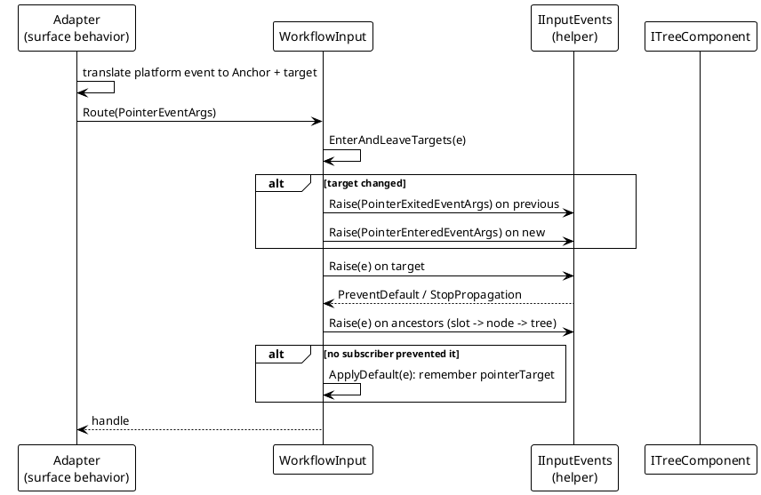
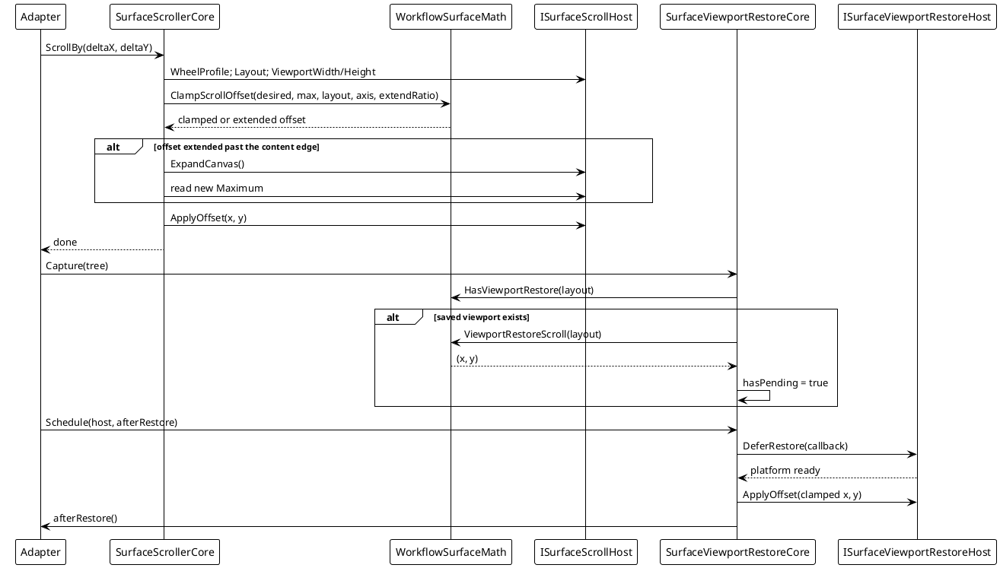
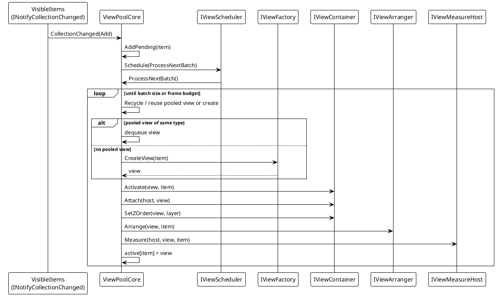

# Platform Adapter Contract

This page follows the shared surface each GUI adapter closes: the input route, the scroll and viewport-restore cores, and the view-pool pipeline. The seven adapters differ in how they observe the platform; the contract they call is here.

## The input route

`WorkflowInput` is one instance per tree. An adapter calls `Route` with a platform-translated event; Core resolves the target, sends enter/leave to both ends of a pointer change, bubbles the event from target to ancestors, and then applies its own default.

Source: `Src/Core/VeloxDev.Core/WorkflowSystem/GUI/Events/WorkflowInput.cs:267-289`

```csharp
public void Route(PointerEventArgs e)
{
    if (e is null) throw new ArgumentNullException(nameof(e));

    EnterAndLeaveTargets(e);

    if (Bubble(e)) return;

    ApplyDefault(e);
}

public void Route(KeyEventArgs e)
{
    if (e is null) throw new ArgumentNullException(nameof(e));
    Bubble(e);
}
```

Bubbling is target first, then ancestors, with the tree always last. A helper that implements `IInputEvents` receives the event on its `InputRelay`; `PreventDefault` suppresses the framework's own default, and `StopPropagation` truncates the rest of the chain.

Source: `Src/Core/VeloxDev.Core/WorkflowSystem/GUI/Events/WorkflowInput.cs:319-378`

```csharp
private bool Bubble(PointerEventArgs e)
{
    var prevented = false;

    foreach (var helper in Chain(e.Target))
    {
        if (helper is not IInputEvents events) continue;

        events.Input.Raise(e);

        if (e.Handle.PreventDefault) prevented = true;
        if (e.Handle.StopPropagation) break;
    }

    return prevented;
}

private IEnumerable<IWorkflowHelper> Chain(IWorkflowComponent? target)
{
    switch (target)
    {
        case ISlotComponent slot:
            yield return slot.GetHelper();
            if (slot.Parent is { } owner) yield return owner.GetHelper();
            break;
        case INodeComponent node: yield return node.GetHelper(); break;
        case ILinkComponent link: yield return link.GetHelper(); break;
    }
    yield return tree.GetHelper();
}
```

The only framework default for a pointer event is remembering where the pointer is. That target is what hover, delete and every adapter's keyboard route read.

Source: `Src/Core/VeloxDev.Core/WorkflowSystem/GUI/Events/WorkflowInput.cs:383-388`

```csharp
private void ApplyDefault(PointerEventArgs e)
{
    if (IsSuspended) return;
    pointerTarget = e is PointerExitedEventArgs ? null : e.Target;
}
```



## Scroll and viewport restore

`SurfaceScrollerCore` implements `IWorkflowSurfaceScroller` and `IWorkflowSurfaceNavigator`. It converts a wheel delta into a step, then clamps through `WorkflowSurfaceMath`; an overshoot past the content edge grows the canvas rather than stopping at the edge.

Source: `Src/Core/VeloxDev.Core/WorkflowSystem/GUI/Surface/SurfaceScrollerCore.cs:49-116`

```csharp
public void ScrollBy(double wheelDeltaX, double wheelDeltaY)
{
    // ... resolve step from SurfaceWheelProfile ...
    var desiredX = dx != 0d ? offsetX + dx : offsetX;
    var desiredY = dy != 0d ? offsetY + dy : offsetY;

    if (layout is null)
    {
        host.ApplyOffset(
            dx != 0d ? WorkflowSurfaceMath.ClampValue(desiredX, 0d, maxX) : null,
            dy != 0d ? WorkflowSurfaceMath.ClampValue(desiredY, 0d, maxY) : null);
        return;
    }

    var newX = dx != 0d
        ? WorkflowSurfaceMath.ClampScrollOffset(desiredX, maxX, layout, horizontal: true,
            extendRatio: WorkflowSurfaceMath.DefaultPanExtendRatio)
        : desiredX;
    // ...
    host.ApplyOffset(/* clamped offsets */);
}
```

`SurfaceViewportRestoreCore` captures a tree's saved viewport when the bound tree changes, then defers one restore through the adapter. A restore that runs before the platform has resolved its scroll container leaves the position pending for the next surface refresh.

Source: `Src/Core/VeloxDev.Core/WorkflowSystem/GUI/Surface/SurfaceViewportRestoreCore.cs:39-95`

```csharp
public void Capture(ITreeComponent? tree)
{
    if (tree is null || ReferenceEquals(tree, lastTree)) return;

    lastTree = tree;
    hasPending = false;

    if (!WorkflowSurfaceMath.HasViewportRestore(tree.Layout)) return;

    var scroll = WorkflowSurfaceMath.ViewportRestoreScroll(tree.Layout);
    pendingX = scroll.Horizontal;
    pendingY = scroll.Vertical;
    hasPending = true;
}

public void Schedule(ISurfaceViewportRestoreHost host, Action? afterRestore = null)
{
    if (!hasPending || isQueued) return;
    isQueued = true;
    host.DeferRestore(() =>
    {
        isQueued = false;
        if (!hasPending || !host.IsRestoreEnabled) return;
        hasPending = false;
        host.ApplyOffset(/* clamped pendingX/pendingY */);
        afterRestore?.Invoke();
    });
}
```



## The view-pool pipeline

`ViewPoolCore` tracks a visible-item collection. A collection change seeds a pending queue; the host scheduler runs batches under a batch-size and frame-budget policy; `Materialize` reuses a pooled view of the same runtime type or creates one through the factory, then activates, attaches, layers, arranges and measures it.

Source: `Src/Core/VeloxDev.Core/WorkflowSystem/ViewHosting/ViewPool.cs:274-317`, `319-378`

```csharp
private void ProcessNextBatch()
{
    scheduled = false;
    if (disposed) return;

    var processed = 0;
    var batchSize = Math.Max(1, host.PoolPolicy.BatchSize);
    var budgetMilliseconds = host.PoolPolicy.FrameBudgetMilliseconds;
    var started = Stopwatch.GetTimestamp();

    while (processed < batchSize && pending.Count > 0)
    {
        var item = pending.Dequeue();
        if (!pendingSet.Remove(item)) continue;
        Materialize(item);
        processed++;
        if (budgetTicks > 0L && Stopwatch.GetTimestamp() - started >= budgetTicks) break;
    }

    if (pendingSet.Count > 0) ScheduleNextBatch();
}
```

```csharp
private void Materialize(object item)
{
    // ... reject unsupported types and link-layer items ...
    if (pools.TryGetValue(itemType, out var pool) && pool.Count > 0)
    {
        view = pool.Dequeue();
        reusedViewCount++;
    }

    if (view is null)
    {
        view = host.Factory.CreateView(typedItem);
        if (view is null) { unsupportedTypes.Add(itemType); return; }
        createdViewCount++;
    }

    host.Container.Activate(view, typedItem);
    host.Container.Attach(hostElement, view);
    host.Container.SetZOrder(view, host.LayerPolicy.GetZOrder(typedItem));
    host.Arranger.Arrange(view, typedItem);
    host.MeasureHost.Measure(hostElement, view, typedItem);
    active[item] = view;
}
```



`ViewSourcePipelineCore` composes the platform layers (factory, container, arranger, scheduler, diagnostics) and creates the pool over the supplied source. An adapter's `ViewPool` attached property rebuilds this pipeline whenever the source or template selector changes, and disposes the old one.

Source: `Src/Core/VeloxDev.Core/WorkflowSystem/ViewHosting/ViewSourcePipelineCore.cs:56-88`

```csharp
public ViewSourcePipelineCore(
    THost hostElement, TFactory factory, TContainer container, TArranger arranger,
    TScheduler scheduler, TDiagnostics diagnostics, INotifyCollectionChanged source,
    IViewPoolPolicy? poolPolicy = null, IViewLayerPolicy<TItem>? layerPolicy = null,
    IViewLinkLayer<THost, TItem>? linkLayer = null, IViewMeasureHost<THost, TView, TItem>? measureHost = null)
    : base(factory, container, arranger, scheduler, diagnostics, poolPolicy, layerPolicy, linkLayer, measureHost)
{
    Pool = new ViewPool<THost, TView, TItem, TPriorityCore>(hostElement, this, source);
}
```

## Overlay measurements

`SurfaceMetrics` is the shared snapshot the adapter computes from its scroll container and decorators. `SurfaceMetricsPush` pushes it to the grid decorator, the minimap overlay and the tree's virtualization inset, so the same subtraction is not repeated per platform.

Source: `Src/Core/VeloxDev.Core/WorkflowSystem/GUI/Surface/SurfaceMetricsPush.cs:25-60`

```csharp
public static void PushGrid(
    SurfaceMetrics metrics, IWorkflowGridDecorator decorator, ITreeComponent? tree)
{
    decorator.ScrollOffsetX = metrics.ScrollOffsetX;
    decorator.ScrollOffsetY = metrics.ScrollOffsetY;
    decorator.ContentOffsetX = metrics.ContentOffsetX;
    decorator.ContentOffsetY = metrics.ContentOffsetY;
    tree?.SetVirtualizeInset(left: decorator.RulerBand, top: decorator.RulerBand);
}

public static void PushMinimap(
    SurfaceMetrics metrics, IWorkflowMinimapOverlay minimap, ITreeComponent? tree)
{
    minimap.ScrollOffsetX = metrics.ScrollOffsetX;
    minimap.WorkflowTree = tree;
    minimap.AvailableRight = metrics.Available.Right;
    minimap.AvailableTop = metrics.Available.Top;
    minimap.AvailableBottom = metrics.Available.Bottom;
    minimap.MinimapMargin = metrics.Available.Margin;
}
```

`IWorkflowMinimapOverlay` extends `IWorkflowGridDecorator`, so an overlay that draws a minimap also receives the shared offset push.

## Related

- [WPF Adapter](../25_wpf-adapter/index.md) — one platform closing this contract.
- [Avalonia Adapter](../26_avalonia-adapter/index.md) — pointer-based variant.
- [WinUI Adapter](../27_winui-adapter/index.md) — dispatcher-queue hosting.
- [MAUI Adapter](../28_maui-adapter/index.md) — gesture-recognizer variant.
- [WinForms Adapter](../29_winforms-adapter/index.md) — static attached configuration.
- [Razor Adapter](../30_razor-adapter/index.md) — component and JavaScript variant.
- [Jalium Adapter](../31_jalium-adapter/index.md) — attached-property variant.
