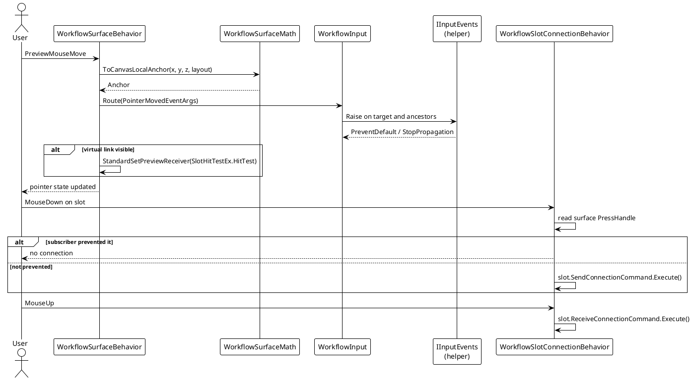
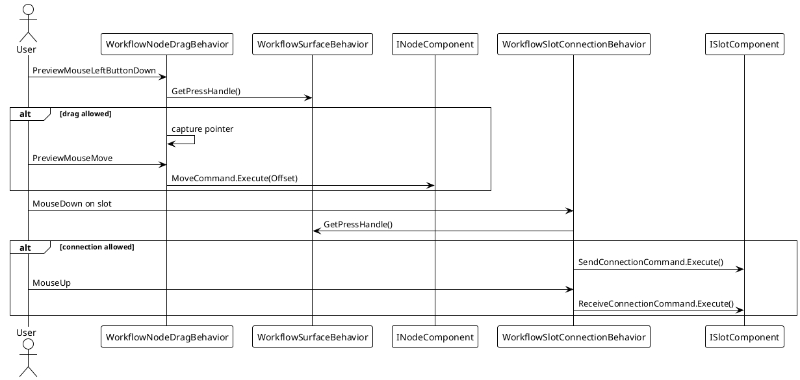

# WPF Adapter

This page follows the WPF surface from attached-property activation to the Core input route, and then the node-drag, slot-connection and view-pool chains that run beside it.

The adapter is a set of attached behaviors over `UserControl`, `Panel` and `FrameworkElement`. Named parts (`ScrollViewerName`, `CanvasName`, `GridDecoratorName`, `MinimapOverlayName`, `PointerPressSourceName`) resolve the visual pieces that Core has no platform knowledge of.

## Attaching the surface

`IsEnabled` is the master switch. Turning it on attaches event handlers, opens `Focusable` so hover focus and Delete have a target, resolves the named parts, and refreshes the surface state.

Source: `Src/Adapters/VeloxDev.WPF/WorkflowSystem/AttachedBehaviors/WorkflowSurfaceBehavior.cs:334-376`

```csharp
private static void OnIsEnabledChanged(DependencyObject d, DependencyPropertyChangedEventArgs e)
{
    if (d is not UserControl control) return;
    if (Equals(e.NewValue, true)) { Attach(control); return; }
    Detach(control);
}

private static void Attach(UserControl control)
{
    Detach(control);

    var state = new SurfaceState { Host = control, Restore = new SurfaceViewportRestoreCore() };
    control.SetValue(StateProperty, state);

    control.Focusable = true;
    control.Loaded += OnLoaded;
    control.Unloaded += OnUnloaded;
    control.DataContextChanged += OnDataContextChanged;
    control.PreviewMouseMove += OnPreviewMouseMove;
    control.PreviewMouseDown += OnLinkPointerPressed;
    control.MouseUp += OnLinkPointerReleased;
    control.MouseEnter += OnLinkPointerEntered;
    control.MouseLeave += OnLinkPointerExited;
    control.PreviewMouseWheel += OnLinkPointerWheel;
    control.KeyDown += OnLinkKeyDown;
    control.KeyUp += OnLinkKeyUp;
    control.AddHandler(UIElement.MouseUpEvent, MouseUpHandler, true);
    ResolveNamedControls(control, state);
    Refresh(control);
}
```

Wheel input is bound at the *preview* phase. The hosted `ScrollViewer` is a descendant and would mark a bubbling wheel event handled before the surface ever sees it.

## Routing input

Every pointer translation ends in `RoutePointer`, which converts the platform point to a canvas-local `Anchor`, resolves the model target, and routes one Core event.

Source: `Src/Adapters/VeloxDev.WPF/WorkflowSystem/AttachedBehaviors/WorkflowSurfaceBehavior.cs:976-988`

```csharp
private static WorkflowEventHandle RoutePointer(
    SurfaceState state, ITreeComponent tree, Point point, FrameworkElement source, DependencyObject? hit,
    Func<Anchor, IWorkflowComponent?, WorkflowEventHandle, Wf.PointerEventArgs> args)
{
    var anchor = WorkflowSurfaceMath.ToCanvasLocalAnchor(point.X, point.Y, Panel.GetZIndex(source), tree.Layout);
    var input = WorkflowInput.For(tree);
    var target = ResolveTarget(hit, tree, anchor.Horizontal, anchor.Vertical, input.HitRadius);

    var handle = new WorkflowEventHandle();
    input.Route(args(anchor, target, handle));
    FocusHoveredLink(input, state);
    return handle;
}
```

`OnPreviewMouseMove` publishes the pointer position to the tree, updates the connection preview while a virtual link is visible, and otherwise routes a normal move.

Source: `Src/Adapters/VeloxDev.WPF/WorkflowSystem/AttachedBehaviors/WorkflowSurfaceBehavior.cs:703-736`

```csharp
private static void OnPreviewMouseMove(object sender, MouseEventArgs e)
{
    // ... guard state and canvas ...
    var point = e.GetPosition(state.Canvas);
    var pointer = WorkflowSurfaceMath.ToCanvasLocalAnchor(point.X, point.Y, 0, viewModel.Layout);
    viewModel.SetPointerCommand.Execute(pointer);

    if (viewModel.VirtualLink.IsVisible)
    {
        viewModel.StandardSetPreviewReceiver(
            SlotHitTestEx.HitTest(viewModel, pointer.Horizontal, pointer.Vertical));
        return;
    }

    RoutePointer(state, viewModel, point, host, e.OriginalSource as DependencyObject,
        (anchor, target, handle) => new Wf.PointerMovedEventArgs(anchor, Modifiers(), host, target, handle));
}
```



## Node drag

The drag behavior is intentionally thin: it watches the press handle the surface already produced, captures the pointer and dispatches `MoveCommand` with the delta since the last move. A subscriber can veto the drag by setting `PreventDefault` on its own relay.

Source: `Src/Adapters/VeloxDev.WPF/WorkflowSystem/AttachedBehaviors/WorkflowNodeDragBehavior.cs:88-132`

```csharp
private static void OnMouseDown(object sender, MouseButtonEventArgs e)
{
    // ...
    if (WorkflowSurfaceBehavior.GetPressHandle(control)?.PreventDefault == true) return;

    state.IsDragging = true;
    state.LastPosition = e.GetPosition(state.CoordinateHost);
    Mouse.Capture(control);
    e.Handled = true;
}

private static void OnMouseMove(object sender, MouseEventArgs e)
{
    // ...
    var current = e.GetPosition(state.CoordinateHost);
    node.MoveCommand.Execute(new Offset(current.X - state.LastPosition.X, current.Y - state.LastPosition.Y));
    state.LastPosition = current;
    e.Handled = true;
}
```

## Slot connection

The connection behavior maps press to `SendConnectionCommand` and release to `ReceiveConnectionCommand`. It reads the surface's press handle rather than inspecting the model, because a slot is not a `DependencyObject`.

Source: `Src/Adapters/VeloxDev.WPF/WorkflowSystem/AttachedBehaviors/WorkflowSlotConnectionBehavior.cs:39-70`

```csharp
private static void OnPointerPressed(object sender, MouseButtonEventArgs e)
{
    if (sender is not Control { DataContext: ISlotComponent slot } control) return;

    if (WorkflowSurfaceBehavior.GetPressHandle(control)?.PreventDefault == true) return;

    slot.SendConnectionCommand.Execute(null);
    e.Handled = true;
}

private static void OnPointerReleased(object sender, MouseButtonEventArgs e)
{
    if (sender is not Control { DataContext: ISlotComponent slot }) return;

    slot.ReceiveConnectionCommand.Execute(null);
    e.Handled = true;
}
```



## View pool and minimap

`ViewPool.ItemsSource` / `TemplateSelector` are attached properties on a `Panel`. Changing either rebuilds the whole `ViewSourcePipeline`; the old system is disposed and removed so the panel does not root it.

Source: `Src/Adapters/VeloxDev.WPF/WorkflowSystem/AttachedBehaviors/ViewPool.cs:52-98`

```csharp
private static void OnItemsSourceChanged(DependencyObject d, DependencyPropertyChangedEventArgs e)
    => RebuildIfPanel(d);

private static void Rebuild(DependencyObject d)
{
    if (d is not Panel panel) return;
    Cleanup(panel);

    if (GetItemsSource(panel) is not { } source) return;

    var system = new ViewSourcePipeline(panel, GetTemplateSelector(panel), source);
    _systems.Add(panel, system);
    panel.Unloaded += OnPanelUnloaded;
}
```

`WorkflowMinimapOverlay` implements `IWorkflowMinimapOverlay` over `FrameworkElement`; the surface pushes `SurfaceMetrics` into it and listens for its drag-to-scroll input. `WorkflowGridDecorator` and the minimap get the same scroll/content offsets, so both draw in the same frame.

## Related

- [Platform Adapter Contract](../24_platform-adapter-contract/index.md) — the Core surface this adapter closes.
- [Avalonia Adapter](../26_avalonia-adapter/index.md) — the closest sibling implementation.
- [Workflow Item Templates](../32_workflow-item-templates/index.md) — generated WPF views to pair with these behaviors.
