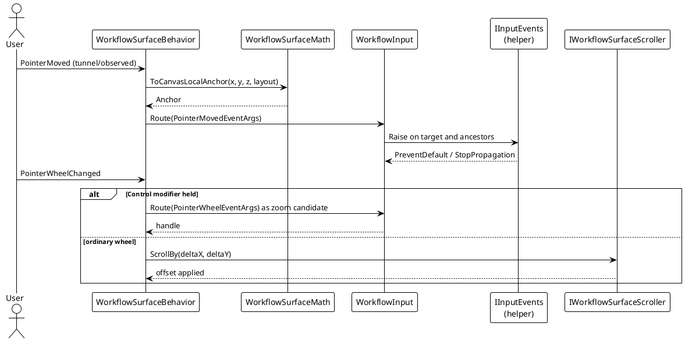
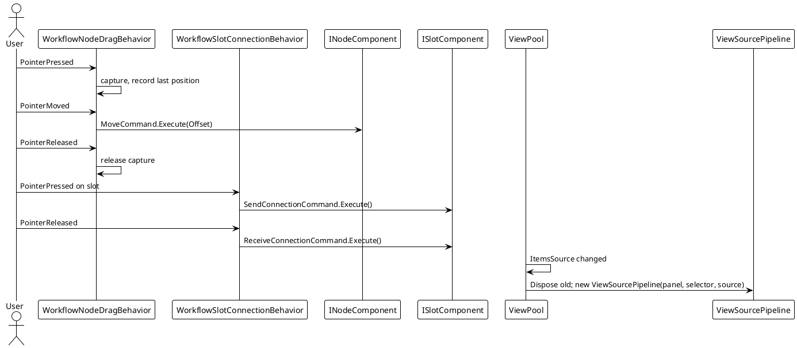

# Avalonia Adapter

This page follows the Avalonia surface from `AvaloniaProperty` activation to the Core input route, then the drag, connection and view-pool chains.

Avalonia uses the same attached-behavior decomposition as WPF but `AvaloniaObject` / `AvaloniaProperty`, and it routes input through the *tunnel* phase rather than the preview event.

## Attaching the surface

`IsEnabled` attaches handlers at the tunnel phase, opens `Focusable`, resolves named parts and refreshes. Tunnel is required because node and slot handlers sit deeper in the visual tree; the surface must produce the press handle before they read it.

Source: `Src/Adapters/VeloxDev.Avalonia/WorkflowSystem/AttachedBehaviors/WorkflowSurfaceBehavior.cs:445-473`

```csharp
private static void Attach(UserControl control)
{
    Detach(control);

    var state = new SurfaceState { Host = control, Restore = new SurfaceViewportRestoreCore() };
    control.SetValue(StateProperty, state);

    control.Focusable = true;
    control.AttachedToVisualTree += OnAttachedToVisualTree;
    control.DetachedFromVisualTree += OnDetachedFromVisualTree;
    control.DataContextChanged += OnDataContextChanged;
    control.AddHandler(InputElement.PointerPressedEvent, OnPressRoute, RoutingStrategies.Tunnel);
    control.PointerEntered += OnPointerEntered;
    control.PointerMoved += OnPointerMoved;
    control.PointerExited += OnPointerExited;
    control.AddHandler(InputElement.PointerWheelChangedEvent, OnPointerWheel, RoutingStrategies.Tunnel);
    control.PointerReleased += OnPointerReleased;
    control.PointerCaptureLost += OnPointerCaptureLost;
    control.KeyUp += OnKeyUp;
    control.KeyDown += OnKeyDown;
    ResolveNamedControls(control, state);
    Refresh(control);
}
```

## Routing input

`OnPointerMoved` mirrors the WPF flow: publish the pointer, report the candidate receiver while a virtual link is visible, otherwise translate and route a Core event.

Source: `Src/Adapters/VeloxDev.Avalonia/WorkflowSystem/AttachedBehaviors/WorkflowSurfaceBehavior.cs:998-1025`

```csharp
private static void OnPointerMoved(object? sender, PlatformInput.PointerEventArgs e)
{
    // ... guard host, state, canvas ...
    OnCanvasPanMoved(host, state, e);
    if (state.IsPanning) return;

    var point = e.GetPosition(state.Canvas);
    var pointer = WorkflowSurfaceMath.ToCanvasLocalAnchor(point.X, point.Y, 0, viewModel.Layout);
    viewModel.SetPointerCommand.Execute(pointer);

    if (viewModel.VirtualLink is { IsVisible: true })
    {
        viewModel.StandardSetPreviewReceiver(
            SlotHitTestEx.HitTest(viewModel, pointer.Horizontal, pointer.Vertical));
        return;
    }

    RoutePointer(host, state, e,
        (position, target, handle) => new Wf.PointerMovedEventArgs(position, Modifiers(e.KeyModifiers), host, target, handle));
}
```

`RoutePointer` builds `WorkflowInput.For(viewModel)` and calls `input.Route(args(...))`. The wheel handler has two jobs: an ordinary wheel scrolls the surface through `WorkflowInput.Scroller`; a Ctrl wheel is routed first as a zoom candidate so a subscriber can refuse it.



## Node drag

Press captures the pointer only when the surface's press handle was not prevented; move dispatches `MoveCommand` with the delta.

Source: `Src/Adapters/VeloxDev.Avalonia/WorkflowSystem/AttachedBehaviors/WorkflowNodeDragBehavior.cs:82-133`

```csharp
private static void OnPointerMoved(object? sender, PlatformInput.PointerEventArgs e)
{
    // ... guard state and coordinate host ...
    var node = ResolveNode(element);
    if (node is null) return;

    var current = e.GetPosition(state.CoordinateHost);
    node.MoveCommand.Execute(new Offset(current.X - state.LastPosition.X, current.Y - state.LastPosition.Y));
    state.LastPosition = current;
}
```

## Slot connection and view pool

`WorkflowSlotConnectionBehavior` maps press/release to the two slot commands, guarded by the surface press handle. `ViewPool` registers an `AvaloniaProperty` class handler for `ItemsSource` and rebuilds the pipeline when it changes.

Source: `Src/Adapters/VeloxDev.Avalonia/WorkflowSystem/AttachedBehaviors/WorkflowSlotConnectionBehavior.cs:38-58`

```csharp
private static void OnPointerPressed(object? sender, PlatformInput.PointerPressedEventArgs e)
{
    // ... guard control and slot ...
    slot.SendConnectionCommand.Execute(null);
}

private static void OnPointerReleased(object? sender, PlatformInput.PointerReleasedEventArgs e)
{
    slot.ReceiveConnectionCommand.Execute(null);
}
```

```csharp
ItemsSourceProperty.Changed.AddClassHandler<Panel>(OnItemsSourceChanged);
```



The minimap is `WorkflowMinimapOverlay : Control, IWorkflowMinimapOverlay, ICustomHitTest`; the surface pushes the shared `SurfaceMetrics` into it and drives restore through `SurfaceViewportRestoreCore`.

## Related

- [Platform Adapter Contract](../24_platform-adapter-contract/index.md) — the Core surface this adapter closes.
- [WPF Adapter](../25_wpf-adapter/index.md) — the sibling XAML implementation.
- [Workflow Item Templates](../32_workflow-item-templates/index.md) — generated Avalonia views.
