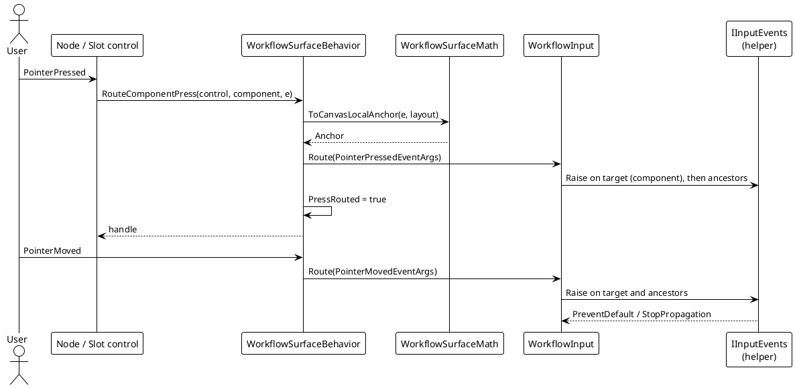
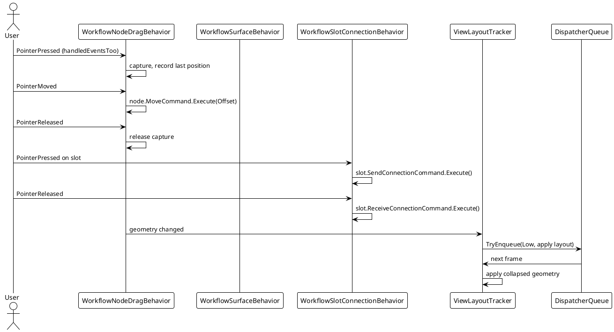

# WinUI Adapter

This page follows the WinUI surface from attached-property activation to the Core input route, then the drag, connection and deferred-layout chains.

WinUI has no preview/tunnel phase. The surface subscribes with `handledEventsToo` so it still sees pointer events a descendant `ScrollViewer` has already marked handled.

## Attaching the surface

`IsEnabled` attaches handlers, resolves named parts and refreshes. Focus is put on the scroll container rather than the host, because the host's first focusable descendant is often a `TextBox` inside a node card, and focusing the host would make `BringIntoView` yank the viewport back to that input.

Source: `Src/Adapters/VeloxDev.WinUI/WorkflowSystem/AttachedBehaviors/WorkflowSurfaceBehavior.cs:369-413`

```csharp
private static void Attach(UserControl control)
{
    Detach(control);

    var state = new SurfaceState { Restore = new SurfaceViewportRestoreCore() };
    control.SetValue(StateProperty, state);

    control.Loaded += OnLoaded;
    control.Unloaded += OnUnloaded;
    control.DataContextChanged += OnDataContextChanged;
    control.PointerMoved += OnPointerMoved;
    control.PointerEntered += OnPointerEntered;
    control.PointerExited += OnPointerExited;
    control.AddHandler(UIElement.PointerReleasedEvent, new PointerEventHandler(OnPointerReleased), true);
    control.AddHandler(UIElement.PointerPressedEvent, new PointerEventHandler(OnLinkPointerPressed), true);
    control.AddHandler(UIElement.KeyDownEvent, new KeyEventHandler(OnLinkKeyDown), false);
    control.AddHandler(UIElement.KeyUpEvent, new KeyEventHandler(OnLinkKeyUp), false);
    ResolveNamedControls(control, state);
    Refresh(control);
}
```

## Routing input

`RoutePointer` converts the platform event to a canvas-local `Anchor`, resolves the target and routes one Core event. It also focuses the scroll container when the pointer is over a link, so Delete reaches the surface without a click.

Source: `Src/Adapters/VeloxDev.WinUI/WorkflowSystem/AttachedBehaviors/WorkflowSurfaceBehavior.cs:1167-1187`

```csharp
private static WorkflowEventHandle RoutePointer(
    SurfaceState state, ITreeComponent tree, PointerRoutedEventArgs e, UserControl host,
    DependencyObject? hit,
    Func<Anchor, IWorkflowComponent?, WorkflowEventHandle, Wf.PointerEventArgs> args)
{
    var anchor = ToCanvasLocalAnchor(state, e, tree.Layout);
    var input = WorkflowInput.For(tree);
    var target = ResolveTarget(hit, tree, anchor.Horizontal, anchor.Vertical, input.HitRadius);

    var handle = new WorkflowEventHandle();
    input.Route(args(anchor, target, handle));

    if (input.HoveredLink is not null)
        state.ScrollViewer?.Focus(FocusState.Pointer);

    return handle;
}
```

Because descendants run before the surface in the bubbling phase, a node or slot routes its own press back through `RouteComponentPress`, which marks the press as routed so the surface's pan and link handlers do not route the same physical press twice.

Source: `Src/Adapters/VeloxDev.WinUI/WorkflowSystem/AttachedBehaviors/WorkflowSurfaceBehavior.cs:1192-1209`

```csharp
internal static WorkflowEventHandle? RouteComponentPress(
    DependencyObject? control, IWorkflowComponent component, PointerRoutedEventArgs e)
{
    // ... resolve host, tree, scroll viewer ...
    var anchor = ToCanvasLocalAnchor(state, e, tree.Layout);
    var handle = new WorkflowEventHandle();
    WorkflowInput.For(tree).Route(new Wf.PointerPressedEventArgs(
        anchor, Modifiers(e.KeyModifiers), host, component, CurrentButton(e, host), 1, handle));

    state.PressRouted = true;
    return handle;
}
```



## Node drag and slot connection

Press captures the pointer; move dispatches `MoveCommand` with the delta since the last move. The slot behavior maps press to send and release to receive.

Source: `Src/Adapters/VeloxDev.WinUI/WorkflowSystem/AttachedBehaviors/WorkflowNodeDragBehavior.cs:155-172`

```csharp
private static void OnPointerMoved(object sender, PointerRoutedEventArgs e)
{
    // ... guard state and coordinate host ...
    var node = ResolveNode(element);
    if (node is null) return;

    var current = e.GetPosition(state.CoordinateHost);
    node.MoveCommand.Execute(new Offset(current.X - state.LastPosition.X, current.Y - state.LastPosition.Y));
    state.LastPosition = current;
}
```

Source: `Src/Adapters/VeloxDev.WinUI/WorkflowSystem/AttachedBehaviors/WorkflowSlotConnectionBehavior.cs:37-65`

```csharp
private static void OnPointerPressed(object sender, PointerRoutedEventArgs e)
{
    // ... guard control and slot ...
    slot.SendConnectionCommand.Execute(null);
}

private static void OnPointerReleased(object sender, PointerRoutedEventArgs e)
{
    slot.ReceiveConnectionCommand.Execute(null);
}
```

## Deferred layout

Node geometry changes are applied through `ViewLayoutTracker`, which enqueues work at `DispatcherQueuePriority.Low`. A synchronous layout read during the mutation would see the old, pre-collapse size; the deferred pass sees the settled one.

Source: `Src/Adapters/VeloxDev.WinUI/WorkflowSystem/ViewHosting/ViewLayoutTracker.cs:35-43`

```csharp
var dispatcher = view.DispatcherQueue;
// ...
dispatcher.TryEnqueue(DispatcherQueuePriority.Low, () =>
{
    // ... apply geometry after the current frame settles ...
});
```



The minimap is `WorkflowMinimapOverlay : Canvas, IWorkflowMinimapOverlay`; its refresh timer runs on a `DispatcherQueue` and its redraw is enqueued at `Low` priority, so it never competes with input.

## Related

- [Platform Adapter Contract](../24_platform-adapter-contract/index.md) — the Core surface this adapter closes.
- [WPF Adapter](../25_wpf-adapter/index.md) — the preview-phase equivalent.
- [MAUI Adapter](../28_maui-adapter/index.md) — the gesture-recognizer equivalent.
- [Workflow Item Templates](../32_workflow-item-templates/index.md) — generated WinUI views.
