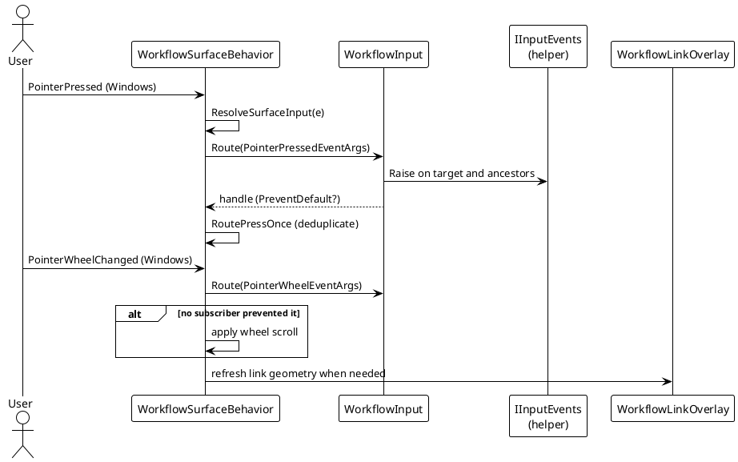
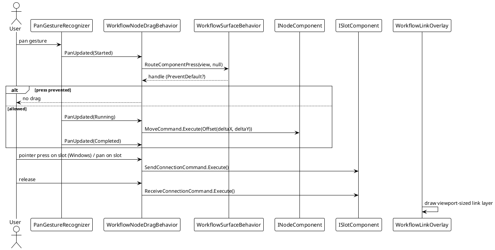
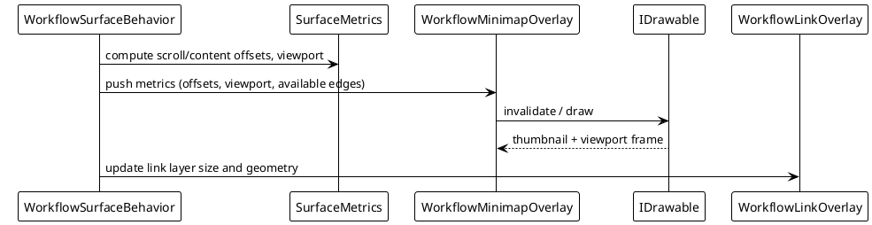

# MAUI Adapter

This page follows the MAUI surface from `BindableProperty` activation to the Core input route, then the two input models it uses: native pointer events on Windows and `PanGestureRecognizer` / `PinchGestureRecognizer` elsewhere.

MAUI has no single cross-platform pointer event. The adapter therefore splits: Windows routes through the platform `PointerRoutedEventArgs`, while other heads route pan and pinch gestures and translate them into the same Core events.

## Attaching the surface

`IsEnabled` attaches load, unload, binding-context and size handlers, resolves named parts, subscribes to layout, captures the viewport restore and refreshes.

Source: `Src/Adapters/VeloxDev.MAUI/WorkflowSystem/AttachedBehaviors/WorkflowSurfaceBehavior.cs:637-671`

```csharp
private static void Attach(ContentView control)
{
    Detach(control);

    var state = new SurfaceState
    {
        Host = control,
        Restore = new SurfaceViewportRestoreCore(),
    };
    control.SetValue(StateProperty, state);
    control.Loaded += OnLoaded;
    control.Unloaded += OnUnloaded;
    control.BindingContextChanged += OnBindingContextChanged;
    control.SizeChanged += OnHostSizeChanged;
    ResolveNamedControls(control, state);
    UpdateLayoutSubscription(control, state);
    CaptureViewportRestore(control, state);
    Refresh(control);
}
```

## Windows: native pointer events

On Windows the surface routes its own press and wheel through `WorkflowInput`, inside a `#if WINDOWS` block. The canvas and the link layer share these routes so a press or wheel is not translated twice.

Source: `Src/Adapters/VeloxDev.MAUI/WorkflowSystem/AttachedBehaviors/WorkflowSurfaceBehavior.cs:1860-1899`

```csharp
private static WorkflowEventHandle? RouteSurfacePress(
    SurfaceState state, Microsoft.UI.Xaml.Input.PointerRoutedEventArgs e)
{
    if (ResolveSurfaceInput(state, e) is not { } input) return null;

    return RoutePressOnce(input.Tree, () =>
    {
        var routed = WorkflowInput.For(input.Tree);
        var handle = new WorkflowEventHandle();
        routed.Route(new Wf.PointerPressedEventArgs(
            new Anchor(input.Point.X, input.Point.Y, 0), Modifiers(e.KeyModifiers), input.Canvas,
            ResolveTarget(null, input.Tree, input.Point, routed.HitRadius),
            Wf.MouseButton.Left, 1, handle));
        return handle;
    });
}
```

```csharp
private static WorkflowEventHandle? RouteSurfaceWheel(
    SurfaceState state, Microsoft.UI.Xaml.Input.PointerRoutedEventArgs e, double deltaX, double deltaY)
{
    if (ResolveSurfaceInput(state, e) is not { } input) return null;

    return RouteWheelOnce(e, () =>
    {
        var routed = WorkflowInput.For(input.Tree);
        var handle = new WorkflowEventHandle();
        routed.Route(new Wf.PointerWheelEventArgs(
            new Anchor(input.Point.X, input.Point.Y, 0), Modifiers(e.KeyModifiers), input.Canvas,
            ResolveTarget(null, input.Tree, input.Point, routed.HitRadius),
            deltaX, deltaY, handle));
        return handle;
    });
}
```



## Other heads: gesture recognizers

Off Windows there is no usable press event for the drag behavior, so `PanUpdated` is the first point of a gesture. `Started` forwards a component press so a subscriber can veto the drag; `Running` accumulates `TotalX` / `TotalY` into `MoveCommand`.

Source: `Src/Adapters/VeloxDev.MAUI/WorkflowSystem/AttachedBehaviors/WorkflowNodeDragBehavior.cs:299-345`

```csharp
private static void OnPanUpdated(object? sender, PanUpdatedEventArgs e)
{
    // ... guard view and state ...
    switch (e.StatusType)
    {
        case GestureStatus.Started:
            state.CoordinateHost ??= ResolveCoordinateHost(view);
            state.LastPanX = 0d;
            state.LastPanY = 0d;
            state.IsPressPrevented =
                WorkflowSurfaceBehavior.RouteComponentPress(view, null)?.PreventDefault == true;
            state.IsDragging = !state.IsPressPrevented;
            break;
        case GestureStatus.Running:
            if (state.IsPressPrevented) break;
            // ... resolve node ...
            var deltaX = e.TotalX - state.LastPanX;
            var deltaY = e.TotalY - state.LastPanY;
            // ... node.MoveCommand.Execute(new Offset(deltaX, deltaY)) ...
            break;
    }
}
```

The surface itself uses `PanGestureRecognizer` and `PinchGestureRecognizer`; the pinch is translated into a zoom candidate and routed before the platform changes the scale.



## Link layer and minimap

`WorkflowLinkOverlay` is a viewport-sized link layer: links are drawn above nodes but do not participate in hit testing as individual visuals. The minimap is `WorkflowMinimapOverlay : Grid, IDrawable, IWorkflowMinimapOverlay`, so it draws through MAUI's `IDrawable` pipeline and still receives the shared `SurfaceMetrics` push.

Source: `Src/Adapters/VeloxDev.MAUI/WorkflowSystem/AttachedBehaviors/WorkflowMinimapOverlay.cs:27`

```csharp
public class WorkflowMinimapOverlay : Grid, IDrawable, IWorkflowMinimapOverlay
```



## Related

- [Platform Adapter Contract](../24_platform-adapter-contract/index.md) — the Core surface this adapter closes.
- [WinUI Adapter](../27_winui-adapter/index.md) — the other native-pointer head.
- [Workflow Item Templates](../32_workflow-item-templates/index.md) — generated MAUI views.
