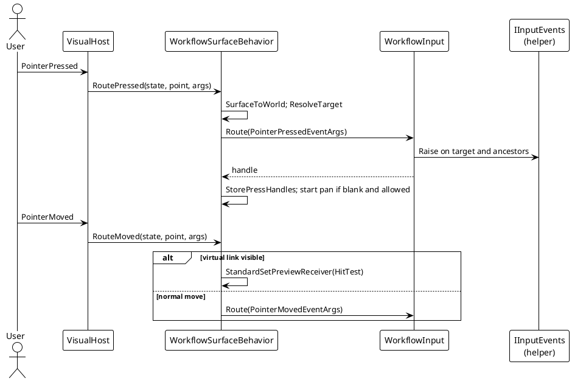
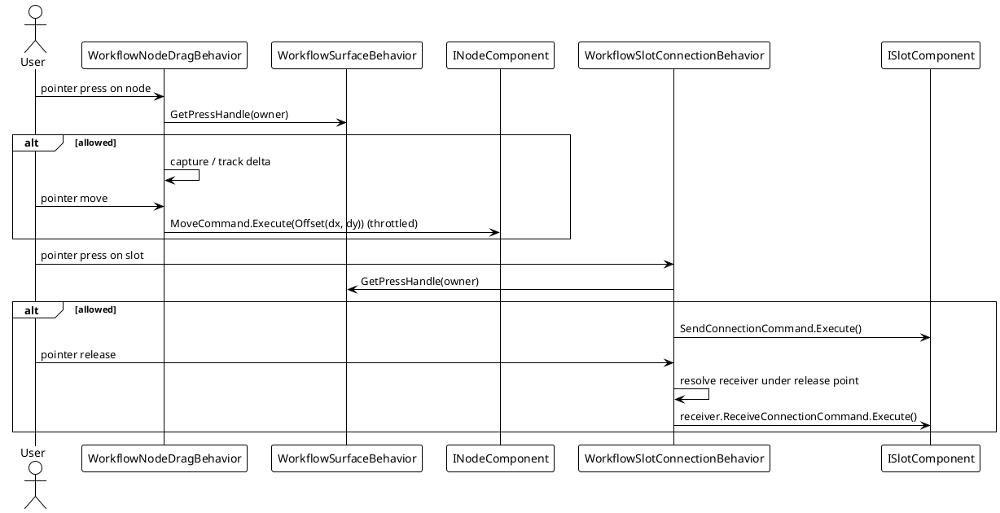

# WinForms Adapter

This page follows the WinForms surface from static attached configuration to the Core input route, then the drag, connection and overlay chains.

WinForms has no dependency properties. Configuration is a set of static setters on `WorkflowSurfaceBehavior` (`SetCanvasName`, `SetScrollViewerName`, `SetPointerPressSourceName`, and so on) keyed by the host `Control`. The surface itself is an Easel `VisualHost`.

## Attaching the surface

`IsEnabled` attaches. Any later configuration change re-resolves the named parts, the tree, the view pool and the camera, then re-attaches the child behaviors. That re-resolution is what makes the static setters usable after the host has been created.

Source: `Src/Adapters/VeloxDev.WinForms/WorkflowSystem/AttachedBehaviors/WorkflowSurfaceBehavior.cs:400-424`, `434-452`

```csharp
private static void OnIsEnabledChanged(Control target, DependencyPropertyChangedEventArgs e)
{
    if (Equals(e.NewValue, true)) Attach(target);
    else Detach(target);
}

private static void OnConfigurationChanged(Control target, DependencyPropertyChangedEventArgs e)
{
    if (!States.TryGetValue(target, out var state) || !state.Attached) return;

    EnsureParts(target, state);
    EnsureTree(target, state);
    EnsurePool(target, state);
    ApplyCamera(state);
    EnsureAttachedBehaviors(state.Surface ?? state.Root);
}
```

```csharp
private static void Attach(Control host)
{
    var state = GetState(host);
    if (state.Attached) return;
    if (host is not VisualHost visualHost) return;
    // ... wire VisualHost pointer events ...
}
```

## Routing input

The VisualHost reports pointer events in surface coordinates. `RoutePressed` converts to world, resolves the target and routes one Core event; it then starts a pan only when the press was on blank surface, no subscriber prevented it, and the press source check passes.

Source: `Src/Adapters/VeloxDev.WinForms/WorkflowSystem/AttachedBehaviors/WorkflowSurfaceBehavior.cs:1177-1211`

```csharp
private static void RoutePressed(SurfaceState state, DrawingPointF surfacePoint, VisualPointerEventArgs args)
{
    if (state.Tree is not { } tree) return;

    var world = SurfaceToWorld(state.Host!, surfacePoint);
    var target = ResolveTarget(state, surfacePoint);
    var handle = new Wf.WorkflowEventHandle();
    Wf.WorkflowInput.For(tree).Route(new Wf.PointerPressedEventArgs(
        new Wf.Anchor(world.X, world.Y, 0),
        ToModifiers(args.Modifiers),
        state.VisualHost,
        target,
        ToButton(args.Button),
        args.ClickCount,
        handle));

    StorePressHandles(state, surfacePoint, handle);

    if (args.Button == MouseButtons.Left
        && target is null
        && !handle.PreventDefault
        && !IsOverScrollBar(state, surfacePoint)
        && IsWithinPressSource(state, state.VisualHost?.FindElementAt(surfacePoint)))
    {
        state.Panning = true;
        state.PanStart = surfacePoint;
        state.PanStartPan = state.Pan;
        if (state.VisualHost is { } host) host.Capture = true;
    }
}
```

`RouteMoved` publishes the pointer and, while a virtual link is visible, reports the candidate receiver by geometry instead of routing hover. `RouteReleased` routes the release so a subscriber can react.

Source: `Src/Adapters/VeloxDev.WinForms/WorkflowSystem/AttachedBehaviors/WorkflowSurfaceBehavior.cs:1214-1236`

```csharp
private static void RouteMoved(SurfaceState state, DrawingPointF surfacePoint, VisualPointerEventArgs args)
{
    if (state.Tree is not { } tree) return;

    var world = SurfaceToWorld(state.Host!, surfacePoint);
    tree.SetPointerCommand.Execute(new Wf.Anchor(world.X, world.Y, 0));

    if (tree.VirtualLink is { IsVisible: true })
    {
        tree.StandardSetPreviewReceiver(Wf.SlotHitTestEx.HitTest(tree, world.X, world.Y));
        return;
    }

    Wf.WorkflowInput.For(tree).Route(new Wf.PointerMovedEventArgs(
        new Wf.Anchor(world.X, world.Y, 0),
        ToModifiers(args.Modifiers),
        state.VisualHost,
        ResolveTarget(state, surfacePoint),
        new Wf.WorkflowEventHandle()));
    UpdateHover(state);
}
```



## Node drag and slot connection

The drag behavior throttles: pointer events can arrive above 100 Hz, and each `MoveCommand` re-lays out the whole visual tree and repaints the surface. The slot behavior resolves the receiver under the release point, because the VisualHost captured the sender.

Source: `Src/Adapters/VeloxDev.WinForms/WorkflowSystem/AttachedBehaviors/WorkflowNodeDragBehavior.cs:185-193`

```csharp
if (node.MoveCommand.CanExecute(new Offset(dx, dy)))
{
    node.MoveCommand.Execute(new Offset(dx, dy));
}
```

Source: `Src/Adapters/VeloxDev.WinForms/WorkflowSystem/AttachedBehaviors/WorkflowSlotConnectionBehavior.cs:82-114`

```csharp
private void OnPointerPressed(object? sender, VisualPointerEventArgs args)
{
    if (args.Button != MouseButtons.Left
        || owner.DataContext is not ISlotComponent slot
        || WorkflowSurfaceBehavior.GetPressHandle(owner)?.PreventDefault == true)
        return;

    slot.SendConnectionCommand.Execute(null);
    args.Handled = true;
}

private void OnPointerReleased(object? sender, VisualPointerEventArgs args)
{
    // ... resolve the element under the release point ...
    for (var current = hit; current is not null; current = current.ParentElement)
    {
        if (current.DataContext is ISlotComponent receiver && !ReferenceEquals(receiver, senderSlot))
        {
            receiver.ReceiveConnectionCommand.Execute(null);
            args.Handled = true;
            return;
        }
    }
}
```



## Overlays and view hosting

`WorkflowMinimapOverlay` implements `IWorkflowMinimapOverlay` and `IWorkflowMinimapScrollSource` over an Easel `VisualElement`; `WorkflowInfoOverlay` draws the informational panel. `ViewPool.ItemsSource` / `TemplateSelector` are static attached setters that create and replace the host's `ViewSourcePipeline`, exactly as in the XAML adapters.

Source: `Src/Adapters/VeloxDev.WinForms/WorkflowSystem/AttachedBehaviors/ViewPool.cs:29-60`

```csharp
public static readonly DependencyProperty ItemsSourceProperty = DependencyProperty.RegisterAttached(
    "ItemsSource", typeof(INotifyCollectionChanged), typeof(ViewPool), ...);

public static INotifyCollectionChanged? GetItemsSource(VisualElement element)
    => (INotifyCollectionChanged?)element.GetValue(ItemsSourceProperty);

public static void SetItemsSource(VisualElement element, INotifyCollectionChanged? value)
    => element.SetValue(ItemsSourceProperty, value);
```

## Related

- [Platform Adapter Contract](../24_platform-adapter-contract/index.md) — the Core surface this adapter closes.
- [WPF Adapter](../25_wpf-adapter/index.md) — the attached-property equivalent.
- [Workflow Item Templates](../32_workflow-item-templates/index.md) — generated WinForms views.
