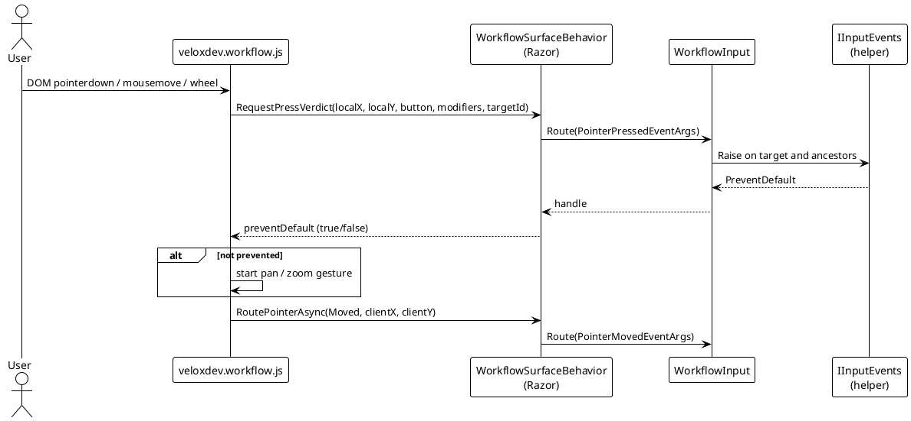
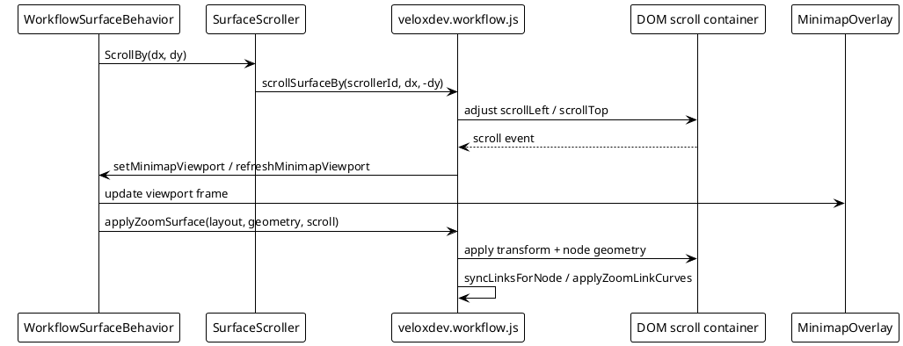

# Razor Adapter

This page follows the Razor/Blazor surface from component parameters to the Core input route, then the JavaScript interop that owns the DOM scroll container and link geometry.

The adapter is a set of Razor components plus one ES module, `wwwroot/veloxdev.workflow.js`. Blazor owns the component model; JavaScript owns the browser geometry and the gestures that need frames.

## Attaching the surface

`WorkflowSurfaceBehavior` is a `ComponentBase` that takes the tree as a parameter and holds one `WorkflowInput`. It subscribes to the tree, resolves the DOM scroll container and canvas by id, and wires the JS module's init handle.

Source: `Src/Adapters/VeloxDev.Razor/WorkflowSystem/AttachedBehaviors/WorkflowSurfaceBehavior.razor.cs:22-64`

```csharp
public partial class WorkflowSurfaceBehavior : ComponentBase, IAsyncDisposable
{
    [Parameter] public ITreeComponent? Tree { get; set; }
    [Parameter] public string ScrollViewerId { get; set; } = "veloxdev-wf-scroll";
    [Parameter] public string CanvasId { get; set; } = "veloxdev-wf-canvas";
    // ...
    private WorkflowInput? _input;
}
```

The Razor markup composes the decorator, minimap, template selector and link menu as child fragments of the surface behavior, so the whole surface is one component tree.

## Routing input

`RoutePointerAsync` converts viewport coordinates to canvas-local coordinates, resolves a target from the position when the caller did not supply one, and routes the matching Core event. While a menu is open, `WorkflowInput.IsSuspended` keeps the pointer target so moving onto the menu does not clear it.

Source: `Src/Adapters/VeloxDev.Razor/WorkflowSystem/AttachedBehaviors/WorkflowSurfaceBehavior.razor.cs:493-529`

```csharp
public async Task RoutePointerAsync(
    SurfacePointerKind kind, double clientX, double clientY,
    Wf.MouseButton button = Wf.MouseButton.None, double deltaY = 0, IWorkflowComponent? target = null,
    Wf.InputModifiers modifiers = Wf.InputModifiers.None)
{
    if (_input is not { } input) return;
    if (await ToCanvasLocalAsync(clientX, clientY) is not { } local) return;

    var anchor = new Anchor(local[0], local[1], 0);
    target ??= input.Tree.HitTestVisibleLinks(anchor.Horizontal, anchor.Vertical, input.HitRadius);
    WorkflowEventHandle handle = new();

    input.Route(kind switch
    {
        SurfacePointerKind.Entered => new Wf.PointerEnteredEventArgs(anchor, modifiers, _surfaceRoot, target, handle),
        SurfacePointerKind.Pressed => new Wf.PointerPressedEventArgs(anchor, modifiers, _surfaceRoot, target, button, 1, handle),
        SurfacePointerKind.Wheel => new Wf.PointerWheelEventArgs(anchor, modifiers, _surfaceRoot, target, 0d, deltaY, handle),
        _ => new Wf.PointerMovedEventArgs(anchor, modifiers, _surfaceRoot, target, handle),
    });
}
```

The surface also exposes `[JSInvokable]` verdict methods. JavaScript calls them *before* it starts a gesture the surface owns (canvas pan, Ctrl+wheel zoom), so a subscriber's `PreventDefault` is answered before the DOM changes.

Source: `Src/Adapters/VeloxDev.Razor/WorkflowSystem/AttachedBehaviors/WorkflowSurfaceBehavior.razor.cs:541-545`

```csharp
[JSInvokable]
public bool RequestPressVerdict(double localX, double localY, int button, int modifiers, string? targetId)
    => Tree is { } tree
       && RoutePress(tree, ResolveComponentTarget(targetId, tree), localX, localY,
              ToButton(button), (Wf.InputModifiers)modifiers).PreventDefault;
```



## JavaScript module

The ES module owns the DOM geometry: it converts client coordinates to canvas-local space, sizes the canvas, positions node wrappers, draws link curves in SVG, scrolls the surface, and drives the minimap viewport. Every `init*` function returns a `{ dispose() }` handle, which the component disposes on teardown.

Source: `Src/Adapters/VeloxDev.Razor/wwwroot/veloxdev.workflow.js:3-6`, `219-241`

```javascript
// Every init* function returns a `{ dispose() }` handle so components can tear down listeners.
```

```javascript
// Scrolls a surface by a pixel delta — the wheel's default scroll, which the adapter applies after
// the same edge-aware path as panning and the minimap (surfaceRegistry's scrollBy), so a wheel at an
// edge grows the canvas instead of stopping.
function scrollSurfaceBy(scrollerId, dx, dy) { /* ... */ }
```

The Razor `SurfaceScroller` implements both Core scroller interfaces by forwarding to the module: the DOM scroll container cannot be scrolled from .NET without JS.

Source: `Src/Adapters/VeloxDev.Razor/WorkflowSystem/AttachedBehaviors/WorkflowSurfaceBehavior.razor.cs:1097-1117`

```csharp
private sealed class SurfaceScroller : IWorkflowSurfaceScroller, IWorkflowSurfaceNavigator
{
    private readonly WorkflowSurfaceBehavior owner;

    public void ScrollBy(double wheelDeltaX, double wheelDeltaY)
    {
        var module = owner._module;
        var id = owner.ScrollViewerId;
        if (module is null || string.IsNullOrWhiteSpace(id)) return;

        _ = module.InvokeVoidAsync("scrollSurfaceBy", id, wheelDeltaX, -wheelDeltaY);
    }

    public void CenterOn(double localX, double localY) => _ = owner.CenterOnAsync(localX, localY);
}
```



`ViewPool.razor` is a component wrapper over the shared `ViewSourcePipeline`; `WorkflowGridDecorator.razor` and `WorkflowMinimapOverlay.razor` implement the Core overlay interfaces for the browser. `WorkflowGeometryScope` and `WorkflowRuntimeIds` are helpers that carry canvas geometry and stable element ids across renders.

## Related

- [Platform Adapter Contract](../24_platform-adapter-contract/index.md) — the Core surface this adapter closes.
- [WPF Adapter](../25_wpf-adapter/index.md) — a non-interop comparison.
- [Workflow Item Templates](../32_workflow-item-templates/index.md) — generated Razor components.
