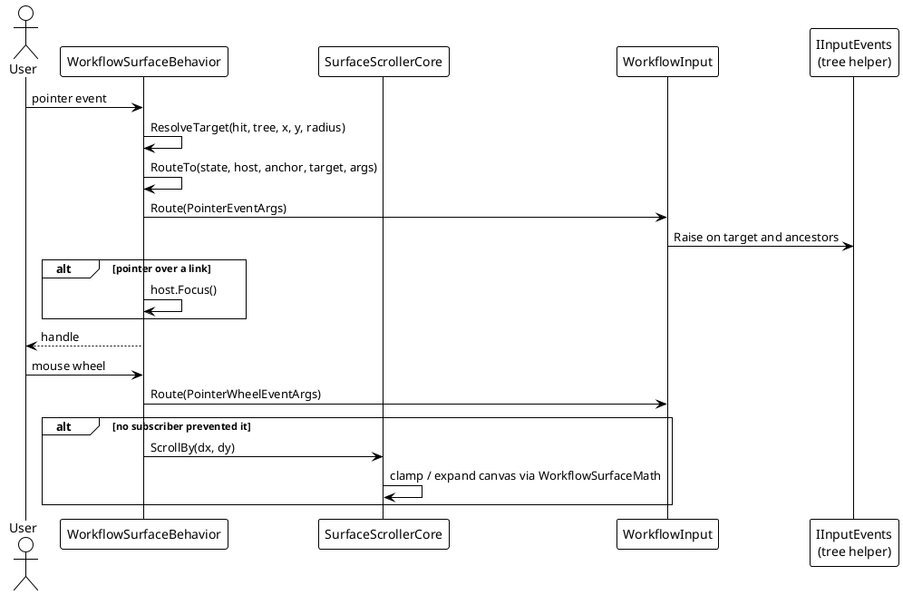
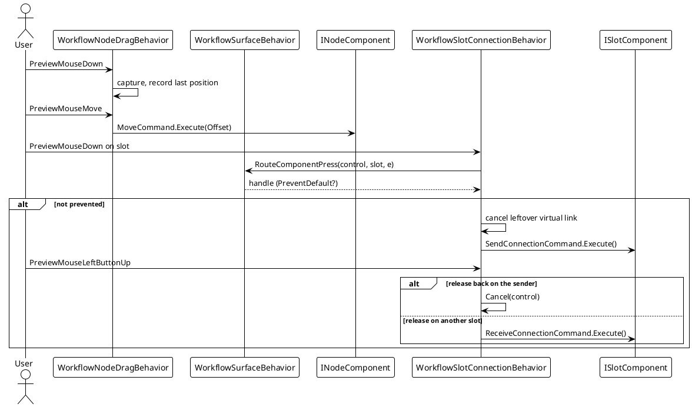

# Jalium Adapter

This page follows the Jalium surface from attached-property activation to the Core input route, then the drag, connection and link-bounds chains.

`WorkflowSurfaceBehavior` is a static class of attached properties. It owns the platform `ScrollViewer` adapter and assigns a `SurfaceScrollerCore` as both `WorkflowInput.Scroller` and `WorkflowInput.Navigator`.

## Attaching the surface

`IsEnabled` attaches the host. Configuration resolves the named parts, then `AttachInteraction` builds the Core input and the scroller, subscribes to the tree helper's input relay, and wires the link-removed notification.

Source: `Src/Adapters/VeloxDev.Jalium/WorkflowSystem/AttachedBehaviors/WorkflowSurfaceBehavior.cs:1037-1062`

```csharp
private static void AttachInteraction(SurfaceState state)
{
    if (state.Tree is not { } tree) return;

    var input = WorkflowInput.For(tree);
    state.Input = input;

    var scroller = new SurfaceScrollerCore(new JaliumSurfaceScrollHost(state));
    state.Scroller = scroller;
    input.Scroller = scroller;
    input.Navigator = scroller;

    if (tree.GetHelper() is Wf.IInputEvents events)
    {
        state.InputPressedHandler = (_, e) => OnLinkPointerPressed(state, e);
        events.Input.PointerPressed += state.InputPressedHandler;
    }

    state.LinkRemovedHandler = (_, link) => OnLinkRemoved(state, link);
    tree.GetHelper().LinkRemoved += state.LinkRemovedHandler;
}
```

The detach path clears the scroller only when it is still the one this surface installed. Two surfaces over one tree must not tear down each other's scroll port.

Source: `Src/Adapters/VeloxDev.Jalium/WorkflowSystem/AttachedBehaviors/WorkflowSurfaceBehavior.cs:1064-1073`

```csharp
private static void DetachInteraction(SurfaceState state)
{
    if (state.Input is { } released && ReferenceEquals(released.Scroller, state.Scroller))
    {
        released.Scroller = null;
        released.Navigator = null;
    }

    state.Scroller = null;
    // ...
}
```

## Routing input

`RouteTo` is the single route entry. It routes an event built from a canvas-local point and a resolved target, then moves focus to the host when the pointer is over a link so Delete reaches the surface.

Source: `Src/Adapters/VeloxDev.Jalium/WorkflowSystem/AttachedBehaviors/WorkflowSurfaceBehavior.cs:1505-1528`

```csharp
private static WorkflowEventHandle RouteTo(
    SurfaceState state, FrameworkElement host, Point anchorPoint, IWorkflowComponent? target,
    Func<Anchor, IWorkflowComponent?, WorkflowEventHandle, Wf.PointerEventArgs> args)
{
    var handle = new WorkflowEventHandle();
    if (state.Input is not { } input) return handle;

    input.Route(args(new Anchor(anchorPoint.X, anchorPoint.Y, 0), target, handle));

    if (input.HoveredLink is not null)
        host.Focus();

    return handle;
}
```

Target resolution is the adapter's job and must answer nodes and slots as well as links. If it only answered links, the `slot → node → tree` chain in `WorkflowInput` would never run.

Source: `Src/Adapters/VeloxDev.Jalium/WorkflowSystem/AttachedBehaviors/WorkflowSurfaceBehavior.cs:1530-1534`

```csharp
// 指针底下是什么，由适配器回答 —— 节点和插槽也是答案的一部分。只认连线的话，路由的 Target 就永远
// 只是「连线或空白」，WorkflowInput.Chain 里 slot → node → tree 那条链于是永远走不到。
private static IWorkflowComponent? ResolveTarget(
    DependencyObject? hit, ITreeComponent tree, double x, double y, double radius)
```



## Node drag and slot connection

Drag dispatches `MoveCommand` with the delta since the last position. Slot connection reads the press handle the surface produced, then sends on press and receives on release. A release back onto the sender cancels the virtual link instead of connecting a slot to itself.

Source: `Src/Adapters/VeloxDev.Jalium/WorkflowSystem/AttachedBehaviors/WorkflowNodeDragBehavior.cs:160-180`

```csharp
private static void OnMouseMove(object? sender, MouseEventArgs e)
{
    // ... guard state and coordinate host ...
    var node = ResolveNode(element);
    if (node is null) return;

    var current = e.GetPosition(state.CoordinateHost);
    node.MoveCommand.Execute(new Offset(current.X - state.LastPosition.X, current.Y - state.LastPosition.Y));
    state.LastPosition = current;
}
```

Source: `Src/Adapters/VeloxDev.Jalium/WorkflowSystem/AttachedBehaviors/WorkflowSlotConnectionBehavior.cs:75-129`

```csharp
private static void OnPointerPressed(object? sender, MouseButtonEventArgs e)
{
    // ...
    if (WorkflowSurfaceBehavior.RouteComponentPress(control, slot, e)?.PreventDefault == true) return;
    if (!slot.SendConnectionCommand.CanExecute(null)) return;

    CancelLeftover(control);
    slot.SendConnectionCommand.Execute(null);
    StateOf(control).Sender = slot;
    e.Handled = true;
}

private static void OnPointerReleased(object? sender, MouseButtonEventArgs e)
{
    var state = StateOf(control);

    if (ReferenceEquals(state.Sender, slot))
    {
        Cancel(control);
        e.Handled = true;
        return;
    }

    if (slot.ReceiveConnectionCommand.CanExecute(null))
    {
        slot.ReceiveConnectionCommand.Execute(null);
        state.Sender = null;
        e.Handled = true;
    }
}
```



## Link bounds and view hosting

`WorkflowLinkBounds` carries the link-layer bounds the adapter draws within, so a link that leaves the node area still has a place to be clipped and hit-tested. `ViewSourcePipeline` composes the Jalium factory, container, arranger, scheduler and diagnostics over the visible-item source.

Source: `Src/Adapters/VeloxDev.Jalium/WorkflowSystem/ViewHosting/ViewSourcePipeline.cs:10`

```csharp
public sealed class ViewSourcePipeline : ViewSourcePipelineCore<
    // ... Jalium host, view, item and priority types ...
>
```

The minimap is `WorkflowMinimapOverlay : FrameworkElement, IWorkflowMinimapOverlay`; it is resolved as a named part (`MinimapOverlayName`) and receives the shared `SurfaceMetrics` push.

Source: `Src/Adapters/VeloxDev.Jalium/WorkflowSystem/AttachedBehaviors/WorkflowSurfaceBehavior.cs:560`

```csharp
state.MinimapOverlay = ResolvePart<FrameworkElement>(host, GetMinimapOverlayName(host)) as IWorkflowMinimapOverlay;
```

## Related

- [Platform Adapter Contract](../24_platform-adapter-contract/index.md) — the Core surface this adapter closes.
- [WPF Adapter](../25_wpf-adapter/index.md) — the closest attached-property comparison.
- [Workflow Item Templates](../32_workflow-item-templates/index.md) — generated Jalium views.
