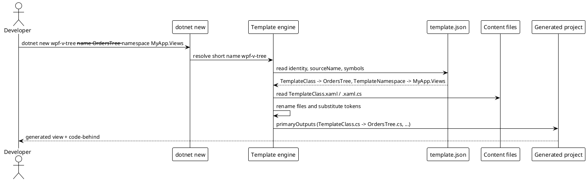
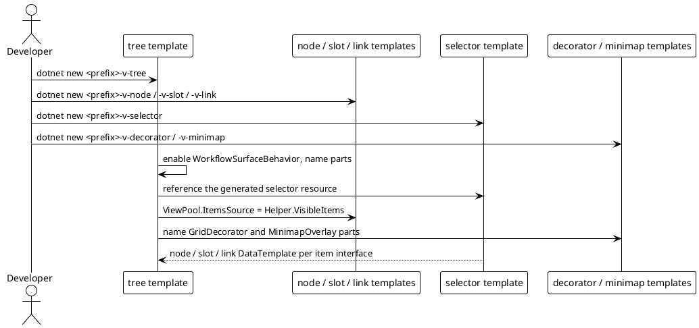

# Workflow Item Templates

This page follows what happens when a developer runs `dotnet new` for one of the seven workflow item packs: the template engine reads a manifest, substitutes the class name and namespace, and writes the role's files.

There are seven packs (`WPF`, `Avalonia`, `WinUI`, `MAUI`, `WinForms`, `Razor`, `Jalium`) and seven roles per pack (`tree`, `node`, `slot`, `link`, `selector`, `decorator`, `minimap`), for 49 short names.

## The template manifests

Every role is its own template folder under `working/content/workflow-{role}/`, with a `.template.config/template.json`. The manifest declares an identity, a short name, `sourceName = TemplateClass`, and a `namespace` parameter that replaces `TemplateNamespace`.

Source: `Src/Templates/VeloxDev.WPF.Templates/working/content/workflow-tree-view/.template.config/template.json:11-16`

```json
"identity": "VeloxDev.WPF.WorkflowTreeView",
"name": "VeloxDev WPF Workflow Tree View",
"shortName": "wpf-v-tree",
"sourceName": "TemplateClass",
"defaultName": "TreeView",
```

The short-name prefixes are `wpf`, `ava`, `winui`, `maui`, `winforms`, `razor` and `jalium`; the role suffixes are `-v-tree`, `-v-node`, `-v-slot`, `-v-link`, `-v-selector`, `-v-decorator` and `-v-minimap`.

| Role | WPF | Avalonia | WinUI | MAUI | WinForms | Razor | Jalium |
|---|---|---|---|---|---|---|---|
| tree | `wpf-v-tree` | `ava-v-tree` | `winui-v-tree` | `maui-v-tree` | `winforms-v-tree` | `razor-v-tree` | `jalium-v-tree` |
| node | `wpf-v-node` | `ava-v-node` | `winui-v-node` | `maui-v-node` | `winforms-v-node` | `razor-v-node` | `jalium-v-node` |
| slot | `wpf-v-slot` | `ava-v-slot` | `winui-v-slot` | `maui-v-slot` | `winforms-v-slot` | `razor-v-slot` | `jalium-v-slot` |
| link | `wpf-v-link` | `ava-v-link` | `winui-v-link` | `maui-v-link` | `winforms-v-link` | `razor-v-link` | `jalium-v-link` |
| selector | `wpf-v-selector` | `ava-v-selector` | `winui-v-selector` | `maui-v-selector` | `winforms-v-selector` | `razor-v-selector` | `jalium-v-selector` |
| decorator | `wpf-v-decorator` | `ava-v-decorator` | `winui-v-decorator` | `maui-v-decorator` | `winforms-v-decorator` | `razor-v-decorator` | `jalium-v-decorator` |
| minimap | `wpf-v-minimap` | `ava-v-minimap` | `winui-v-minimap` | `maui-v-minimap` | `winforms-v-minimap` | `razor-v-minimap` | `jalium-v-minimap` |

The identity follows the same shape: `VeloxDev.<Platform>.Workflow<Role>`, for example `VeloxDev.WinForms.WorkflowTreeView`.

Source: `Src/Templates/VeloxDev.WinForms.Templates/working/content/workflow-tree-view/.template.config/template.json:11-16`

```json
"identity": "VeloxDev.WinForms.WorkflowTreeView",
"name": "VeloxDev WinForms Workflow Tree View",
"shortName": "winforms-v-tree",
"sourceName": "TemplateClass",
"defaultName": "TreeView",
```



## What the tree template wires

The tree template is the composition root of a generated suite: it turns the surface behavior on, names the parts, and points the view pool at the tree helper's visible items.

Source: `Src/Templates/VeloxDev.WPF.Templates/working/content/workflow-tree-view/TemplateClass.xaml:8-15`

```xml
behaviors:WorkflowSurfaceBehavior.IsEnabled="True"
behaviors:WorkflowSurfaceBehavior.ZoomEnabled="True"
behaviors:WorkflowSurfaceBehavior.ScrollViewerName="PART_ScrollViewer"
behaviors:WorkflowSurfaceBehavior.CanvasName="PART_Canvas"
behaviors:WorkflowSurfaceBehavior.GridDecoratorName="PART_GridDecorator"
behaviors:WorkflowSurfaceBehavior.PointerPressSourceName="PART_SurfaceBorder"
behaviors:WorkflowSurfaceBehavior.MinimapOverlayName="PART_MinimapOverlay"
behaviors:WorkflowSurfaceBehavior.LinkMenuKey="LinkContextMenu"
```

Source: `Src/Templates/VeloxDev.WPF.Templates/working/content/workflow-tree-view/TemplateClass.xaml:59-60`

```xml
behaviors:ViewPool.ItemsSource="{Binding Helper.VisibleItems}"
behaviors:ViewPool.TemplateSelector="{StaticResource WorkflowTemplateSelector}"
```

The selector template is the one code role instead of markup: it maps an item's component interface to the node, slot or link template, and throws when a template is not assigned.

Source: `Src/Templates/VeloxDev.WPF.Templates/working/content/workflow-template-selector/TemplateClass.cs:20-30`

```csharp
public override DataTemplate SelectTemplate(object item, DependencyObject container)
    => item switch
    {
        ILinkComponent => LinkTemplate
            ?? throw new InvalidOperationException("LinkTemplate is not set."),
        ISlotComponent => SlotTemplate
            ?? throw new InvalidOperationException("SlotTemplate is not set."),
        INodeComponent => NodeTemplate
            ?? throw new InvalidOperationException("NodeTemplate is not set."),
        _ => throw new InvalidOperationException($"Unsupported workflow item: {item?.GetType().FullName}")
    };
```

## Per-platform exceptions

The role set is identical across packs; the file types and the way the surface is hosted are not.

- **WPF / WinUI** emit `.xaml` + `.xaml.cs`; the tree extends `UserControl`. The surface is attached by `WorkflowSurfaceBehavior` properties in markup.
- **Avalonia** emits `.axaml` + `.axaml.cs`; the tree extends `Avalonia.Controls.UserControl`.
- **MAUI** emits `.xaml` + `.xaml.cs`; the tree extends `ContentView` and expects `BindingContext` to be set to the `ITreeComponent` before load.
- **WinForms** emits `.xaml` + `.xaml.cs` over Easel; the tree extends `Easel.Visuals.Controls.UserControl`, and the surface is a single `VisualHost` with a `CustomTemplateSelector` resource. The link menu is a `VisualContextMenu` resource resolved by key.
- **Razor** emits `.razor` + `.razor.cs`; the tree is a `ComponentBase` with `Tree`, `ScrollViewerId`, `CanvasId`, `NodeTemplate` and `GridSpacing` parameters, and the markup composes `WorkflowSurfaceBehavior`, `GridDecorator`, `MinimapOverlay`, `TemplateSelector` and `LinkMenu`. The decorator and minimap roles are Razor components, not code-behind classes.
- **Jalium** emits `.jalxaml` + `.jalxaml.cs`; the tree extends `UserControl`. Because the platform cannot bind an attached property, the template exposes a CLR mirror `CanvasTransformProperty` that forwards to `WorkflowSurfaceBehavior.CanvasTransformProperty`.

Source: `Src/Templates/VeloxDev.Jalium.Templates/working/content/workflow-tree-view/TemplateClass.jalxaml.cs:13-16`

```csharp
public static readonly DependencyProperty CanvasTransformProperty = WorkflowSurfaceBehavior.CanvasTransformProperty;

/// <summary>The world-to-view translation the pooled node and link views follow.</summary>
public Transform? CanvasTransform => GetValue(CanvasTransformProperty) as Transform;
```

Source: `Src/Templates/VeloxDev.Razor.Templates/working/content/workflow-tree-view/TemplateClass.razor.cs:8-28`

```csharp
public partial class TemplateClass : ComponentBase
{
    [Parameter] public ITreeComponent? Tree { get; set; }
    [Parameter] public string ScrollViewerId { get; set; } = "veloxdev-wf-scroll";
    [Parameter] public string CanvasId { get; set; } = "veloxdev-wf-canvas";
    [Parameter] public RenderFragment<INodeComponent>? NodeTemplate { get; set; }
    [Parameter] public double GridSpacing { get; set; } = 40;
}
```



The templates are a starting suite, not a closed set: each generated file carries a `VeloxDev customization:` comment naming the one thing a developer is expected to change there.

## Related

- [Platform Adapter Contract](../24_platform-adapter-contract/index.md) — the behaviors these views are attached to.
- [WPF Adapter](../25_wpf-adapter/index.md) — the behavior set the WPF suite targets.
- [Razor Adapter](../30_razor-adapter/index.md) — the component model the Razor suite targets.
- [Jalium Adapter](../31_jalium-adapter/index.md) — the adapter the Jalium suite targets.
