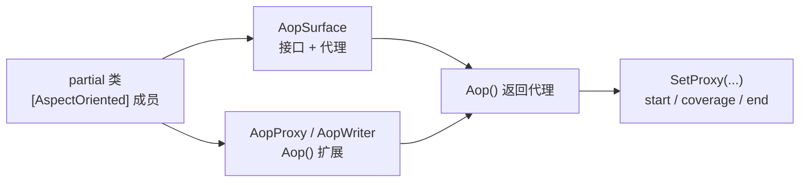

# AOP — 快速开始

`VeloxDev.Core` 的 **aop** 功能为普通 `partial` 类提供面向切面拦截。给公有成员标上 `[AspectOriented]`，源生成器会在编译期产出三样东西：镜像接口、实现该接口的密封代理类，以及每个目标实例返回同一个缓存代理的 `Aop()` 扩展方法。

代理是你自己程序集里的普通 C# 代码：没有 `System.Reflection.DispatchProxy`，没有 `Reflection.Emit`，也没有逐次调用的方法查找。未挂钩子的成员直接调用目标。

每个被拦截的成员对应一组 `AspectHooks`，最多包含三个委托：

| 阶段 | 运行时机 | 返回值的去向 |
|---|---|---|
| `start` | 成员之前 | 作为 `previous` 传给 `coverage` |
| `coverage` | 非空时代替成员体 | 成为成员的结果 |
| `end` | 成员之后 | 被丢弃 |

## 子页面

| 页面 | 内容 |
|---|---|
| [前置条件](00_前置条件/index.md) | 支持的目标框架、SDK、语言版本、所需服务 |
| [安装](01_安装/index.md) | `VeloxDev.Core` 与生成器分析器，以及仓库内引用方式 |
| [定义切面目标](02_定义切面目标/index.md) | `partial` 类、成员规则与生成产物 |
| [安装钩子](03_安装钩子/index.md) | `Aop()`、`SetProxy`、三个阶段与 `Aop.GetTarget` |
| [验证与完整代码](04_验证与完整代码/index.md) | 随仓库 Demo、完整控制台程序、实跑输出与运行声明 |

## 证据来源

- 测试：`Src/Core/VeloxDev.Core.Test/AspectOriented/AopProxyTests.cs` 与 `AopFixture.cs` 钉住阶段顺序、替换语义、异常路径、缓存与可回收性。
- Demo：`Examples/AOP/WPF/Demo`、`Examples/AOP/Avalonia/Demo`。
- 运行时：`Src/Core/VeloxDev.Core/AspectOriented/`。
- 生成器：`Src/Generators/VeloxDev.Core.Generator/AopSurface.cs`、`AopProxy.cs`、`Writers/AopWriter.cs`。
