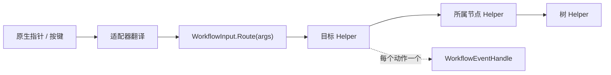

# 画布输入与导航

VeloxDev 的工作流画在画布上，而画布并不是平台控件：适配器拥有手势，Core 拥有一套所有平台共用的标准输入词汇。这个功能就是那条分界线——原生指针或按键如何变成可路由、可否决的事件，内置手势如何平移与缩放，以及宿主如何把视口移到它指定的节点上。

## 这个功能覆盖什么

- **一棵树一条输入路由。** `WorkflowInput.For(tree)` 是适配器转发标准事件、宿主订阅事件的那个唯一对象。它把 `PointerEventArgs` 或 `KeyEventArgs` 从目标一路路由到树。
- **一个动作一个句柄。** 每个被路由的事件都带一个 `WorkflowEventHandle`；`PreventDefault` 让框架自己那一手不执行，`StopPropagation` 让事件不再冒泡给祖先。
- **手势留在适配器里。** 平移、Ctrl+滚轮缩放、节点拖动与连线拖动都是适配器的行为，它们发出模型命令。Core 只负责路由输入与提供几何。
- **导航是能力，不是依赖。** 挂上的表面会注册 `IWorkflowSurfaceScroller` 与 `IWorkflowSurfaceNavigator`；`Locate()` 与滚轮接管在它们存在时使用，不存在时什么也不做。

## 各部分在哪里

| 层 | 类型 | 职责 |
|---|---|---|
| Core | `WorkflowInput`、`IInputEvents`、`InputRelay`、`Pointer*EventArgs`、`Key*EventArgs`、`InputKey`、`InputModifiers`、`MouseButton`、`WorkflowEventHandle` | 路由、唯一的句柄、标准参数形状。不含手势。 |
| Core | `IWorkflowSurfaceScroller`、`IWorkflowSurfaceNavigator`、`SurfaceScrollerCore`、`WorkflowSurfaceMath`、`WorkflowNavigationEx` | 把滚轮增量变成滚动、把画布局部点居中、定位组件。 |
| Core | `LinkHitTestEx`、`SlotHitTestEx`、`LinkCurve` | 适配器调用的共享几何命中；连线命中使用视图发布的那条曲线。 |
| WPF | `WorkflowSurfaceBehavior` | 解析命名部件、路由原生输入、拥有平移 / Ctrl+滚轮缩放 / 滚轮归属，注册 scroller 与 navigator。 |
| WPF | `WorkflowNodeDragBehavior`、`WorkflowSlotConnectionBehavior`、`WorkflowCanvasTransformBehavior` | 逐视图的拖动与连线手势，以及模板绑定的渲染变换载体。 |

其余六家适配器用各自的属性系统闭合同一组角色。类型名相同，属性系统不同。

## 页面

- [前置条件](00_前置条件/index.md) —— 支持的目标、包与可运行示例。
- [表面设置](01_表面设置/index.md) —— 挂上表面行为，命名它需要的部件。
- [路由输入](02_路由输入/index.md) —— 订阅路由、读取句柄、接管一次滚轮。
- [导航](03_导航/index.md) —— 平移、Ctrl+滚轮缩放、`Locate()`，以及 scroller/navigator 两项能力。
- [验证](04_验证/index.md) —— 运行示例、逐项验证行为、完整代码与运行声明。

## 路由一瞥

顺序是目标先、祖先其次、树最后。靠近目标的订阅者先于框架的反应执行，并且可以取消它；同一个句柄实例会到达链上每一级，所以祖先能读到更近的订阅者做了什么决定。

## 证据

- 示例：`Examples/Workflow/WPF Trimmed/Demo/Views/Workflow/TreeView.xaml` 与 `TreeView.xaml.cs`；完整工作台 `Examples/Workflow/WPF/Demo/Views/Workflow/WorkflowView.xaml.cs` 另有定位、Shift+滚轮与否决的示例。
- 测试：`Src/Test/Unit/Core/VeloxDev.Core.Test/WorkflowSystem/WorkflowInputTests.cs`、`WorkflowInputHandleTests.cs`、`SurfacePipelineTests.cs`、`WorkflowNavigationExTests.cs`；`Src/Test/Headless/VeloxDev.WPF.Headless.Tests/Tests/WorkflowSurfaceHeadlessTests.cs`。
