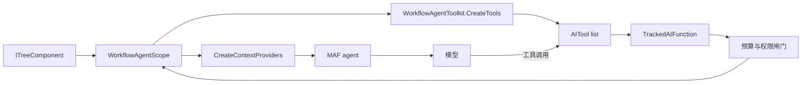

# 工作流智能体工具

`WorkflowAgentScope` 把一棵工作流树变成 Microsoft Agent Framework（MAF）智能体可以调用的工具面。工具覆盖查询、图编辑、执行、布局、分析与状态，并且每一次调用都经过同一条管线：计数、闸门与上报都在那里完成。

本快速开始在一棵零依赖的 `TreeDefaultViewModel` 上建立 scope，按分类列出工具，关闭其中一个，然后接上聊天客户端，让模型调用其余工具。

## 你会构建什么

- 用 `tree.AsAgentScope()` 得到 `WorkflowAgentScope`；
- 用 `CreateToolkit().CreateTools(WorkflowToolCategory…)` 得到按分类过滤的工具列表；
- 一段由模型检查并编辑工作流的真实对话。

## 页面

- [安装准备](00_安装准备/index.md) —— 前置条件、包与 scope 配置。
- [使用](01_使用/index.md) —— 工具分类、实时开关、聊天客户端接线与完整程序。

## 各部分如何协作

`CreateContextProviders()` 返回的 provider 是工具的唯一来源。不要把工具同时塞进 `ChatOptions.Tools`：MAF 会把两份列表做并集且不按名去重，同一个工具会两次送到模型面前。

## 相关

- [智能体安全与预算](../18_智能体安全与预算/index.md) —— 每次工具调用都要穿过的权限闸门。
- [无头 CLI](../23_无头CLI/index.md) —— 把同一套工具以 MCP 发布，不需要界面。
