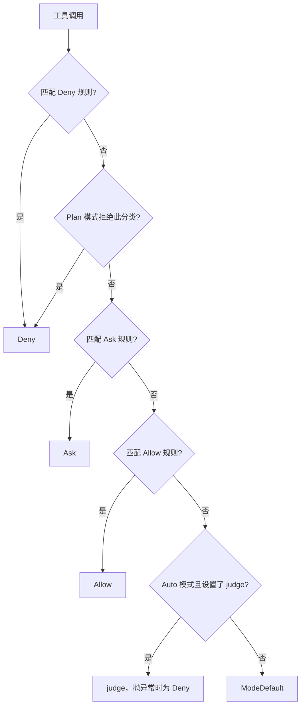

# 智能体安全与预算

`VeloxDev.AI.Safety` 在每次工具调用时决定智能体能否执行它，以及能花多少。这个决定是一个有名字的**模式**加一组**规则**，并在调用点强制执行——切换模式会管住下一次调用。同一个作用域还负责调用数与 token 预算。

`AgentActionCategory` 在调用期对调用**做什么**分类。它刻意不同于 `WorkflowToolCategory`：后者只决定什么发送给模型。一个工具可以可见，却仍被拒绝。

## 命名空间

| 命名空间 | 类型 |
|---|---|
| `VeloxDev.AI.Safety` | `AgentPermissionMode`、`AgentActionCategory`、`PermissionDecision`、`AgentPermissionRule`、`ToolInvocation`、`AgentPermissionPolicy` |
| `VeloxDev.AI.Workflow` | `WorkflowAgentScope` 的安全与预算成员、`WorkflowAgentScope.SelectionResult` |
| `VeloxDev.AI` | `AgentToolCallEventArgs`、`IAgentToolCallNotifier`、`AgentSelectionEventArgs`、`AgentConfirmationEventArgs` |

## 页面

- [权限模型](00_权限模型/index.md) —— 模式、分类、规则、调用与策略的求值顺序。
- [作用域安全](01_作用域安全/index.md) —— 作用域的权限、选择性加入与交互处理器成员。
- [预算与脏标记](02_预算/index.md) —— 调用、token 与结果大小上限。
- [交互事件](03_交互事件/index.md) —— 宿主处理器接收、调用方观察的事件参数类型。

## 求值顺序

## 相关

- [工作流智能体工具](../17_工作流智能体工具/index.md) —— 这些规则管辖的工具。
- [MCP 集成](../20_MCP集成/index.md) —— 模式最谨慎对待的 `Curate` 调用。
- [子智能体](../21_子智能体/index.md) —— 子级额度所依赖的账本。
