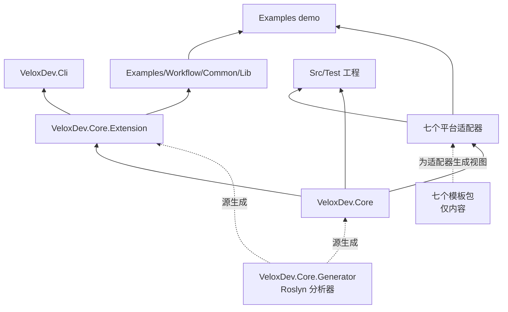

# 文件结构

VeloxDev 是一个多工程 .NET 解决方案：产品与验证代码在 `Src/` 下，可运行的 demo 在 `Examples/` 下，本文档的源文件则是挂在 `Wiki/` 的 Git 子模块。目录结构刻意不按功能划分：图模型、编译器和运行时同住在 `VeloxDev.Core`，而同一套画布能力在七个适配器工程里各实现一遍，并由七个示例工程分别驱动。

## 仓库布局

```text
VeloxDev/
├── Src/
│   ├── Core/
│   │   ├── VeloxDev.Core/              模型、画布机制、编译器、运行时与核心服务
│   │   └── VeloxDev.Core.Extension/    智能体工具、安全、技能、MCP、子智能体
│   ├── Generators/
│   │   └── VeloxDev.Core.Generator/    十个 Roslyn 增量生成器
│   ├── Adapters/                       Avalonia、Jalium、MAUI、Razor、WinForms、WinUI、WPF
│   ├── Cli/
│   │   └── VeloxDev.Cli/               无头宿主与 stdio MCP 服务器
│   ├── Templates/                      每个适配器一个条目模板包，共七个
│   └── Test/
│       ├── Unit/                       MSTest 套件与 CLI 夹具
│       ├── Headless/                   无窗口的适配器契约套件
│       ├── Benchmarks/                 BenchmarkDotNet 与有头视图管线宿主
│       ├── AutoTest/                   真实窗口验收套件
│       ├── Harness/                    一次性 UI 与浏览器探针
│       └── Compatibility/              WinForms 的 .NET Framework 4.8 冒烟工程
├── Examples/
│   ├── Workflow/                       各 GUI 的 demo、最小镜像与共享 Lib
│   ├── MVVM/                           共享 Lib 与 WPF、Avalonia demo
│   ├── Transition/                     每个 GUI 一个 demo
│   ├── Theme/                          WPF、Avalonia demo 与最小镜像
│   ├── AOP/                            WPF、Avalonia demo
│   └── Tickable/                       WPF demo
├── Easel/                              Git 子模块；WinForms 的动画依赖
├── Wiki/                               Git 子模块；本文档源文件
├── Assets/                             徽标、宣传素材、VeloxDev.Core.agentcontext.xml
├── memory/                             模块记忆与规范
├── skills/                             仓库级 Claude 技能
└── VeloxDev.slnx
```

构建产物（`bin/`、`obj/`）与空且未被 Git 跟踪的 `Src/Verification/` 目录不属于解决方案内容。`Src/Test/AutoTest` 刻意不在 `VeloxDev.slnx` 里，因此在仓库根运行 `dotnet test` 不会拉起窗口；`Src/Test/Harness` 放的是 PowerShell 探针脚本，不是工程。

## 项目映射

### 解决方案成员

解决方案按工作区而不是按功能组织工程。

| 解决方案目录 | 工程 |
| --- | --- |
| `/Core/` | `VeloxDev.Core`、`VeloxDev.Core.Extension` |
| `/Generators/` | `VeloxDev.Core.Generator` |
| `/Adapters/` | `VeloxDev.Avalonia`、`VeloxDev.Jalium`、`VeloxDev.MAUI`、`VeloxDev.Razor`、`VeloxDev.WinForms`、`VeloxDev.WinUI`、`VeloxDev.WPF` |
| `/Cli/` | `VeloxDev.Cli` |
| `/Templates/` | 七个 `VeloxDev.*.Templates` 包，各自位于 `Src/Templates/<name>/working/` |
| `/Test/Unit/Core/` | `VeloxDev.Core.Test`、`VeloxDev.Core.Extension.Test` |
| `/Test/Unit/Cli/` | `VeloxDev.Cli.Test`，以及 `Test.Copy`、`Test.Plugin` 两个夹具 |
| `/Test/Headless/` | `VeloxDev.AdapterTestKit`，以及 WPF、Avalonia、WinForms、Razor、Jalium 五套套件 |
| `/Test/Benchmarks/` | 七个基准宿主 |
| `/Test/Compatibility/` | `VeloxDev.WinForms.Net48.Smoke` |
| `/Examples/...` | 全部 demo 工程，见下文 |

适配器目录最直接地说明了「一个 GUI 一个工程」的规则：

```xml
<Folder Name="/Adapters/">
    <Project Path="Src/Adapters/VeloxDev.Avalonia/VeloxDev.Avalonia.csproj" />
    <Project Path="Src/Adapters/VeloxDev.Jalium/VeloxDev.Jalium.csproj" />
    <Project Path="Src/Adapters/VeloxDev.MAUI/VeloxDev.MAUI.csproj" />
    <Project Path="Src/Adapters/VeloxDev.Razor/VeloxDev.Razor.csproj" Id="7fd995c3-8c46-486c-b8b2-e2bcac557da7" />
    <Project Path="Src/Adapters/VeloxDev.WinForms/VeloxDev.WinForms.csproj" />
    <Project Path="Src/Adapters/VeloxDev.WinUI/VeloxDev.WinUI.csproj" />
    <Project Path="Src/Adapters/VeloxDev.WPF/VeloxDev.WPF.csproj" />
</Folder>
```

> 来源：`VeloxDev.slnx:8-16`

### 产品工程

| 工程 | 源码目录 | 类型 | 目标框架 |
| --- | --- | --- | --- |
| `VeloxDev.Core` | `Src/Core/VeloxDev.Core/` | 类库 | `netstandard2.0`、`netframework4.6.1`、`net5.0`、`netcoreapp3.0`、`net8.0` |
| `VeloxDev.Core.Generator` | `Src/Generators/VeloxDev.Core.Generator/` | Roslyn 分析器 | `netstandard2.0` |
| `VeloxDev.Core.Extension` | `Src/Core/VeloxDev.Core.Extension/` | 类库 | `netstandard2.0`、`net8.0` |
| `VeloxDev.WPF` | `Src/Adapters/VeloxDev.WPF/` | 类库 | `netframework4.6.1`、`net5.0-windows`、`netcoreapp3.0`、`net8.0-windows` |
| `VeloxDev.Avalonia` | `Src/Adapters/VeloxDev.Avalonia/` | 类库 | `netstandard2.0`、`net6.0`、`net8.0` |
| `VeloxDev.WinUI` | `Src/Adapters/VeloxDev.WinUI/` | 类库 | `net8.0-windows10.0.19041.0`、`net10.0-windows10.0.19041.0` |
| `VeloxDev.MAUI` | `Src/Adapters/VeloxDev.MAUI/` | 类库 | `net10.0`、`net10.0-windows10.0.19041.0` |
| `VeloxDev.WinForms` | `Src/Adapters/VeloxDev.WinForms/` | 类库 | `netframework4.6.1`、`net5.0-windows`、`netcoreapp3.0`、`net8.0-windows` |
| `VeloxDev.Razor` | `Src/Adapters/VeloxDev.Razor/` | 类库 | `net6.0`、`net8.0` |
| `VeloxDev.Jalium` | `Src/Adapters/VeloxDev.Jalium/` | 类库 | `net10.0` |
| `VeloxDev.Cli` | `Src/Cli/VeloxDev.Cli/` | 控制台工具 | `net8.0` |
| 七个 `VeloxDev.*.Templates` 包 | `Src/Templates/<name>/working/` | 模板包 | `netstandard2.0` |

`VeloxDev.Core` 只在 `net8.0` 上声明 `IsAotCompatible`（`Src/Core/VeloxDev.Core/VeloxDev.Core.csproj:15`）；这是逐目标框架的声明，并不保证各适配器自身的平台类型都能通过裁剪。

### 示例工程

每个 demo 都是解决方案中的普通工程，`Examples/` 下没有任何生成内容。

| 示例目录 | 工程 | 引用 |
| --- | --- | --- |
| `Examples/Workflow/Common/Lib/` | `Lib.csproj` | `VeloxDev.Core`、`VeloxDev.Core.Extension` |
| `Examples/Workflow/{WPF,Avalonia,WinUI,MAUI,WinForms,Jalium}/Demo/` | 每个 GUI 一个 `Demo.csproj` | 对应适配器加共享 `Lib` |
| `Examples/Workflow/Blazor/Demo/` | `Demo/Demo.csproj`（服务端）与 `Demo.Client/Demo.Client.csproj` | 服务端工程引用 Razor 适配器与 `Lib` |
| `Examples/Workflow/Avalonia Trimmed/Demo/` | `Demo`、`Demo.Desktop`、`Demo.Browser`、`Demo.Android`、`Demo.iOS` | 围绕共享 `Demo` 的 Avalonia 头部工程 |
| 其余 `* Trimmed` 目录 | 各一个 `Demo.csproj` | 最小调用序列 demo，不是裁剪或 AOT 发布测试 |
| `Examples/MVVM/Common/Lib/`、`WPF/`、`Avalonia/` | `Lib.csproj` 与两个 `Demo.csproj` | Core 加 MVVM 生成器 |
| `Examples/Transition/{7 GUIs}/Demo/` | 每个 GUI 一个 `Demo.csproj`（Blazor 有两个） | 对应适配器 |
| `Examples/Theme/{WPF,Avalonia}{, Trimmed}/Demo/` | 各一个 `Demo.csproj` | WPF 或 Avalonia 适配器 |
| `Examples/AOP/{WPF,Avalonia}/Demo/` | 各一个 `Demo.csproj` | Core 加 AOP 生成器 |
| `Examples/Tickable/WPF/Demo/` | `Demo.csproj` | Core 加帧循环生成器 |

### 验证工程

| 目录 | 工程 | 验证什么 |
| --- | --- | --- |
| `Src/Test/Unit/Core/` | `VeloxDev.Core.Test`（net10.0）、`VeloxDev.Core.Extension.Test`（net10.0） | 模型、编译器、运行时、布局、MVVM、过渡、主题、AOP、帧循环、序列化，以及与 CLI 相邻的智能体行为 |
| `Src/Test/Unit/Cli/` | `VeloxDev.Cli.Test`（net10.0），加 `Test.Copy`、`Test.Plugin` 夹具（netstandard2.0） | 选项解析、MCP 协议、归档、会话、插件加载、运行日志 |
| `Src/Test/Headless/` | `VeloxDev.AdapterTestKit`（netstandard2.0）与五套套件 | 不开窗口的适配器契约：WPF、Avalonia、WinForms、Razor、Jalium |
| `Src/Test/Benchmarks/` | 七个宿主 | 序列化对 System.Text.Json 与 Newtonsoft 的基准；WPF、Avalonia、WinForms、Jalium、WinUI、MAUI、Razor 的有头视图管线宿主 |
| `Src/Test/AutoTest/` | `VeloxDev.AT`（net10.0-windows）、`VeloxDev.SamplerTest` | 通过真实窗口做端到端验收；不在解决方案内 |
| `Src/Test/Compatibility/` | `VeloxDev.WinForms.Net48.Smoke`（net48） | WinForms 适配器在 .NET Framework 4.8 上的冒烟验证 |
| `Src/Test/Harness/` | 仅 PowerShell 脚本 | 一次性 UI 与 CDP 浏览器探针、模板输出校验 |

## 引用关系



这张图由工程文件强制，而不是靠约定。`VeloxDev.Core` 没有任何产品引用——生成器以分析器身份挂上来，且只在 Debug 构建里是工程引用：

```xml
<ItemGroup>
    <ProjectReference Include="../../Generators/VeloxDev.Core.Generator/VeloxDev.Core.Generator.csproj"
                      OutputItemType="Analyzer"
                      ReferenceOutputAssembly="false"
                      Condition="'$(Configuration)' == 'Debug'" />
    <PackageReference Include="VeloxDev.Core.Generator" Version="12.3.0"
                      Condition="'$(Configuration)' != 'Debug'" />
</ItemGroup>
```

> 来源：`Src/Core/VeloxDev.Core/VeloxDev.Core.csproj:50-57`

凡是要消费生成特性的工程都会重复这一对：`VeloxDev.Core.Extension` 再写了一遍（`Src/Core/VeloxDev.Core.Extension/VeloxDev.Core.Extension.csproj:29-32`），单元测试工程也用同样方式挂载分析器。每个适配器只引用 `VeloxDev.Core`，不引用其他 VeloxDev 工程（`Src/Adapters/VeloxDev.WPF/VeloxDev.WPF.csproj:28-29`）；WinForms 额外引用 Easel 子模块以获得它的动画原语。`VeloxDev.Cli` 只有一个工程引用，即 `VeloxDev.Core.Extension`（`Src/Cli/VeloxDev.Cli/VeloxDev.Cli.csproj:48`）。模板包只包含 `content/` 资源，没有任何工程引用，因此无法引入对适配器的编译依赖。

哪个功能归哪个程序集、宿主从哪个类型进入这套栈，见[功能结构](../01_功能结构/index.md)。
