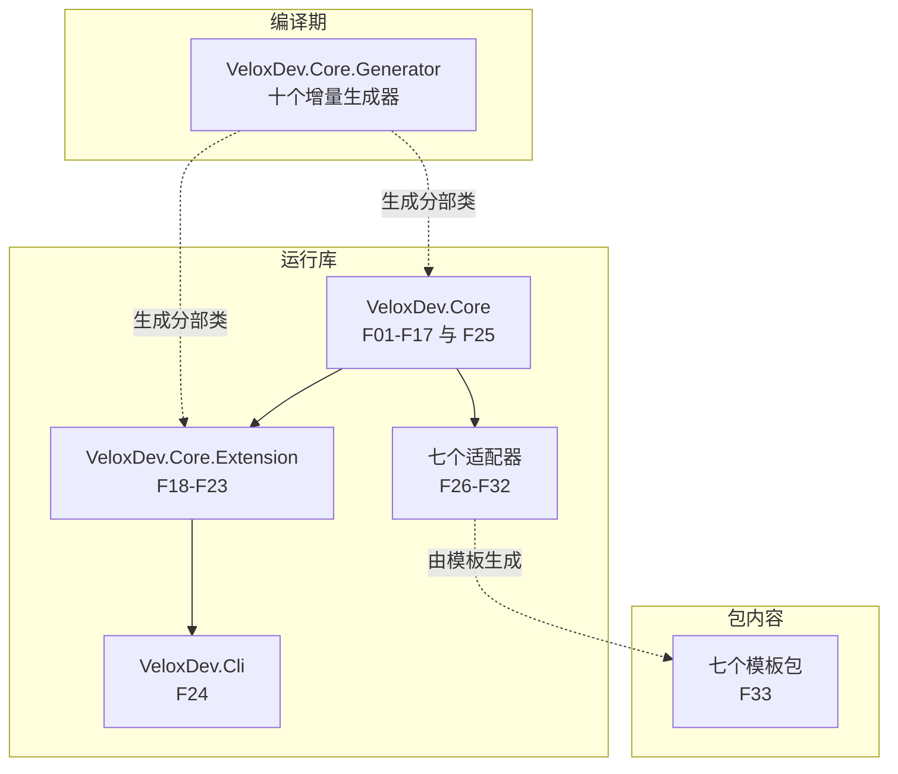

# 功能结构

VeloxDev 对外提供 33 项功能。文档以功能为单位；归属工程是能力契约所在之处。若干功能刻意分层：Core 拥有契约与平台无关的引擎，每个适配器拥有该契约的一份 GUI 实现，Roslyn 生成器则写出组件类本来要重复的管道。

## 程序集分层



| 层 | 程序集 | 提供什么 |
| --- | --- | --- |
| 模型与引擎 | `VeloxDev.Core` | 图及其命令、画布输入契约、布局、编译器、运行时、视图托管、小地图契约，以及六个配套服务 |
| 智能体 | `VeloxDev.Core.Extension` | 图之上的工具面、权限闸门、上下文、技能、MCP、子智能体、仪表盘与转录 |
| 平台 | 七个适配器 | 每个 GUI 各自的附着行为、视图池、平台采样器与主题转换器 |
| 无头宿主 | `VeloxDev.Cli` | 基于同一套 Extension 工具面的 stdio MCP 服务器与一次性运行器 |
| 编译期 | `VeloxDev.Core.Generator` | 十个增量生成器，写出库特性所标记的成员 |
| 包内容 | 七个模板包 | 为每个 GUI 生成七种视图角色的 `dotnet new` 条目模板 |

## 功能到工程的映射

归属工程是拥有该能力的程序集。能力被拆分时，Core 记为契约的归属方，适配器列在依赖一侧。

| ID | 功能 | 归属工程 | 依赖 |
| --- | --- | --- | --- |
| F01 | 工作流图模型 | `VeloxDev.Core` | — |
| F02 | 工作流编辑与历史 | `VeloxDev.Core` | F01 |
| F03 | 连接规则与预览 | `VeloxDev.Core` | F01 |
| F04 | 动态插槽枚举 | `VeloxDev.Core` | F01、F02 |
| F05 | 工作流编译器 | `VeloxDev.Core` | F01、F03 |
| F06 | 工作流运行时 | `VeloxDev.Core` | F05 |
| F07 | 工作流自动布局 | `VeloxDev.Core` | F01、F03 |
| F08 | 画布输入与导航 | `VeloxDev.Core` + 适配器 | F01、F03 |
| F09 | 视图托管与虚拟化 | `VeloxDev.Core` + 适配器 | F01、F08 |
| F10 | 小地图 | `VeloxDev.Core` + 适配器 | F01、F08、F09 |
| F11 | 网格装饰器与标尺 | `VeloxDev.Core` + 适配器 | F01、F08 |
| F12 | MVVM 视图模型生成 | `VeloxDev.Core` + 生成器 | — |
| F13 | 过渡动画 | `VeloxDev.Core` + 适配器 | — |
| F14 | 运行时主题 | `VeloxDev.Core` + 生成器 + 适配器 | F13 |
| F15 | 面向切面编程 | `VeloxDev.Core` + 生成器 | — |
| F16 | 帧循环 | `VeloxDev.Core` + 生成器 | — |
| F17 | 封闭世界序列化 | `VeloxDev.Core` + 生成器 | — |
| F18 | 工作流智能体工具 | `VeloxDev.Core.Extension` | Core |
| F19 | 智能体安全与预算 | `VeloxDev.Core.Extension` | F18 |
| F20 | 智能体上下文与技能 | `VeloxDev.Core.Extension` | F18 |
| F21 | MCP 集成 | `VeloxDev.Core.Extension` | F18、F19 |
| F22 | 子智能体 | `VeloxDev.Core.Extension` | F18、F19 |
| F23 | 智能体仪表盘与转录 | `VeloxDev.Core.Extension` | F18、F19 |
| F24 | 无头 CLI | `VeloxDev.Cli` | Core.Extension |
| F25 | 平台适配器契约 | `VeloxDev.Core` | F01、F08-F11 |
| F26 | WPF 适配器 | `VeloxDev.WPF` | Core、F25 |
| F27 | Avalonia 适配器 | `VeloxDev.Avalonia` | Core、F25 |
| F28 | WinUI 适配器 | `VeloxDev.WinUI` | Core、F25 |
| F29 | MAUI 适配器 | `VeloxDev.MAUI` | Core、F25 |
| F30 | WinForms 适配器 | `VeloxDev.WinForms` | Core、F25、Easel |
| F31 | Razor 适配器 | `VeloxDev.Razor` | Core、F25 |
| F32 | Jalium 适配器 | `VeloxDev.Jalium` | Core、F25 |
| F33 | 工作流条目模板 | 七个 `VeloxDev.*.Templates` 包 | F25、各适配器 |

按归属程序集统计：Core 拥有 18 项（F01-F17 加 F25），Extension 拥有 6 项（F18-F23），CLI 拥有 1 项（F24），七个适配器各拥有 1 项（F26-F32），另有 1 项分布在七个模板包中（F33）。

## 职责与入口点

### 模块边界

| 模块 | 命名空间 | 职责 | 工程 |
| --- | --- | --- | --- |
| 工作流系统 | `VeloxDev.WorkflowSystem` | 四种组件契约、编辑命令、连接规则与预览、插槽提供者、输入路由、几何、布局、编译器、运行时、视图托管、小地图管线 | Core |
| MVVM | `VeloxDev.MVVM` | 属性与命令特性、命令管线、集合跟踪 | Core + 生成器 |
| 过渡 | `VeloxDev.TransitionSystem` | 类型化过渡链、缓动目录、采样器、调度器与解释器 | Core；类型化 `Transition<T>` 特化在各适配器 |
| 主题 | `VeloxDev.DynamicTheme` | 主题注册、调色板缓存、动画或瞬时切换 | Core + 生成器；值转换器在适配器 |
| AOP | `VeloxDev.AspectOriented` | 切面特性、按实例的代理缓存、钩子面 | Core + 生成器 |
| 帧循环 | `VeloxDev.TimeLine`、`VeloxDev.Timing` | 通道、五个生命周期钩子、帧泵、时间采样器 | Core + 生成器 |
| 序列化 | `VeloxDev.Serialization` | 封闭世界的读写器注册表与归档特性 | Core + 生成器 |
| AI 元数据 | `VeloxDev.AI` | 上下文特性、上下文读取器、插槽选择器元数据 | Core |
| 智能体 | `VeloxDev.AI.Workflow`、`.Safety`、`.Skills`、`.MCP`、`.SubAgents`、`.Dashboard`、`.Pipelines`、`VeloxDev.AI` | 工具作用域、权限闸门、技能源、MCP 服务器、子智能体树、仪表盘视图模型、事件管线、转录、媒体 | Extension |
| 平台适配器 | `VeloxDev.WorkflowSystem`、`VeloxDev.TransitionSystem`、`VeloxDev.DynamicTheme` | 附着行为、视图池、平台采样器、主题转换器 | 每个 GUI 一个 |
| CLI | `VeloxDev.Cli` | 选项解析、归档与会话宿主、隔离 worker、MCP 宿主、运行日志 | Cli |
| 生成器 | `VeloxDev.Generators` | 十个增量生成器及其 writer | 生成器 |
| 模板 | — | 仅条目模板内容 | 七个包 |

Core 的几个小命名空间各司一职：`VeloxDev.WeakTypes` 放弱缓存、弱委托与弱队列；`VeloxDev.Threading` 放调度器抽象；`VeloxDev.Lifetime` 放应用状态契约。

### 入口点

这套栈的每个区域都有一个宿主最先接触的类型。下表列出声明位置，而不是包装层。

| 入口 | 声明位置 | 打开什么 |
| --- | --- | --- |
| `[WorkflowBuilder.Node<T>]` | `Src/Core/VeloxDev.Core/WorkflowSystem/Templates/WorkflowBuilder.cs:27-33` | 节点的生成式组件生命周期 |
| 生成的 `InitializeWorkflow` | `Src/Generators/VeloxDev.Core.Generator/Writers/WorkflowWriter.cs:510-525` | Helper 创建、插槽、集合 |
| `ITreeComponent` 命令 | `Src/Core/VeloxDev.Core/Interfaces/WorkflowSystem/Components/ITreeComponent.cs:27` | 新建、连接、撤销与重做 |
| `WorkflowInput.For` | `Src/Core/VeloxDev.Core/WorkflowSystem/GUI/Events/WorkflowInput.cs:53` | 每棵树一份的指针与按键路由 |
| `CompilerViewModel.CompileAsync` | `Src/Core/VeloxDev.Core/WorkflowSystem/CompilerEx/Compile/CompilerViewModel.cs:38` | 一张 `CompiledGraph` |
| `RuntimeEngine.RunAsync` | `Src/Core/VeloxDev.Core/WorkflowSystem/CompilerEx/Runtime/RuntimeEngine.cs:56` | 执行，可选从检查点恢复 |
| `WorkflowLayoutEx.Arrange` | `Src/Core/VeloxDev.Core/WorkflowSystem/Layout/WorkflowLayoutEx.cs:20` | Helper 的布局求解器 |
| `ViewPool<THost,TView,TItem,TPriorityCore>` | `Src/Core/VeloxDev.Core/WorkflowSystem/ViewHosting/ViewPool.cs:463` | 每个可见项一个视图 |
| `MinimapPipelineCore<...>` | `Src/Core/VeloxDev.Core/WorkflowSystem/Minimap/MinimapPipelineCore.cs:61` | 缩略图与视口框 |
| `[VeloxProperty]` | `Src/Core/VeloxDev.Core/MVVM/VeloxPropertyAttribute.cs:26` | 生成的 observable 属性 |
| `TransitionCore` / `Transition<T>` | `Src/Core/VeloxDev.Core/TransitionSystem/Effects/Transition.cs:10`；`Src/Adapters/VeloxDev.WPF/TransitionSystem/Transition.cs:15` | 一段过渡或一条过渡链 |
| `ThemeManager.Transition<T>` | `Src/Core/VeloxDev.Core/DynamicTheme/ThemeManager.cs:155` | 带动画的主题切换 |
| `[AspectOriented]` | `Src/Core/VeloxDev.Core/AspectOriented/AspectOrientedAttribute.cs:9` | 生成的切面代理 |
| `TickManager.Start` | `Src/Core/VeloxDev.Core/TimeLine/TickManager.cs:1063` | 一个帧通道 |
| `VeloxJsonSerializer.Serialize` | `Src/Core/VeloxDev.Core/Serialization/VeloxJsonSerializer.cs:56` | 一份封闭世界文档 |
| `WorkflowAgentScope.ProvideTools` | `Src/Core/VeloxDev.Core.Extension/Agent/Workflow/WorkflowAgentScope.cs:1586` | 工作流工具集 |
| `McpScope.LoadAsync` | `Src/Core/VeloxDev.Core.Extension/Agent/MCP/McpScope.cs:778` | 外部 MCP 工具 |
| `CliOptions.Parse` | `Src/Cli/VeloxDev.Cli/CliOptions.cs:95` | `mcp` 或 `run` 动词 |

组件声明与生成的生命周期是其余一切的前提：

```csharp
[AttributeUsage(AttributeTargets.Class, AllowMultiple = false, Inherited = false)]
public sealed class NodeAttribute<T>(int workSemaphore = 1) : Attribute
    where T : INodeHelper, new()
{
    /// <summary>The concurrent capacity of the node's receive task.</summary>
    public int Semaphore { get; } = workSemaphore;
}
```

> 来源：`Src/Core/VeloxDev.Core/WorkflowSystem/Templates/WorkflowBuilder.cs:27-33`

引擎入口接收组件与角色，或接收编译好的图与上下文：

```csharp
public async Task<IReadOnlyList<CompiledGraph>> CompileAsync<T>(
    T component, CompileRole role, CancellationToken ct = default)
    where T : IWorkflowComponent
```

> 来源：`Src/Core/VeloxDev.Core/WorkflowSystem/CompilerEx/Compile/CompilerViewModel.cs:38-40`

### 边界规则

- **Core 不碰 UI。** `WorkflowSystem/GUI` 定义输入契约、几何与算术（`WorkflowInput`、`SurfaceScrollerCore`、`WorkflowSurfaceMath`）；窗口、控件与调度器类型只出现在适配器里。
- **契约传递，实现不传递。** F25 规定七个表面角色；每个适配器在自己的属性系统上实现同名角色，位于各自的 `WorkflowSystem/AttachedBehaviors/`。针对 Core 编写的宿主可以跑在任意适配器上。
- **Extension 只做加法，方向单一。** `VeloxDev.Core.Extension` 引用 Core（`Src/Core/VeloxDev.Core.Extension/VeloxDev.Core.Extension.csproj:24-25`）；没有任何 Core 工程引用 Extension，也没有适配器引用它。
- **生成器只存在于编译期。** 它把分部类写进消费方程序集（`VeloxDev.Core.Generator` 以分析器身份挂载，从不是运行时库），因此生成成员不增加运行时依赖。
- **模板只装内容，不装代码。** 模板包提供 `content/` 与清单，没有任何工程引用，因此既不能调用适配器，也不能钉住版本。

同一张图在文件层面的样子——这些工程落在哪些目录、彼此如何引用——见[文件结构](../00_文件结构/index.md)。
