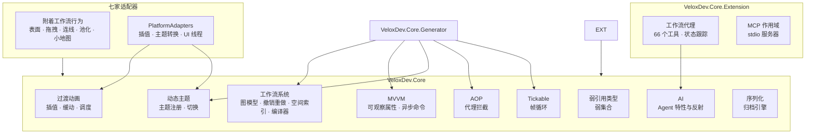

# 01 · 功能结构

## 功能 → 项目 → 依赖

Wiki 按**功能**组织，而不是按目录组织。下表是 QuickStart、API、SE Analysis 三个维度共用的映射。

| 功能 | 所属项目 | 公共 API 概要 | 依赖 | 证据 |
|---|---|---|---|---|
| **工作流系统** | `VeloxDev.Core`（+ `VeloxDev.Core.Extension` 的编译图/检查点文档） | `[WorkflowBuilder.*]`、`IWorkflowTreeViewModel` 家族、`CompilerEx`、`SelectorEx`、`StandardEx`、`SpatialGridHashMap` | Roslyn 生成器 | Demo + Test |
| **工作流代理** | `VeloxDev.Core.Extension` | `WorkflowAgentScope`、`WorkflowAgentToolkit`（66 个内置工具）、`McpScope`、`VeloxDev.AI` | `Microsoft.Extensions.AI`、`ModelContextProtocol` | Test + README + Demo |
| **MVVM** | `VeloxDev.Core` | `VeloxPropertyAttribute`、`VeloxCommandAttribute`、`VeloxCommand`、`IVeloxCommand` | Roslyn 生成器 | Demo + Test |
| **过渡动画** | `VeloxDev.Core` + 适配器 | `Eases`、`Transition<T>`、`InterpolatorCore`、`TransitionSchedulerCore`、原生插值器 | `System.Numerics`、`System.Drawing` | Demo + Test |
| **动态主题** | `VeloxDev.Core` + 适配器 | `ThemeManager`、`ThemeConfigAttribute`、`IThemeObject`、转换器 | 过渡引擎 | Demo + Test |
| **AOP** | `VeloxDev.Core`（`#if NET`） | `ProxyEx`、`ProxyInstance`、`AopCache`、`IAspectOriented` | `DispatchProxy` + 生成器 | Demo + Test |
| **Tickable** | `VeloxDev.Core` | `TickManager`、`TickableAttribute`、`ITickable` | Roslyn 生成器 | Demo + Test |
| **弱引用类型** | `VeloxDev.Core` | `WeakDelegate`、`WeakQueue`、`WeakStack`、`WeakCache` | — | Test |
| **平台适配器** | 七个适配器 + `Src/Templates` | 附着的工作流行为、各平台 Transition/Theme 接线、`dotnet new` 模板 | 各平台 SDK | README + Demo + Source |
| **序列化** | `VeloxDev.Core`（+ Extension 的编译图/检查点文档） | `ViewModelSerializer`、`SerializationOptions`、`ArchivableAttribute`、`ArchiveAttribute`、`ArchiveOptions`、`CompiledGraphEx`、`CheckpointEx` | Roslyn 生成器 | Demo + Test |

## 模块职责

## 入口

| 场景 | 入口 | 位置 |
|---|---|---|
| 构建工作流编辑器 | `tree.AsAgentScope()` / `[WorkflowBuilder.Tree<T>]` | `Examples/Workflow/Common/Lib` |
| 动画一个属性 | `Transition<T>.Create().Property(...)` | `Examples/Transition/*` |
| 切换主题 | `ThemeManager.Transition<Light>(...)` | `Examples/Theme/*` |
| 执行异步命令 | 在 partial 方法上标注 `[VeloxCommand]` | `Examples/MVVM/*` |
| 拦截节点执行 | `ProxyEx.CreateProxy(...)` + `SetProxy(...)` | `Examples/AOP/*` |
| Tick 驱动模拟 | `[Tickable]` + `TickManager.Start()` | `Examples/Tickable/*` |
| 安装预置视图 | `dotnet new wpf-v-node -n NodeView ...` | `Src/Templates` |
