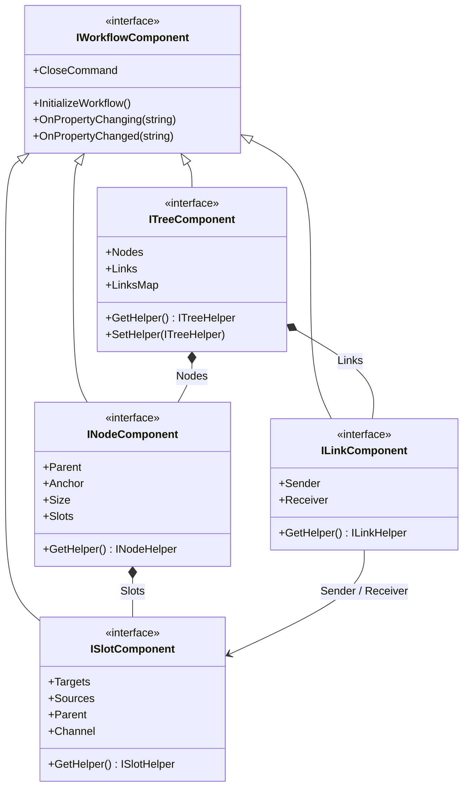
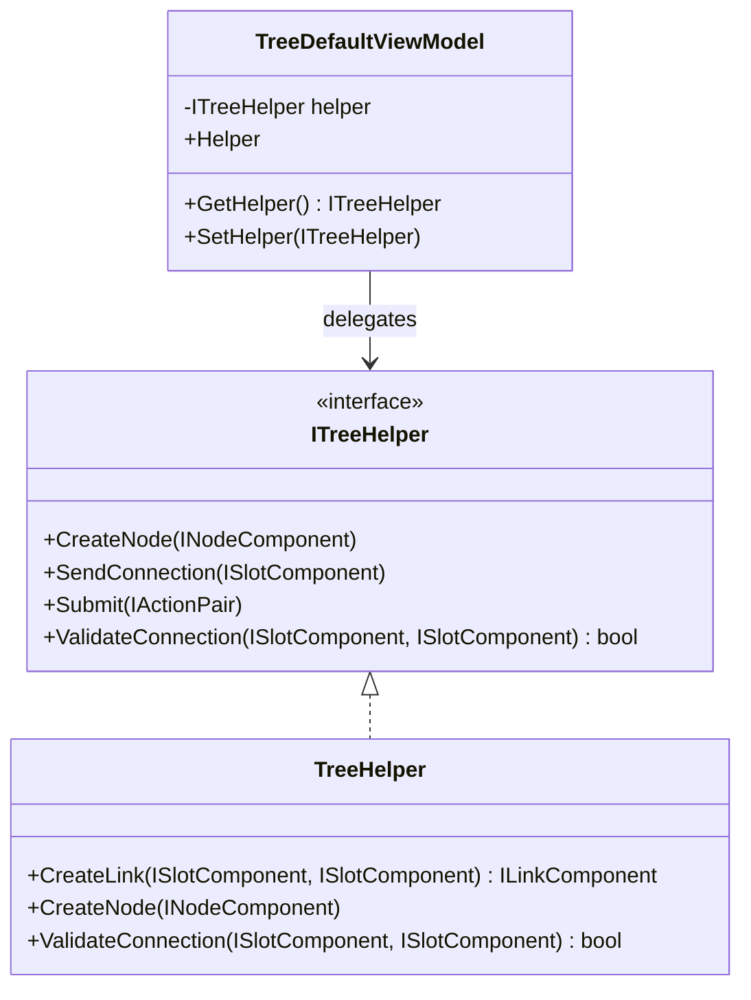
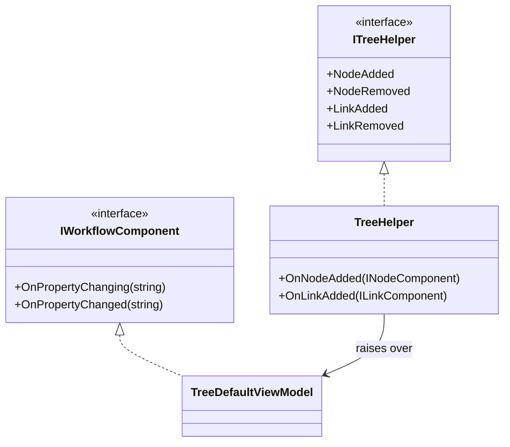

# 工作流图模型中的设计模式

图模型是一个四角色的组合结构，行为与数据分离。每个角色由一个接口、一个密封的默认视图模型和一个 helper 组成，中间那层管线由源生成器写出。本页分析支撑该设计的三种模式——组合（Composite）、桥接（以运行时策略实现的 Bridge）与模板方法（Template Method）——以及让各部分保持同步的观察者契约。

## 组合：一棵树持有节点、插槽与连线

`ITreeComponent` 持有 `Nodes` 与 `Links`；每个 `INodeComponent` 持有 `Slots`；每条 `ILinkComponent` 指明一个发送插槽和一个接收插槽。所有角色都实现同一个根契约 `IWorkflowComponent`，因此遍历图的代码不需要为每一层写特例。



所有权在契约里是字面写明的：`ITreeComponent.Nodes` 与 `Links` 是 `ObservableCollection` 属性，`INodeComponent.Slots` 也是，`ISlotComponent.Targets`/`Sources` 则从两端镜像连线。

源码：`Src/Core/VeloxDev.Core/Interfaces/WorkflowSystem/Components/ITreeComponent.cs` 第 17-23 行；`.../INodeComponent.cs` 第 28 行；`.../ISlotComponent.cs` 第 11-14 行；`.../ILinkComponent.cs` 第 10-13 行。

| 角色 | 契约 | 默认实现 | 默认 helper |
| --- | --- | --- | --- |
| 树 | `ITreeComponent` | `TreeDefaultViewModel` | `TreeHelper` |
| 节点 | `INodeComponent` | `NodeDefaultViewModel` | `NodeHelper` |
| 插槽 | `ISlotComponent` | `SlotDefaultViewModel` | `SlotHelper` |
| 连线 | `ILinkComponent` | `LinkDefaultViewModel` | `LinkHelper` |

组合结构也是标准扩展方法成立的前提：`WorkflowTreeEx.StandardCloseAsync` 只用 `IWorkflowComponent` 成员，就能先遍历节点、再遍历其插槽、最后遍历连线。

源码：`Src/Core/VeloxDev.Core/WorkflowSystem/StandardEx/WorkflowTreeEx.cs` 第 62-78 行。

## 桥接：组件携带数据，helper 携带行为

每个组件都提供 `GetHelper()` 与 `SetHelper(...)`。组件是带可观察属性的数据载体，helper 持有算法——创建、移动、连接、删除、校验。由于 helper 以接口为类型并可在运行时安装，这一分离在结构上读作 Bridge，在运行上读作 Strategy：宿主无需继承视图模型就能替换随附的 helper。



`TreeDefaultViewModel` 把 helper 存进私有字段，并通过一个会发通知的属性暴露；构造函数调用 `InitializeWorkflow()`，由它安装 helper。

源码：`Src/Core/VeloxDev.Core/WorkflowSystem/Templates/ViewModels/TreeDefaultViewModel.cs` 第 9-28 行。

泛型 helper 把行为绑定到具体组件类型。`TreeHelper<T>` 同时实现 `ITreeHelper`、`ITreeEvents`、`IInputEvents` 与 `IWorkflowLayoutHost`，因此一个对象既是行为接缝，也是事件面。

源码：`Src/Core/VeloxDev.Core/WorkflowSystem/Templates/Helpers/TreeHelper.cs` 第 34 行。

## 模板方法：生成器写骨架，重写填步骤

`[WorkflowBuilder.*]` 属性指出组件使用的 helper 类型。生成器随后发出 `InitializeWorkflow`、`GetHelper`、`SetHelper`、集合与命令属性；helper 基类把关键步骤留为虚方法。

```csharp
public override ILinkComponent CreateLink(ISlotComponent sender, ISlotComponent receiver)
{
    return new LinkViewModel() { Sender = sender, Receiver = receiver };
}
```

源码：`Examples/Workflow/Common/Lib/ViewModels/Workflow/Helper/AgentHelper.cs` 第 394-397 行。安装该 helper 的树在 `Examples/Workflow/Common/Lib/ViewModels/Workflow/TreeViewModel.cs` 第 16 行声明 `[WorkflowBuilder.Tree<AgentHelper>]`。

生成的 `InitializeWorkflow` 调用虚方法 `InitializeWorkflowCore`，安装 helper，并接好标准命令。`CreateNode` 与 `Receive` 是生成的转发重写，目标是 helper。

源码：`Src/Generators/VeloxDev.Core.Generator/Writers/WorkflowWriter.cs` 第 505-528 行（生命周期）、第 555-558 行（`CreateNode`）、第 841 行（`ReceiveAsync`）。

随附 helper 中的虚步骤就是模板钩子：`CreateLink` 决定具体连线类型，`CreateNode` 委托给标准创建操作，`ValidateConnection` 默认返回 `true`，宿主只有存在规则时才重写。

源码：`Src/Core/VeloxDev.Core/WorkflowSystem/Templates/Helpers/TreeHelper.cs` 第 227-238 行与第 378-381 行。

## 观察者：通知是协作层

根契约同时继承 `INotifyPropertyChanging` 与 `INotifyPropertyChanged`，helper 另加生命周期事件（`NodeAdded`、`NodeRemoved`、`LinkAdded`、`LinkRemoved`）。生成的 `[VeloxProperty]` setter 发出两个属性通知；helper 的受保护 `On...` 方法发出事件通道。



标准操作使用以 `ConditionalWeakTable` 为键的每树缓存，把撤销栈和事件缓存挂在组件旁，而不往公开接口上增加字段。

源码：`Src/Core/VeloxDev.Core/WorkflowSystem/StandardEx/WorkflowTreeEx.cs` 第 11 行。

## 模式小结

| 模式 | 参与者 | 存在理由 |
| --- | --- | --- |
| 组合 Composite | `ITreeComponent`、`INodeComponent`、`ISlotComponent`、`ILinkComponent` | 对异构图做一次统一遍历 |
| 桥接 Bridge / 策略 Strategy | `*DefaultViewModel` ↔ `*Helper` | 数据模型独立于行为，helper 可按实例替换 |
| 模板方法 Template Method | `InitializeWorkflow*`、`CreateLink`、`ValidateConnection` | 生成骨架，步骤可重写 |
| 观察者 Observer | `INotifyPropertyChanged`、helper 事件 | 视图与标准操作免轮询响应 |

下一项功能在这些观察者之上构建历史记录；参见[工作流编辑与历史](../01_工作流编辑与历史/index.md)。
