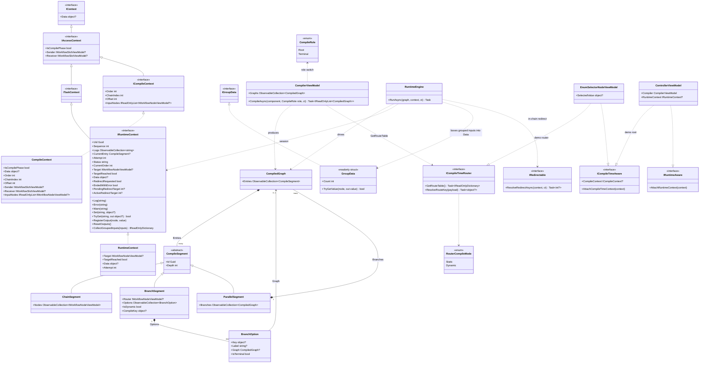

# 工作流系统 — 类图：核心 / 执行模型

## A. 核心 / 执行模型（CompilerEx）

下列类型都存在于 `Src/Core/VeloxDev.Core/WorkflowSystem/CompilerEx/**`（Compile + Runtime 目录）。模型分两阶段：`CompilerViewModel.CompileAsync` 固定每个节点的身份（Order），并通过 `AccessAsync` 静态校验边；随后 `RuntimeEngine.RunAsync` 用运行时会话驱动这些不可变分段。

源码：`CompilerEx/Compile/CompilerViewModel.cs`、`CompilerEx/Compile/CompilerViewModel.Reverse.cs`、`CompilerEx/Runtime/RuntimeEngine.cs`、`CompilerEx/Compile/Model/*.cs` + `Runtime/Model/*.cs`、`Interfaces/WorkflowSystem/Execution/IContext.cs`、`IAccessContext.cs`、`ITaskContext.cs`。
