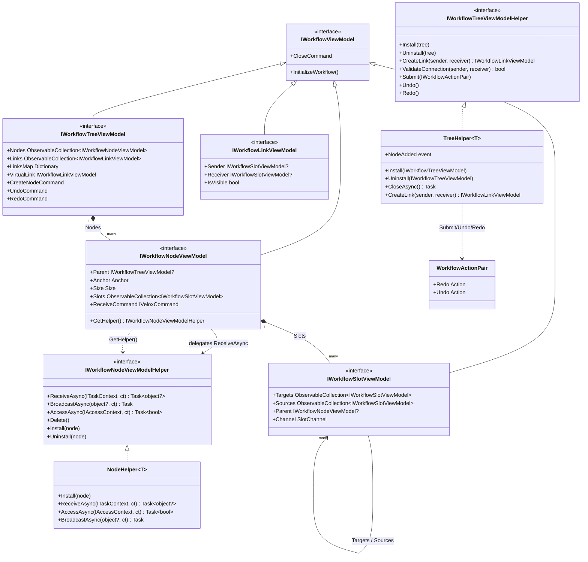

# 工作流系统 — 设计模式 — 组件模型

组件模型：四个 VM 接口、它们的 Helper，以及编译器消费的拓扑（`Slots` → `Targets`/`Sources` 边）。

## B. 组件模型（VM 接口 + Helper）

编辑器树由四个 VM 接口构成；每个都配一个拥有行为的 *Helper*（模板方法 / 命令模式）。节点暴露编译器消费的拓扑：`Slots` → `Targets`/`Sources` 边。

源码：`Interfaces/WorkflowSystem/IWorkflow*.cs`、`Templates/Helpers/TreeHelper.cs`、`Templates/Helpers/NodeHelper.cs`、`Templates/WorkflowBuilder.cs`。
