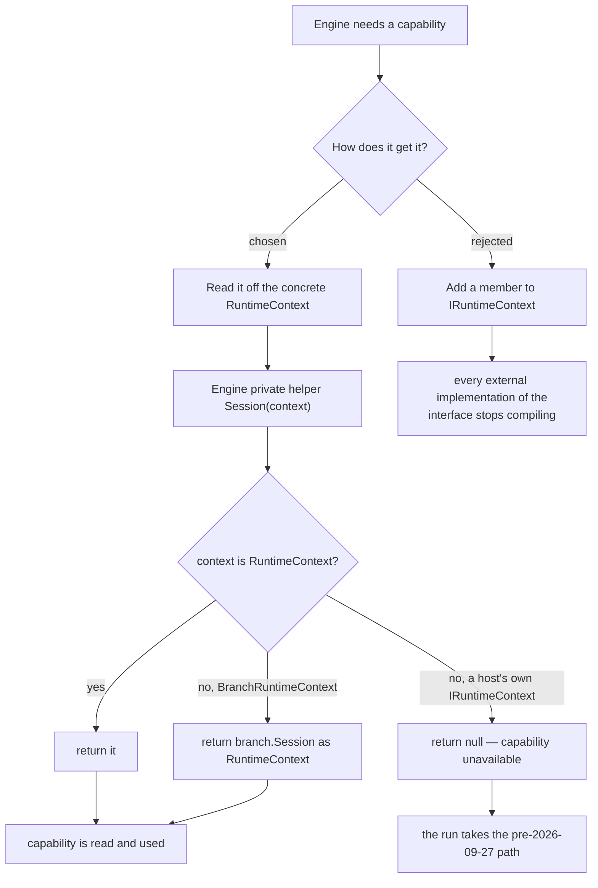

# 工作流系统 — 设计模式 — 策略族（宿主能力）

2026-09-27 那一层是**策略**模式的七次应用，外加**空对象**作为每一项的默认。这里没有新机制：编译期路由器（`ICompileTimeRouter`）与运行期重定向（`IRedirectable`）本来就是策略，这层把同一想法扩展到运行中宿主可能想控制的部分。

## 策略族

| 在运行中的角色 | 策略接口 | 随附策略 | 配置位置 |
|---|---|---|---|
| 在节点边界停住运行 | `IExecutionGate` | `ManualExecutionGate`、`DelegateExecutionGate` | `RuntimeContext.ExecutionGate` |
| 观察时间线 | `IExecutionObserver` | `DelegateExecutionObserver` | `.Observer` |
| 决定一次抛异常是否再试 | `INodeRetryPolicy` | `ExponentialBackoffRetry` | `.RetryPolicy` |
| 把失败记录为数据 | `IExecutionErrorSink` | `DelegateExecutionErrorSink` | `.ErrorSink` |
| 撤销坏运行的成功项 | `IExecutionCompensation` | `DelegateExecutionCompensation` | `.Compensation` |
| 持久化运行位置 | `IExecutionCheckpointStore` | `InMemoryCheckpointStore`（Core）、`FileCheckpointStore`（扩展） | `.CheckpointStore` |
| 改道日志 | `ILogWriter` | `TextWriterLogWriter`、`DelegateLogWriter` | `.LogWriter` |

每一项都是**一个方法**（存储是两个，因为它必须读回自己写下的内容），每项实现都能在 `RunAsync` 之前通过设置会话属性在运行期替换。

## 为什么挂在具体类上，而不是契约上

这是一个值得当作决策来读的设计选择，而不是遗漏。



源码给出的三个理由，按顺序：

1. **向已发布接口加成员是破坏性变更。** `IRuntimeContext` 是宿主可能实现的契约。九个新成员会打断每一个此类实现，而这是一个按定义就可选的功能。
2. **它们是宿主*策略*，不是会话状态。** `MaxParallelBranches` 与 `MaxRetainedLogs` 表达宿主更愿意怎样，而不是运行当前在哪。`IRuntimeContext` 描述后者。
3. **代价是显式且有界的。** 自带 `IRuntimeContext` 实现的宿主得到无上限、无观察、2026-09-27 之前的行为 —— `Session()` 返回 `null`，每次读取都短路。这是有记录的取舍，不是意外。

`Session()` 还会**拆开扇出分支**，这正是接缝能在最关键处生效的原因：

```csharp
private static RuntimeContext? Session(IRuntimeContext context)
    => context switch
    {
        RuntimeContext session => session,
        BranchRuntimeContext branch => branch.Session as RuntimeContext,
        _ => null,
    };
```

没有这层拆解，配置在会话上的闸门或观察者会在 `ParallelSegment` 内部悄悄失效 —— 而那正是宽图花时间的地方（`ExecutionGateTests.AClosedGate_AlsoHoldsTheBranchesOfAFanOut` 钉住它）。

## 空对象作为默认

**每个接缝的默认都是 `null`，而 `null` 意味着「像该功能不存在一样行为」—— 不是「做点合理的事」。** 引擎检查 `session?.X is not { } x` 并提前返回；没有默认观察者、默认重试、默认写入器。

这很重要，因为它让兼容性声明可测试而非空谈：所有接缝都不设置时，运行产生与这层出现之前**相同的日志行**和**相同次数的驱动**。这一声明写在源码里（基于 `Session` 的读取、没有默认实例），并由整套既有测试不改一字继续通过来断言。

两个后果，都是刻意的：

- **能力为 `null` 不是错误。** 没有诊断、没有 `[Warning]`、结果里没有元数据。会话只是没有意见。
- **能力损坏也不致命。** 抛异常的观察者、接收器、存储、补偿器或写入器会被记录并丢弃（`[Observer]`、`[ErrorSink]`、`[Checkpoint]`、`[Compensation]`、`LogWriteFailed`）。唯一例外是 `AttachRuntimeContext`，它在失败纪律*内部*注入，所以抛异常会结束运行而不是悄悄跳过节点 —— 区别在于：跳过一个节点改变了图*做了什么*，而丢一条观察只改变你*知道*什么。

## 策略族之上的外观

`RuntimeContext` 就是外观：宿主在一个对象上设置九个属性，引擎从一个地方读取它们。demo 在一个方法里（`WorkflowDemoSession.ConfigureRun`）正是这样做的，这就是该门面被设计成的形状 —— 一处声明宿主对「这里一次运行应如何表现」的策略。

*源码：`Src/Core/VeloxDev.Core/WorkflowSystem/CompilerEx/Runtime/RuntimeEngine.cs`（`Session`）、`Runtime/Model/RuntimeContext.cs`、`Runtime/Model/*.cs`。Demo：`Examples/Workflow/Common/Lib/ViewModels/Workflow/WorkflowDemoSession.cs`。测试：`CompilerEx/Execution*Tests.cs`。*
