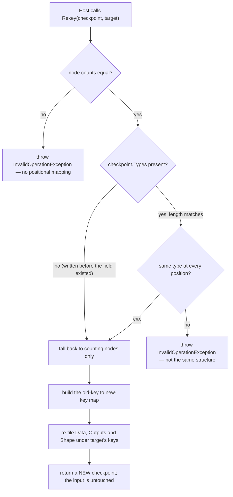

# 工作流系统 — 设计模式 — 备忘录（检查点）

`ExecutionCheckpoint` 是**备忘录**模式：一次运行内部状态的快照，其不透明程度足以让宿主保存与持久化，而恢复路径由原发者（`RuntimeContext`）掌握。

该模式通常的三个角色映射得很干净：

| 角色 | 这里 |
|---|---|
| **原发者** | `RuntimeContext` —— 它产生备忘录，也知道如何从备忘录恢复自己 |
| **备忘录** | `ExecutionCheckpoint` —— 一份普通、可序列化的文档 |
| **Caretaker** | `IExecutionCheckpointStore` —— 保存备忘录，从不检查其内容；何时保存、何时取回由宿主决定 |

## 快照边界

备忘录只捕获恢复所需的内容，边界这样划定有两个理由：

```csharp
return new ExecutionCheckpoint
{
    Attempt = Attempt,
    ActiveRedirectTarget = ActiveRedirectTarget,
    Data = Normalize(Data, nodes),
    Outputs = outputs,
    Shape = nodes is null ? [] : [.. nodes.Select(entry => entry.Key)],
    Types = nodes is null ? [] : [.. nodes.Select(entry => entry.Node.GetType().Name)],
};
```

| 字段 | 为何在备忘录里 |
|---|---|
| `Attempt` | 它同时是输出注册表的趟戳。恢复必须保持它**不变** —— 递增会把恢复的输出降级为过期，join 会立刻看不到它们。 |
| `ActiveRedirectTarget` | 告诉输出收集器哪些「被跳过」的节点是契约保留前缀，而不是过期分支。 |
| `Data` | 快照时刻的链式负载 —— 下一个节点本会收到的内容。 |
| `Outputs` | 注册表本身，下游 join 仍能聚合恢复后的上游。 |
| `Shape` | 图按驱动顺序的节点键 —— 让恢复安全的指纹。 |
| `Types` | `Shape` 背后的节点类型，使原图对象不在时 `Rekey` 仍有结构可查。 |

会话中的其他内容刻意**不**进备忘录：`Uid` 与 `Logs` 是会话身份（恢复的运行是一次新运行，日志也是新日志），`IsRunning`/`Status`/`CurrentOrder`/`NodeIndex`/`BranchKey` 是引擎会重写的瞬态位置，能力对象则是新会话自己配置的宿主策略。

## 窄接口，以及它唯一不是的东西

`ExecutionCheckpoint` 暴露的是**属性，不是行为** —— 只有一个静态方法。这就是备忘录纪律：caretaker 可以存下并交回，但不能让原发者拿它做任何事。

`Rekey` 是唯一刻意的例外，而且它是**守卫**，不是操作：



它存在的原因是检查点按 `RuntimeId` 归档，而序列化回来的图拥有全新 id —— 因此恢复会被拒绝。拒绝是对的（那确实是不同的节点对象）；`Rekey` 是宿主的显式选择，表示*我知道，这是映射*。它检查**结构而非身份** —— 节点数量与按驱动顺序的节点类型 —— 能抓住不同的图，但抓不住形状相同、部件被改名成其他类型却刚好对齐的图。两个*版本*之间的图迁移由宿主自己写。

## 拒绝恰恰是模式在生效

这里最重要的行为是一次失败，值得作为设计选择而非限制来陈述：

> **检查点会被拒绝，而不是被猜测地套用。** `RunAsync` 在**触碰会话之前**把 `Shape` 与图自身的节点键比较，不同就抛异常。不匹配时 `Status` 仍是 `"Idle"`、`IsRunning` 仍是 `false` —— 会话从不声称运行过。

一个能被套到错误原发者上的备忘录比没有备忘录更糟：它会用别人的负载驱动错误的节点，产出一个看似合理却错误的结果。因此这里通过让备忘录**自描述**（`Shape` + `Types`）并把检查放在恢复路径上，换来安全性。

## 空间与时间

备忘录是 $O(V + R)$ —— 形状、类型，以及每个已注册输出一条。这就是它在**每个节点之后**写入而不是每趟重算的原因，也是随附文件存储用信号量串行化的原因：扇出分支交错，即使没有第二线程，也可能同时有两个保存在飞。

*源码：`Src/Core/VeloxDev.Core/WorkflowSystem/CompilerEx/Runtime/Model/ExecutionCheckpoints.cs`；`Runtime/Model/RuntimeContext.cs`（`Snapshot` 为 internal）；`Runtime/RuntimeEngine.cs`（`RequireSameShape`、`Restore`）。扩展：`Src/Core/VeloxDev.Core.Extension/CheckpointEx.cs`。测试：`CompilerEx/ExecutionCheckpointTests.cs`、`VeloxDev.Core.Extension.Test/Serialization/ExecutionCheckpointSerializationTests.cs`。*
